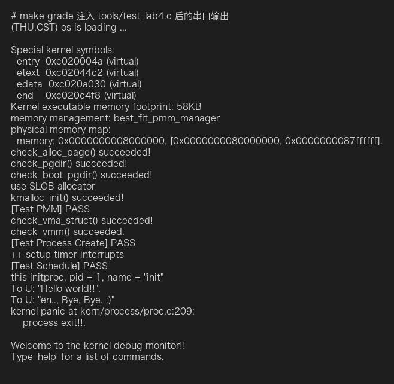

# 操作系统实验报告

## 实验基本信息

| 项目 | 内容 |
|------|------|
| **实验名称** | Lab 4：进程管理 |
| **小组成员** | 2412172-许城玮（单人小组） |
| **完成日期** | 2026-11-20 |

### 小组分工

| 成员 | 负责的练习/模块 |
|------|----------------|
| 2412172-许城玮 | 独立完成 Lab 4 全部内容：Lab 2/3 代码迁移、三个功能模块实现、测试验证及实验报告 |

---

## 一、实验目的

1. 理解内核线程的进程控制块 `struct proc_struct` 各字段的含义，掌握 PCB 从分配、初始化、登记到被调度运行的完整生命周期。
2. 掌握 `kernel_thread → do_fork → copy_thread` 的线程创建流程，理解为什么第一个内核线程也要通过“构造临时 trapframe 再 fork”的方式创建。
3. 理解新线程第一次运行的链路 `switch_to → forkret → forkrets → __trapret → sret → kernel_thread_entry → fn(arg)`，以及 `struct context` 与 `struct trapframe` 两种“现场”的区别。
4. 实现 `page_insert` / `page_remove`，理解页表项、物理页引用计数和 TLB 三者必须保持一致。
5. 实现 FIFO 轮转调度 `schedule` 与上下文切换 `proc_run` / `switch_to`，理解 idle 进程的兜底作用和切换过程中关中断的必要性。

---

## 二、实验环境

### 使用的 AI 工具

| 成员 | AI 编程工具 | 底层模型 | 备注 |
|------|------------|---------|------|
| 2412172-许城玮 | Claude Code | Claude Opus 4.5 | 读骨架代码与测试用例、按四段式提示词生成代码、排查编译报错并运行 `make grade` 验证 |

### 软硬件与容器环境

- **宿主机与容器**：macOS（Apple Silicon）+ OrbStack Docker，镜像 `os2026-dbg`（沿用 Lab 2/3 的容器环境，入口脚本 `os2026.sh`）。
- **工具链与模拟器版本**：`riscv64-unknown-elf-gcc 13.2.0`、`QEMU 4.1.1`、引导固件 `OpenSBI v0.4`（Runtime SBI Version `0.1`）。
- **课程骨架**：使用课程下发的 `lab4.zip`，原样导入至 `lab4` 分支后开始开发。

---

## 三、实验整体逻辑分析

### 3.1 本章节的逻辑主线

Lab 3 结束时，内核已经有物理内存管理、页表和中断处理，但从 `kern_init` 开始始终只有“一条执行流”。Lab 4 要让内核拥有多个可以轮流使用 CPU 的执行实体——内核线程。

整条执行链是：

```text
kern_init
 ├─ pmm_init        物理内存 + 页表（page_insert / page_remove 在这里被自检）
 ├─ pic_init / idt_init
 ├─ vmm_init        VMA 管理（本实验只做自检）
 ├─ proc_init       把当前执行流包装成 idleproc(pid 0)，再用 kernel_thread 创建 initproc(pid 1)
 ├─ clock_init / intr_enable
 └─ cpu_idle        idleproc 的循环：need_resched → schedule
                      └─ schedule 选中 initproc → proc_run → switch_to
                           └─ ret 到 forkret → forkrets → __trapret → sret
                                └─ kernel_thread_entry: a0 = s1; jalr s0  即 init_main("Hello world!!")
                                     └─ 返回后 do_exit（本实验直接 panic）
```

前半段（`pmm_init`）把地址空间准备好，后半段（`proc_init` 之后）让第一个真正的内核线程跑起来。

### 3.2 功能的逐步实现

1. **迁移 Lab 2 / Lab 3 代码**：`pmm_init` 需要 `page_init` 和分配器，时钟中断需要 Lab 3 的 trap 处理和 `RESTORE_ALL`，否则内核无法编译或启动。
2. **功能模块一：虚拟内存页操作**。`pmm_init` 里的 `check_pgdir` / `check_boot_pgdir` 依赖 `page_insert` / `page_remove`，而后续线程切换页表、lab5 建立用户地址空间也建立在这两个函数之上，所以最先实现。
3. **功能模块二：进程创建及初始化**。先有 `alloc_proc` 得到空白 PCB，再由 `do_fork` 组合内核栈、trapframe、context、pid、链表，最后 `proc_init` 用它们创建 idleproc 和 initproc。
4. **功能模块三：进程调度**。线程对象存在之后，`cpu_idle → schedule → proc_run → switch_to` 才能把 CPU 从 idleproc 交给 initproc。`switch_to` 只负责寄存器搬运，“第一次运行跳到哪里”由模块二的 `copy_thread` 事先决定，所以模块三依赖模块二。

---

## 四、实验内容与实现

### 前置工作：迁移 Lab 2 / Lab 3 代码

**负责人：** 2412172-许城玮

按指导书要求，先把 Lab 2 的 `page_init()` / Best-Fit 分配器，以及 Lab 3 的 `interrupt_handler` / `exception_handler`、`RESTORE_ALL` 和 `__alltraps` 入口迁移进 Lab 4 骨架。最终提示词见 [prompt.md：一、迁移 Lab 2/3 代码](prompt.md#task01)。

#### 实现迭代过程

这部分踩了几个头文件和符号差异的坑，改了两轮才编译通过（详细报错见 [ai_logs/lab4/bugs.md](ai_logs/lab4/bugs.md)）：

- **第一次迭代（直接迁移旧代码）**：
  - 读骨架时先发现 `kern/mm/default_pmm.c` 开头 `#include <best_fit_pmm.h>`，但目录下没有这个头文件，且 `pmm.c` 写死了绑定 `&default_pmm_manager`。
  - 把 Lab 2/3 的代码原样填进去编译，直接报了两处未定义符号错误：一是 `trap.c` 里 Lab 3 用的 `CAUSE_FAULT_FETCH` / `CAUSE_FAULT_LOAD` / `CAUSE_FAULT_STORE` 在 Lab 4 的 `riscv.h` 里改名成了 `CAUSE_*_ACCESS`；二是 `pmm.c` 里 `page_init()` 用的 `PHYSICAL_MEMORY_END` 在 Lab 4 的 `memlayout.h` 里被删掉了。
- **第二次迭代（补齐差异约束）**：
  - 在提示词里要求先对比新旧头文件差异再改代码，不修改骨架原有的头文件和自检函数：从 Lab 2 补回 `best_fit_pmm.h`，把 Best-Fit 实现以 `default_pmm_manager` 导出（`.name` 仍为 `"best_fit_pmm_manager"`）；`page_init()` 改用 `KERNTOP - PHYSICAL_MEMORY_OFFSET` 换算同一物理上界 `0x88000000`；`trap.c` 同步替换三个异常号宏名。
  - 重新编译通过，启动后 `check_alloc_page()` 通过，时钟中断正常。

---

### 功能模块一：虚拟内存页操作功能（`kern/mm/pmm.c`）

**负责人：** 2412172-许城玮

#### 模块功能描述

| 函数 | 作用 |
|---|---|
| `page_remove_pte(pgdir, la, ptep)`（内部辅助） | 若 `*ptep` 有效：物理页引用计数减一，减到 0 则 `free_page`；清空页表项；`tlb_invalidate` |
| `page_remove(pgdir, la)` | `get_pte(pgdir, la, 0)` 查找页表项，存在则调用 `page_remove_pte`；不存在则直接返回（幂等） |
| `page_insert(pgdir, page, la, perm)` | `get_pte(pgdir, la, 1)` 取得（必要时分配中间级页表）页表项，失败返回 `-E_NO_MEM`；先 `page_ref_inc(page)`，再处理旧映射：同一页则引用减回去（仅更新权限），不同页则 `page_remove_pte` 撤销旧映射；最后写入 `pte_create(page2ppn(page), PTE_V | perm)` 并 `tlb_invalidate` |

关键点是**先加引用再处理旧映射**：如果 `la` 原来已经映射到同一个 `page`，而代码先 `page_remove_pte` 再加引用，引用计数会短暂变成 0 并把这一页释放掉，随后又把已释放的页写进页表。`test_lab4_pmm_basic` 中 `page_insert(p3, 2*PGSIZE, PTE_W)` 对同一地址重复插入同一页，并断言 `nr_free_pages()` 不变，正好覆盖这一点。

`page_remove` 用 `create = 0` 调用 `get_pte`：删除操作不应为了查找一个不存在的映射而分配中间级页表页。

#### 最终提示词

见 [prompt.md：二、功能模块一](prompt.md#task02)。

#### 实现迭代过程

这一块逻辑比较集中，写提示词前先看了 `tools/test_lab4.c`，把“同页重插不能误释放”和“删除时不分配中间页表”两条边界直接写进了约束里。生成代码后编译运行，`check_pgdir()`、`check_boot_pgdir()` 和 `[Test PMM]` 一次通过，没有额外返工。

---

### 功能模块二：进程创建及初始化功能（`kern/process/proc.c`）

**负责人：** 2412172-许城玮

#### 模块功能描述

| 函数 | 作用 |
|---|---|
| `alloc_proc` | `kmalloc` 一个 PCB，置为安全空白状态：`state = PROC_UNINIT`、`pid = -1`、`runs = 0`、`kstack = 0`、`need_resched = 0`、`parent = mm = tf = NULL`、`context` 清零、`pgdir = boot_pgdir_pa`、`flags = 0`、`name` 清零、两个链表节点 `list_init` |
| `copy_mm` | 本实验只有内核线程，`current->mm` 恒为 `NULL`，断言后直接返回 0；保留接口留给 lab5 |
| `copy_thread` | 在新线程内核栈顶放一份 trapframe：`proc->tf = (struct trapframe *)(kstack + KSTACKSIZE) - 1`，复制调用者给的 `*tf`；`tf->gpr.a0 = 0`（子进程中 fork 返回 0）；`tf->gpr.sp = esp ? esp : tf`；`context.ra = forkret`、`context.sp = tf` |
| `do_fork` | `alloc_proc → parent = current → setup_kstack → copy_mm → copy_thread`；关中断后 `get_pid`、`hash_proc`、`list_add(&proc_list)`、`nr_process++`；最后 `wakeup_proc` 设为 `RUNNABLE`，返回 pid。失败时按 `bad_fork_cleanup_kstack → bad_fork_cleanup_proc` 逆序释放 |
| `kernel_thread` | 在栈上构造临时 trapframe：`s0 = fn`、`s1 = arg`、`epc = kernel_thread_entry`、`status = (sstatus | SPP | SPIE) & ~SIE`，调用 `do_fork(clone_flags | CLONE_VM, 0, &tf)` |
| `proc_init` | 初始化 `proc_list` 和 `hash_list`；`alloc_proc` 得到 idleproc，设 `pid = 0`、`RUNNABLE`、`kstack = bootstack`、`need_resched = 1`、名字 `idle`；`current = idleproc`；`kernel_thread(init_main, "Hello world!!", 0)` 创建 initproc 并命名 `init` |

几个容易出错的地方：

- **idleproc 不是 fork 出来的**。它“认领”的是从 `kern_init` 一路执行下来的现场，内核栈就是 `entry.S` 里的 `bootstack`，所以它的 `context`、`tf` 都保持为 0/NULL。它第一次被切走时，`switch_to` 才会把真实寄存器写进它的 `context`。测试 `test_lab4_process_create` 断言了 `idleproc->kstack == bootstack`、`tf == NULL`、`context.ra == 0`。
- **trapframe 与 context 是两种现场**。`context` 只有 `ra/sp/s0~s11`，是 `switch_to` 这次函数调用要保存的被调用者保存寄存器；`trapframe` 是完整的 32 个通用寄存器加 4 个 CSR，是“从内核态 sret 出去”需要的现场。新线程第一次运行先由 `context` 把它带到 `forkret`，再由 `trapframe` 把它带进 `kernel_thread_entry`。
- **`status` 三个位**：`SPP = 1` 让 `sret` 之后仍处于 S 态（内核线程）；`SPIE = 1` 让 `sret` 之后中断打开；`SIE = 0` 保证 `__trapret` 恢复现场的过程中不被中断。
- **登记顺序**：pid 分配、挂 hash 表、挂链表放在关中断区内一次完成；`wakeup_proc` 放在最后，调度器不会看到资源还没准备好的半成品。

#### 最终提示词

见 [prompt.md：三、功能模块二](prompt.md#task03)。

#### 实现迭代过程

写提示词时先对照 `test_lab4_process_create` 理清了 `idleproc` 各个字段的初始值要求，也特意标明了 `proc_init` 必须先设 `current = idleproc` 再调用 `kernel_thread`（否则 `initproc->parent` 不等于 `idleproc`）。代码生成后核对了一遍 `do_fork` 的失败清理路径，运行 `[Test Process Create]` 通过。

---

### 功能模块三：进程调度（`kern/process/proc.c`、`kern/schedule/sched.c`、`kern/process/switch.S`）

**负责人：** 2412172-许城玮

#### 模块功能描述

| 函数 | 作用 |
|---|---|
| `cpu_idle` | idleproc 的死循环：`if (current->need_resched) schedule();` |
| `schedule` | 关中断；清 `need_resched`；从 `current->list_link` 的下一个位置开始（current 是 idleproc 时从链表头开始，因为 idleproc 不在 `proc_list` 里）找第一个 `PROC_RUNNABLE`；找不到则选 idleproc；`next->runs++`；`next != current` 时 `proc_run(next)` |
| `proc_run` | 关中断；`current = proc`；写 `satp = (SATP_MODE_SV39 << 60) | (pgdir >> 12)` 切换页表并刷 TLB；`switch_to(&prev->context, &next->context)` |
| `switch_to`（汇编） | 把 `ra, sp, s0~s11` 存入 `from`（`a0`），从 `to`（`a1`）加载同样 14 个寄存器，`ret` |

为什么 `switch_to` 只存 14 个寄存器：它是一次普通的 C 函数调用，按 RISC-V 调用约定，`t*`、`a*` 等调用者保存寄存器在调用前已由编译器处理，被调用方只需保证 `ra`、`sp` 和 `s0~s11` 不变。`ret` 跳到 `to->ra`：对运行过的线程，它是上次调用 `switch_to` 的返回点（即 `proc_run` 内部）；对新线程，它是 `copy_thread` 设置的 `forkret`。

`proc_run` 切页表时没有用 `libs/riscv.h` 的 `lsatp()`：它是 Sv32 遗留，无法表示 Sv39 的 `satp`（指导书明确提示），这里按 `enable_paging()` 的写法使用 `SATP_MODE_SV39`。本实验所有线程的 `pgdir` 都是 `boot_pgdir_pa`，切换前后页表相同，这一步是为 lab5 用户进程准备的。

#### 最终提示词

见 [prompt.md：四、功能模块三](prompt.md#task04)。

#### 实现迭代过程

这部分最怕的是页表寄存器 `satp` 写错（踩进 `lsatp()` 的坑）和 `switch_to` 寄存器偏移和 `struct context` 对不上。提示词里把这两点都写死了，生成后对照 `proc.h` 核了一遍 14 个寄存器的偏移顺序，跑 `[Test Schedule]` 顺利通过。`test_lab4_schedule` 会在 initproc 里再起两个线程轮流让出 CPU，因为 `list_add` 是头插，链表顺序是 `头 → t2 → t1 → init`，从 init 往后轮转刚好能依次调度到两个新线程。

---

## 五、测试与验证

### 5.1 `make qemu` 运行输出

执行 `./os2026.sh qemu`：内存自检全部通过，initproc 打印 `pid = 1, name = "init"` 和 `"Hello world!!"`；`init_main` 返回后进入 `do_exit`，骨架中 `do_exit` 直接 `panic("process exit!!")`，这是本实验的预期结束方式（进程退出在 lab5 实现）。


### 5.2 `make grade` 评测结果

执行 `./os2026.sh grade`，三项全部通过，总分 `30/30`：


### 5.3 注入测试后的串口输出

`make grade` 会用 `tools/inject.py` 在 `pmm_init` 末尾、`proc_init` 末尾、`init_main` 开头插入 `tools/test_lab4.c` 的三个测试。手动重现同样的注入并运行，可以看到三条 `PASS` 出现的位置与注入点一致：



原始输出保存在 [ai_logs/lab4/evidence/](ai_logs/lab4/evidence/)。

---

## 六、实验总结与收获

### 对操作系统的理解

#### 1. 本实验中重要的知识点，以及与对应 OS 原理知识点的含义、关系和差异

| 本实验中的具体实现 | 对应 OS 原理知识点 | 含义、关系与差异 |
|---|---|---|
| `struct proc_struct` | 进程控制块 PCB | 原理中 PCB 记录进程标识、状态、上下文、内存、文件等信息。本实验的 PCB 已有 `pid`、`state`、`context`、`tf`、`kstack`、`mm`、`pgdir`、`parent`，但还没有文件表、信号、时间片等字段；`mm` 恒为 `NULL`，因为只有内核线程。 |
| `PROC_UNINIT / RUNNABLE / SLEEPING / ZOMBIE` | 进程状态模型（五状态） | 原理把“就绪”和“运行”分开，ucore 用同一个 `PROC_RUNNABLE` 表示，是否正在运行由 `current` 指针区分；`ZOMBIE` 对应原理的“终止但未被父进程回收”。 |
| `do_fork` / `kernel_thread` | `fork` 创建进程、进程与线程的区别 | 原理中 fork 复制父进程得到子进程，线程共享地址空间。本实验所有线程都由 `do_fork` 复制产生（连第一个都先造临时 trapframe 再复制），`CLONE_VM` 表示共享地址空间；由于 `copy_mm` 什么都不复制，“进程”和“线程”此时还没有实质区别。 |
| `switch_to` 与 `struct context` | 上下文切换 | 原理中上下文切换保存/恢复 CPU 现场。实现上分两层：`switch_to` 只保存被调用者保存寄存器（14 个），完整的 32 个寄存器 + CSR 在 trapframe 里，只在中断/异常进出时保存。上下文切换只发生在 `schedule` 内部，所以是“内核态中的函数调用”，不是中断。 |
| `schedule`（FIFO 轮转） | 进程调度算法 | 原理有 FCFS、RR、优先级、多级反馈队列等。本实验是按链表顺序找下一个 RUNNABLE 的简单轮转，没有时间片：时钟中断不会设置 `need_resched`，只能由线程主动 `schedule` 让出 CPU，属于非抢占式。 |
| idleproc 与 `cpu_idle` | 空闲进程 | 原理中当没有就绪进程时 CPU 运行 idle。本实验 idleproc 不在 `proc_list` 里，是 `schedule` 的兜底选项，保证调度器总能选出一个进程。真实系统会在 idle 里执行 `wfi` 降低功耗，本实验只是空转。 |
| `get_pid` 的 `last_pid` / `next_safe` | 进程标识的唯一性 | pid 到达 `MAX_PID` 后回绕到 1。`get_pid` 记录区间 `(last_pid, next_safe)` 内没有被占用的 pid，区间内可直接递增分配；超出区间才重新扫描链表，避免回绕后分到仍被使用的 pid。 |
| `local_intr_save` / `local_intr_restore` | 临界区与原子性 | `do_fork` 的登记、`schedule` 的选择和 `proc_run` 的切换都在关中断区内完成，单核下这样就能保证原子性；多核需要自旋锁，本实验未涉及。 |
| `page_insert` / `page_remove` + `tlb_invalidate` | 页表管理与 TLB 一致性 | 原理中修改页表后需让 TLB 中的旧项失效。RISC-V 的 `sfence.vma la` 可只失效一个地址，比 x86 写 CR3 全部刷新更细；`proc_run` 切换 `satp` 后仍使用 `flush_tlb()` 全部刷新。 |

#### 2. OS 原理中很重要、但在本实验中没有对应上的知识点

1. **用户进程与独立地址空间**：本实验只有内核线程，`mm` 为空、`copy_mm` 什么都不做，所有线程共享内核页表；用户态程序加载（`exec`）、写时复制（COW）、地址空间隔离在 lab5 之后才出现。
2. **抢占式调度与时间片**：时钟中断没有与调度器关联，线程只能主动让出 CPU。
3. **进程退出与回收**：`do_exit` 直接 panic，没有 `ZOMBIE` 状态转换、父进程 `wait` 回收、孤儿进程托付。
4. **进程间同步与通信**：信号量、管程、消息传递、管道等都未涉及。
5. **多核调度与负载均衡**：只有单核，关中断即可保证原子性，没有每 CPU 运行队列和自旋锁。

---

### AI 协作开发的经验

1. **搬旧实验代码不能直接让 AI 硬贴**：这次最浪费时间的地方反而是最简单的 Lab 2/3 迁移。直接把旧代码迁进来，结果头文件里的宏名（`CAUSE_FAULT_*` → `CAUSE_*_ACCESS`）、`PHYSICAL_MEMORY_END` 和 `default_pmm_manager` 都和之前不一样，编译直接报错。以后跨实验迁移，先让 AI 对比新旧头文件差异再动手会省事很多。
2. **先看测试用例和指导书里的坑，再写提示词**：后面三个功能模块之所以没怎么返工，主要是动工前把 `tools/test_lab4.c` 的断言和指导书的提示（比如 `lsatp()` 是 Sv32 遗留不能用、`idleproc` 不在 `proc_list` 里、`page_insert` 同页重插不能先释放）提前写进了提示词。约束给够了，AI 很少在细节上自己发挥出错。
3. **测试全绿不等于自己真的懂了**：AI 生成代码和跑 `make grade` 很快，但像 `context` 和 `trapframe` 的区别、新线程第一次怎么从 `switch_to` 一路走到 `init_main`，如果只看测试通过不自己顺一遍调用链，很容易一知半解。生成完之后自己对照代码把执行链画出来，才是真正把这部分吃透的关键。
