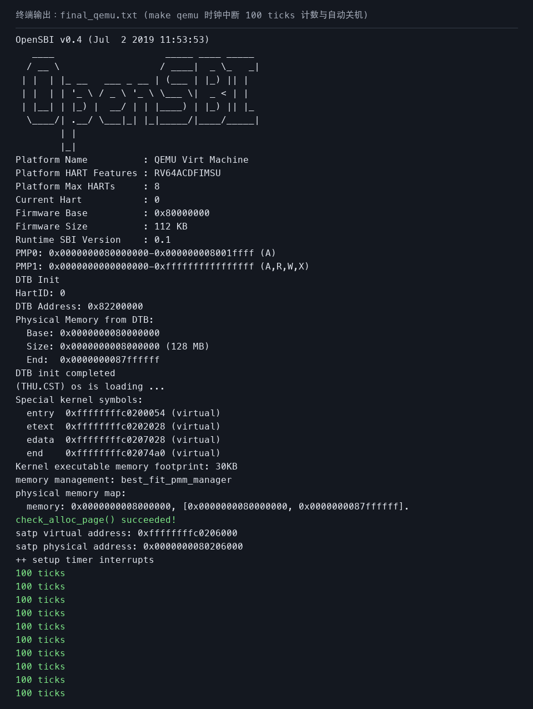

# 操作系统实验报告

## 实验基本信息

| 项目 | 内容 |
|------|------|
| **实验名称** | Lab 3：断，都可以断 |
| **小组成员** | 2412172-许城玮（单人小组） |
| **完成日期** | 2026-11-05 |

### 小组分工

| 成员 | 负责的练习/模块 |
|------|----------------|
| 2412172-许城玮 | 独立完成全部编程练习（Lab 2 代码迁移、功能模块一 Trap 上下文恢复与入口、功能模块二中断与异常处理）、四段式 Spec 编写、测试验证及实验报告 |

---

## 一、实验目的

1. 理解 RISC-V 64 的特权级（M / S / U 模式）、中断委托机制（`mideleg` / `medeleg`）以及 S 模式中断相关的控制状态寄存器（`stvec`、`sepc`、`scause`、`stval`/`sbadaddr`、`sstatus`、`sie`、`sscratch`）。
2. 掌握 Trap 发生前后寄存器上下文（`struct trapframe`：32 个通用寄存器与 4 个 CSR）在内核栈上的保存（`SAVE_ALL`）与恢复（`RESTORE_ALL`）过程，理解汇编入口 `__alltraps` 如何按调用约定把 `struct trapframe *` 传给 C 函数 `trap()`。
3. 实现时钟中断（通过 OpenSBI `sbi_set_timer` 预约下一次时钟事件）以及非法指令异常、断点异常的处理逻辑，掌握根据 RISC-V 指令长度更新 `tf->epc` 的方法。
4. 使用 `PROMPT / RELY / GUARANTEE / SPECIFICATION` 四段式规格辅助完成汇编与内核 C 代码开发、代码审查和 `make grade` 测试验证。

---

## 二、实验环境

### 使用的 AI 工具

| 成员 | AI 编程工具 | 底层模型 | 备注 |
|------|------------|---------|------|
| 2412172-许城玮 | Claude Code | Claude Opus 4.5 | 需求梳理、四段式 Spec 编写、代码审查与 Docker 构建验证 |
| 2412172-许城玮 | Codex CLI | GPT-5.4 | 模块代码生成、编译调试与测试用例核对 |

### 软硬件与容器环境

- **宿主机与容器**：macOS（Apple Silicon）+ OrbStack Docker，使用镜像 `os2026-dbg`（复用 Lab 2 已搭建的容器环境）。
- **工具链与模拟器版本**：`riscv64-unknown-elf-gcc 13.2.0`、`QEMU 4.1.1`、引导固件 `OpenSBI v0.4`（Runtime SBI Version `0.1`）。

---

## 三、实验整体逻辑分析

### 2.1 本章节的逻辑主线

Lab 2 完成了物理内存探测和页分配器，但内核还只能顺序执行初始化代码，不能响应外部设备事件（如定时器到时），也不能处理指令执行过程中触发的异常（如 `ebreak` 断点或非法指令）。

本章围绕 RISC-V S 模式下的 Trap 处理流程展开，主线分成三步：**Trap 上下文保存与恢复 → 汇编入口到 C 处理函数的参数传递与分发 → 具体中断/异常处理与返回地址修正**。当硬件发生中断或异常时，CPU 自动将当前 `pc` 写入 `sepc`、将原因码写入 `scause`、更新 `sstatus` 的 `SPP`/`SPIE`/`SIE` 位，并跳转到 `stvec` 指向的 `__alltraps`。汇编层先通过 `SAVE_ALL` 在内核栈上构造 `struct trapframe`，再调用 C 函数 `trap(tf)`；`trap_dispatch()` 根据 `scause` 最高位区分中断与异常，分别交由 `interrupt_handler()` 和 `exception_handler()` 处理；返回汇编层后由 `RESTORE_ALL` 恢复被修改后的 `sepc`/`sstatus` 及全部通用寄存器，最后执行 `sret` 回到原执行流。

### 2.2 功能的逐步实现

整个实验按模块间的依赖顺序分四步完成：

1. **迁移 Lab 2 的物理内存管理代码（`pmm.c` 与 `best_fit_pmm.c`）**
   `kern_init()` 在初始化时钟中断之前会先调用 `pmm_init()` 并执行 `check_alloc_page()` 自检。同时 Lab 3 在 `pmm.c` 的 `alloc_pages()`、`free_pages()`、`nr_free_pages()` 中新增了 `local_intr_save` / `local_intr_restore` 关中断保护。因此需要先补齐 `page_init()` 和 `best_fit_pmm_manager`，保证内核能通过编译并完成内存初始化。
2. **设置中断入口并实现汇编上下文切换（`idt_init` + `trapentry.S`）**
   硬件触发 Trap 后直接跳到 `stvec` 指向的 `__alltraps`。在进入 C 函数之前，必须先由汇编代码保存全部通用寄存器和 4 个 CSR，否则 C 函数的栈帧操作和寄存器使用会破坏被打断程序的现场；同理，`trap()` 返回后也必须由 `RESTORE_ALL` 恢复寄存器和更新后的 `sepc`，才能执行 `sret`。因此先完成 `trapentry.S` 中的 `__alltraps` 和 `RESTORE_ALL`。
3. **实现 C 语言中断与异常处理函数（`trap.c` 的 `interrupt_handler` 与 `exception_handler`）**
   底层栈上的 `struct trapframe` 通过 `a0` 传进 `trap()` 后，`trap_dispatch()` 按 `tf->cause` 的符号位分流。在这一步实现 `exception_handler()` 处理断点与非法指令异常（打印信息并按指令长度推进 `tf->epc`），实现 `interrupt_handler()` 处理 `IRQ_S_TIMER` 时钟中断（重设下一次定时器、累加 `ticks`、每 100 次打印并在满 10 次输出后调用 `sbi_shutdown()`）。
4. **开启时钟中断与全局 S 模式中断（`clock_init` + `intr_enable`）**
   在 `stvec`、上下文切换和 C 处理函数都准备好之后，由 `clock_init()` 置位 `sie.STIE` 并设定第一次时钟事件，最后由 `intr_enable()` 置位 `sstatus.SIE` 打开 S 模式全局中断，验证连续时钟中断和异常返回的完整流程。

---

## 四、实验内容与实现

### 前置工作：迁移 Lab 2 物理内存管理代码

**负责人：** 2412172-许城玮

- 在 `code/kern/mm/pmm.c` 中将 `init_pmm_manager()` 改为绑定 `&best_fit_pmm_manager`，并在 `//lab2 function1 2412172` 处填入 Lab 2 的 `page_init()`，保留文件原有的 `local_intr_save` / `local_intr_restore` 不动。
- 在 `code/kern/mm/best_fit_pmm.c` 的 `//lab2 function2-2 2412172` 处填入 Best-Fit 分配器实现。
- 所用提示词见 [prompt.md：一、迁移 Lab 2 物理内存管理实现](prompt.md#task01)。

---

### 功能模块一：Trap 上下文恢复与 Trap 入口功能（`kern/trap/trapentry.S`）

**负责人：** 2412172-许城玮

#### 模块功能描述

**需要实现的汇编宏与符号：**

```armasm
# kern/trap/trapentry.S
RESTORE_ALL
__alltraps
```

**功能说明：**

1. **模块作用**：`trapentry.S` 是所有中断和异常进入内核的统一汇编入口与返回出口，负责在硬件 Trap 和 C 函数 `trap(struct trapframe *tf)` 之间保存、传递和恢复 `struct trapframe`。
2. **`SAVE_ALL` 与 `RESTORE_ALL` 的对应关系及 `sp` 特殊处理**：
   - 框架已提供的 `SAVE_ALL` 先用 `csrw sscratch, sp` 把 Trap 发生前的 `sp` 存进 `sscratch`，随后 `addi sp, sp, -36 * REGBYTES` 在栈上分配 36 个 64 位寄存器空间，把 `x0..x1`、`x3..x31` 存入 `0..31*REGBYTES(sp)`，再从 `sscratch` 读出原 `sp` 存入 `2*REGBYTES(sp)`，最后把 `sstatus`、`sepc`、`sbadaddr`、`scause` 存入 `32..35*REGBYTES(sp)`。
   - `RESTORE_ALL` 需要逆向恢复现场，顺序上有三个约束：
     1. **先恢复 `sstatus` 和 `sepc`，再恢复通用寄存器**：`exception_handler()` 会修改栈上的 `tf->epc`（`33*REGBYTES(sp)`）。因为 RISC-V 不能直接从内存写 CSR，需要先借用 `s1`、`s2` 从 `32*REGBYTES(sp)` 和 `33*REGBYTES(sp)` 读出 `status` 和 `epc`，执行 `csrw sstatus, s1` 和 `csrw sepc, s2`。`sbadaddr` 和 `scause` 是硬件进入 Trap 时写入的原因和地址记录，`sret` 返回时硬件不读这两个寄存器，不需要写回。
     2. **恢复 `x1` 及 `x3..x31`**：依次从 `1*REGBYTES(sp)`、`3..31*REGBYTES(sp)` 加载各通用寄存器，把刚才借用的 `s1(x9)`、`s2(x18)` 也一并还原。`x0` 恒为 0 不必恢复。
     3. **最后恢复 `x2(sp)`**：所有 `LOAD` 指令都以当前 `sp` 为基址。如果提前恢复 `x2`，后面的寄存器就无法再按 `offset(sp)` 寻址。由于 `2*REGBYTES(sp)` 里存的就是 `addi sp, sp, -36 * REGBYTES` 之前的原始栈顶，把 `LOAD x2, 2*REGBYTES(sp)` 放在宏的最后一行，就能直接把 `sp` 还原到 Trap 前的位置。
3. **`__alltraps` 参数传递**：`SAVE_ALL` 结束后，`sp` 指向栈上的 `struct trapframe` 首地址。按 RISC-V 调用约定，第一个函数参数放在 `a0`，因此执行 `move a0, sp` 和 `jal trap` 即可调用 `trap(struct trapframe *tf)`。`sp` 是被调用者保存寄存器，`trap()` 返回后 `sp` 保持不变，直接顺序进入 `__trapret` 执行 `RESTORE_ALL` 和 `sret`。

#### 最终提示词

完整提示词见 [prompt.md：二、功能模块一](prompt.md#task02)，核心四段式内容如下：

````markdown
## PROMPT
请修改 `code/kern/trap/trapentry.S`，在两处 `#lab3 function1 YOUR CODE` 注释位置（将注释替换为 `#lab3 function1 2412172`）分别实现：
1. 汇编宏 `RESTORE_ALL`：与已提供的 `SAVE_ALL` 对称，从当前内核栈顶 `sp` 指向的 `struct trapframe` 中恢复处理器状态。
2. 汇编入口 `__alltraps` 中 `SAVE_ALL` 之后到 `__trapret` 之前的代码：按 RISC-V 调用约定将当前 `struct trapframe *` 传递给 C 函数 `void trap(struct trapframe *tf)` 并调用之。

## RELY
- `struct trapframe` 内存布局：`0..31*REGBYTES(sp)` 为 `x0..x31`（其中 `2*REGBYTES(sp)` 存进入 Trap 前的原始 `sp`）；`32..35*REGBYTES(sp)` 依次为 `status(sstatus)`、`epc(sepc)`、`badvaddr(sbadaddr)`、`cause(scause)`。
- 64 位下 `LOAD` 为 `ld`，`STORE` 为 `sd`，`REGBYTES` 为 `8`。

## GUARANTEE
- `__alltraps` 通过 `move a0, sp` 和 `jal trap` 传递 `struct trapframe *` 参数并在返回后进入 `__trapret`。
- `RESTORE_ALL` 恢复 `sstatus`、`sepc` 及 `x1..x31`，最后恢复 `x2(sp)`，通过 `make grade` Test 1（35/35）。

## SPECIFICATION
- `__alltraps`：Preconditions 为 `SAVE_ALL` 已完成且 `sp` 指向 `trapframe`；Postconditions 为 `a0 == sp`，调用 `jal trap`，返回后 `sp` 不变并进入 `__trapret`。
- `RESTORE_ALL`：
  1. 先 `LOAD s1, 32*REGBYTES(sp)`、`LOAD s2, 33*REGBYTES(sp)` 并执行 `csrw sstatus, s1`、`csrw sepc, s2`；
  2. 依次 `LOAD x1, 1*REGBYTES(sp)` 及 `LOAD x3..x31, 3..31*REGBYTES(sp)`；
  3. 最后执行 `LOAD x2, 2*REGBYTES(sp)` 恢复栈指针。
````

#### 实现迭代过程

本模块实现经历了 **1** 次迭代：

---

##### 第一次迭代

编写 `SPECIFICATION` 时已经明确了 `s1`/`s2` 先恢复 CSR 再恢复自身、以及 `x2(sp)` 放在最后一行恢复的顺序要求，生成的代码一次通过编译与寄存器上下文测试。

**最终结果：**
- 编译无警告通过；
- `make grade` Test 1（`test_lab3_register_context` 在 `ebreak` 前后比对 26 个通用寄存器）得分 35/35。

**关键改进点总结：**
1. 在 `[RELY]` 中列清了 `struct trapframe` 36 个字段对应的偏移量。
2. 在 `[SPECIFICATION]` 中固定了“先恢复 `sstatus`/`sepc` → 再恢复 `x1, x3..x31` → 最后恢复 `x2(sp)`”的顺序，防止 AI 按寄存器编号顺序提前覆盖 `sp` 或污染 `s1`/`s2`。

---

### 功能模块二：中断与异常处理功能（`kern/trap/trap.c`）

**负责人：** 2412172-许城玮

#### 模块功能描述

**需要实现的函数：**

```c
// kern/trap/trap.c
void interrupt_handler(struct trapframe *tf);
void exception_handler(struct trapframe *tf);
```

**功能说明：**

1. **模块作用**：`trap_dispatch()` 根据 `(intptr_t)tf->cause < 0` 将 Trap 分发给 `interrupt_handler()`（异步中断）或 `exception_handler()`（同步异常），由这两个函数按原因码执行具体处理。
2. **中断处理（`interrupt_handler`）**：
   - 用 `intptr_t cause = (tf->cause << 1) >> 1;` 去掉 `scause` 最高位的中断标志位，拿到中断编号。
   - **S 模式时钟中断（`IRQ_S_TIMER`）**：
     1. 调用 `clock_set_next_event()`，通过 OpenSBI 的 `sbi_set_timer(get_cycles() + timebase)` 设定下一次时钟中断时刻；
     2. `ticks` 加 1，每当 `ticks % TICK_NUM == 0`（每 100 次）时调用 `print_ticks()` 打印 `100 ticks`；
     3. 用静态变量 `num` 统计打印次数，达到 `SHUTDOWN_AFTER`（10 次）时调用 `sbi_shutdown()` 关机。
   - **其他中断与未知中断**：对 `IRQ_U_SOFT`、`IRQ_S_SOFT` 等已知中断打印对应提示；对未知中断（`default`，如测试中的 `cause 15`）先打印 `"Unknown interrupt: cause %d\n", (int)cause`，再调用 `print_trapframe(tf)`。
3. **异常处理（`exception_handler`）**：
   - **指令长度判断（`riscv_inst_len`）**：RISC-V 标准指令为 4 字节（机器码低 2 位为 `11`），RVC 压缩指令为 2 字节（低 2 位不为 `11`，例如 `c.ebreak` 的机器码是 `0x9002`）。读取 `*(const uint16_t *)(tf->epc)`，按 `((inst & 0x3) != 0x3) ? 2 : 4` 计算当前异常指令长度。
   - **非法指令异常（`CAUSE_ILLEGAL_INSTRUCTION`）**：打印 `"Exception type: Illegal instruction\n"` 和 `"Illegal instruction at 0x%08x\n", tf->epc`，然后执行 `tf->epc += riscv_inst_len(tf->epc)`。
   - **断点异常（`CAUSE_BREAKPOINT`）**：打印 `"Exception type: breakpoint\n"` 和 `"Breakpoint at 0x%08x\n", tf->epc`，然后执行 `tf->epc += riscv_inst_len(tf->epc)`。
   - **其他异常**：其余分支及 `default` 调用 `print_trapframe(tf)` 输出异常帧。

#### 最终提示词

完整提示词见 [prompt.md：三、功能模块二](prompt.md#task03)，核心四段式内容如下：

````markdown
## PROMPT
请修改 `code/kern/trap/trap.c`，在 `//lab3 function2 YOUR CODE` 注释位置（将注释替换为 `//lab3 function2 2412172`）实现 `void interrupt_handler(struct trapframe *tf)` 和 `void exception_handler(struct trapframe *tf)`。只允许在该注释区域内编写代码，严禁修改函数签名或 `trap.c` 中的其他已有函数。

## RELY
- `TICK_NUM (100)`、`print_ticks()`、`print_trapframe(tf)`、`ticks`、`clock_set_next_event()`、`sbi_shutdown()`。
- 中断宏 `IRQ_U_SOFT..IRQ_M_EXT`（`IRQ_S_SOFT = 1`、`IRQ_S_TIMER = 5`），异常宏 `CAUSE_MISALIGNED_FETCH..CAUSE_MACHINE_ECALL`（`CAUSE_ILLEGAL_INSTRUCTION = 0x2`、`CAUSE_BREAKPOINT = 0x3`）。
- `tools/test_lab3.c` 通过 `extern` 直接调用 `interrupt_handler` 和 `exception_handler`，测试 `.word 0x0000007b`、`tf.cause = IRQ_S_SOFT | (1ULL << 63)`、`tf.cause = 15`、`tf.cause = 20`。

## GUARANTEE
- `interrupt_handler` 与 `exception_handler` 为非 `static` 函数；编译零警告（`-Werror`）；
- `make grade` 三个测试全部 PASS（100/100）；`make qemu` 打印 10 次 `100 ticks` 后调用 `sbi_shutdown()` 关机。

## SPECIFICATION
- 指令长度辅助函数 `riscv_inst_len(uintptr_t epc)`：读取 `*(const uint16_t *)epc`，返回 `((inst & 0x3) != 0x3) ? 2 : 4`。
- `interrupt_handler(tf)`：
  - `intptr_t cause = (tf->cause << 1) >> 1;`
  - `IRQ_S_TIMER`：调用 `clock_set_next_event()`；`++ticks % TICK_NUM == 0` 时调用 `print_ticks()` 并递增静态计数 `num`，当 `num == SHUTDOWN_AFTER (10)` 时调用 `sbi_shutdown()`。
  - 其他已知中断输出对应提示字符串；`default` 输出 `"Unknown interrupt: cause %d\n", (int)cause` 并调用 `print_trapframe(tf)`。
- `exception_handler(tf)`：
  - `CAUSE_ILLEGAL_INSTRUCTION`：输出 `"Exception type: Illegal instruction\n"` 与 `"Illegal instruction at 0x%08x\n", tf->epc`，更新 `tf->epc += riscv_inst_len(tf->epc)`。
  - `CAUSE_BREAKPOINT`：输出 `"Exception type: breakpoint\n"` 与 `"Breakpoint at 0x%08x\n", tf->epc`，更新 `tf->epc += riscv_inst_len(tf->epc)`。
  - 其他分支与 `default` 调用 `print_trapframe(tf)`。
````

#### 实现迭代过程

在迁移依赖与实现本模块的过程中，一共遇到并解决了以下几个问题（详见 [bugs.md](ai_logs/lab3/bugs.md)）：

---

##### 第一次迭代：处理跨实验迁移时的 `PHYSICAL_MEMORY_END` 未定义报错

**遇到的问题：**
- 把 Lab 2 的 `page_init()` 贴进 Lab 3 的 `code/kern/mm/pmm.c` 后，编译报错：
  `kern/mm/pmm.c:96:20: error: 'PHYSICAL_MEMORY_END' undeclared (first use in this function)`。
- 原因：对比两个实验的 `kern/mm/memlayout.h` 发现，Lab 2 定义了 `#define PHYSICAL_MEMORY_END 0x88000000`，而 Lab 3 的 `memlayout.h` 删掉了这个宏。

**问题解决策略：**
- 为遵守不修改非任务头文件的约束，在 `code/kern/mm/pmm.c` 的 `//lab2 function1 2412172` 区域开头加上 `#ifndef PHYSICAL_MEMORY_END` 宏定义（`0x88000000`），编译通过。

---

##### 第二次迭代：处理 2/4 字节指令长度差异与未知中断测试格式

**遇到的问题：**
- 问题 1：RV64GC 编译时，汇编里的 `ebreak` 默认生成 2 字节的 `c.ebreak`（`0x9002`），而 `test_lab3.c` 里的非法指令 `.word 0x0000007b` 是 4 字节。如果写死 `tf->epc += 4`，`ebreak` 返回后会跳过紧接着的 2 字节指令（`li a0, 0x105`），导致 Test 1 寄存器检查失败；如果写死 `tf->epc += 2`，4 字节非法指令只跳了一半，后半部分 `0x0000` 依然是非法指令。
- 问题 2：`test_lab3.c` 的 `test_lab3_handler_fallbacks()` 在测未知中断时直接传入 `tf.cause = 15`（没有置最高位 bit 63），且 `grade.sh` 检查 `"Unknown interrupt: cause 15"`。

**问题解决策略：**
- 针对问题 1：在 `SPECIFICATION` 中加入 `riscv_inst_len(tf->epc)`，读取 `tf->epc` 处的 16 位半字，按最低两位是否为 `11` 动态返回 4 或 2。
- 针对问题 2：用 `(tf->cause << 1) >> 1` 提取中断号，兼容最高位为 0 或 1 的情况，并在 `default` 分支打印 `"Unknown interrupt: cause %d\n"` 后再调 `print_trapframe(tf)`。

**最终结果：**
- 编译零警告通过；
- `make grade` 三项测试全部通过（35/35、25/25、40/40，总分 100/100）；
- `make qemu` 每 100 次时钟中断输出一行 `100 ticks`，满 10 次后正常调用 `sbi_shutdown()` 退出。

---

## 五、测试与验证

### 5.1 `make qemu` 运行输出

执行 `./os2026.sh qemu`，内核完成 DTB 解析、Best-Fit 内存管理初始化与自检后开启时钟中断，打印 10 次 `100 ticks` 后正常关机：



### 5.2 `make grade` 评测结果

执行 `./os2026.sh grade`，三项测试全部通过，总分 `100/100`：


### 5.3 各测试项串口输出

1. **Test 1（Trap 入口、寄存器恢复与 `ebreak` 断点返回）**：
   在 `0xc0201b08` 触发断点异常，`tf->epc` 加 2 跳过 `c.ebreak` 后返回，26 个通用寄存器校验通过：

   

2. **Test 2（非法指令 `epc` 更新与中断/异常兜底分支）**：
   在 `0xc0201ab8` 触发 4 字节非法指令 `.word 0x0000007b`，`tf->epc` 加 4 返回；随后依次通过 `IRQ_S_SOFT`、未知中断 `cause 15` 和未知异常 `cause 20 (0x14)` 兜底测试：

   

---

## 六、实验总结与收获

### 对操作系统的理解

#### 1. 本实验中重要的知识点，以及与对应 OS 原理知识点的含义、关系和差异

| 本实验中的具体实现 | 对应 OS 原理知识点 | 含义、关系与差异 |
|---|---|---|
| `trapentry.S` 的 `SAVE_ALL`、`RESTORE_ALL` 与 `struct trapframe` | 中断/异常上下文保存与恢复 | 原理课讲中断处理要先保护现场、处理完再恢复现场。落实到 RISC-V 代码里，硬件只自动更新 `sepc`、`scause`、`stval`、`sstatus` 四个 CSR，32 个通用寄存器都得靠软件在 `SAVE_ALL` 里逐个压栈；而且因为压栈本身要改 `sp`，必须先借 `sscratch` 暂存原 `sp`，恢复时也必须把 `x2(sp)` 留到最后一步恢复。 |
| `stvec`、`trap_dispatch()`、`interrupt_handler()`、`exception_handler()` | 中断向量表与中断/异常分发 | 原理中 CPU 通过中断向量表跳到不同服务例程。本实验把 `stvec` 设成 `Direct` 模式（低 2 位为 `00`，因此 `__alltraps` 必须 `.align(2)` 四字节对齐），所有中断和异常先跳同一个入口 `__alltraps`，进 C 语言后再按 `scause` 最高位是 1（中断）还是 0（异常）软件分发。 |
| `exception_handler()` 中 `tf->epc += riscv_inst_len(tf->epc)` | 异常返回地址修正（Fault vs Trap） | 原理区分了修复后重新执行原指令（如缺页）和跳过当前指令继续执行（如断点、系统调用）。RISC-V 硬件在异常发生时一律把 `sepc` 设成触发异常的那条指令地址，不会自动加偏移；需要内核软件自己判断指令是 2 字节压缩指令还是 4 字节标准指令，手动改 `tf->epc`。 |
| `clock_init()`、`clock_set_next_event()` 与 `sbi_set_timer()` | 时钟中断与特权级调用 | 时钟中断提供操作系统计时和调度的基本刻度。原理课常假设硬件定时器设好周期后会自动重复触发，而 RISC-V 的定时器比较寄存器在 M 模式且是单次触发，S 模式内核必须在每次收到 `IRQ_S_TIMER` 时通过 `ecall` 调 OpenSBI 的 `sbi_set_timer()` 设下一次触发时间。 |
| `kern/sync/sync.h` 的 `local_intr_save` / `local_intr_restore` | 临界区与关中断互斥 | 单核内核开启中断后，如果在 `alloc_pages()` / `free_pages()` 修改空闲链表中途被中断打断并再次调内存分配，链表就会乱掉。通过保存并清零 `sstatus.SIE` 关中断，是单核下保护内核临界区最直接的做法。 |

#### 2. OS 原理中很重要、但在本实验中没有对应上的知识点

1. **用户态（U-Mode）陷入内核态（S-Mode）时的栈切换**：本实验的所有异常和时钟中断都发生在内核态，所以 `idt_init()` 把 `sscratch` 设为 0，`SAVE_ALL` 直接在当前内核栈 `sp` 上压栈。如果中断来自用户态，不能直接信任用户栈，必须用 `csrrw sp, sscratch, sp` 把 `sp` 切换到内核栈，并在返回用户态前把内核栈顶换回 `sscratch`。
2. **中断嵌套与中断上下半部（Top / Bottom Half）**：进入 S 模式 Trap 时硬件自动把 `sstatus.SIE` 清零，本实验在 `trap()` 处理全程都没有重开 `SIE`，不支持高优先级中断抢占，也没有拆分快进快出的上半部和延后执行的下半部。
3. **基于时钟中断的时间片轮转调度**：原理中时钟中断会扣减当前进程的时间片并在到期时触发调度切换；本实验还没有进程控制块（PCB），时钟中断只做了 `ticks` 计数和打印。
4. **缺页异常（Page Fault）的修复与重执**：本实验对断点与非法指令只是跳过指令，对缺页等异常只打印 `trapframe`；还没有实现读取 `stval` 故障地址、分配物理页、填页表后保持 `sepc` 不变返回重执原指令的流程。
5. **外部中断控制器（PLIC）与外设中断处理**：本实验只打开了 `sie.STIE` 核内时钟中断，还没有涉及通过 PLIC 接收和处理串口、磁盘等外部设备中断。

---

### AI 协作开发的经验

1. **写汇编提示词必须把寄存器恢复顺序写死在 `SPECIFICATION` 里**：如果只让 AI“写一个和 `SAVE_ALL` 相反的 `RESTORE_ALL`”，AI 很容易先恢复 `s1`/`s2` 再借用它们写 `sstatus`/`sepc`，或者按编号顺序在 `x2` 的位置提前恢复 `sp`，导致后面的 `LOAD` 寻址全错。把“先写 CSR → 再恢复 `x1, x3..x31` → 最后恢复 `x2(sp)`”明确写进规格后，一次就能生成正确的代码。
2. **提前看清测试条件和指令集细节**：指导书提到不同异常指令长度可能不同，结合 RV64GC 会把 `ebreak` 编译成 2 字节 `c.ebreak`、而测试里的 `.word 0x0000007b` 是 4 字节指令这一事实，在提示词里直接给出按机器码最低两位判断 2/4 字节的规则，避免了反复调试死循环或跳错指令的问题。
