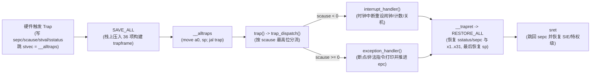
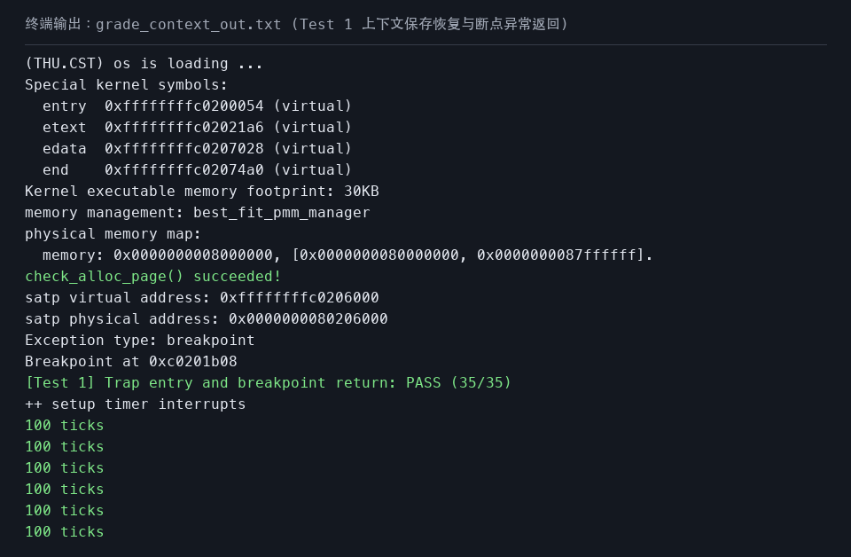
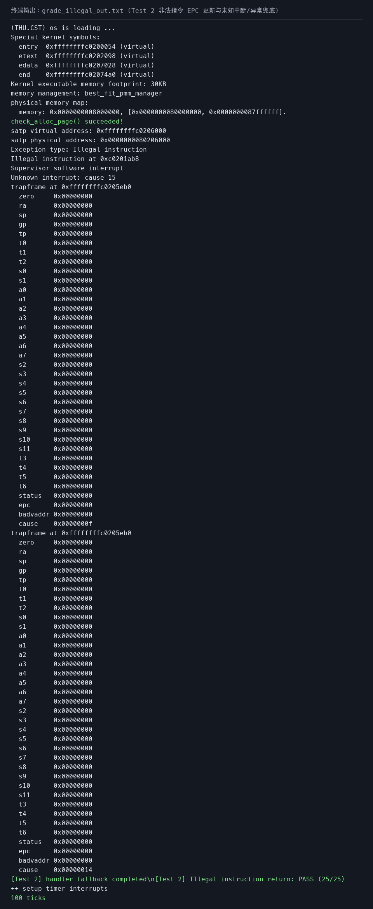

# 操作系统实验报告

## 实验基本信息

| 项目 | 内容 |
|------|------|
| **实验名称** | Lab 3：断，都可以断（RISC-V 中断与异常处理） |
| **小组成员** | 2412172-许城玮（单人小组） |
| **完成日期** | 2026-11-05 |

### 小组分工

| 成员 | 负责的练习/模块 |
|------|----------------|
| 2412172-许城玮 | 单人独立完成全部编程练习（Lab 2 依赖迁移、功能模块一 Trap 上下文恢复与入口、功能模块二中断与异常处理）、四段式 Spec 设计、测试验证及实验报告撰写 |

---

## 一、实验目的

本实验的主要目的是：

1. 理解 RISC-V 64 架构的特权级（M / S / U 模式）、中断委托机制（`mideleg` / `medeleg`）以及 S 模式下的中断与异常控制状态寄存器（`stvec`、`sepc`、`scause`、`stval`/`sbadaddr`、`sstatus`、`sie`、`sscratch`）。
2. 掌握 Trap 发生前后处理器上下文（`struct trapframe`：32 个通用寄存器与 4 个 CSR）在内核栈上的保存（`SAVE_ALL`）与恢复（`RESTORE_ALL`）机制，以及汇编入口 `__alltraps` 与 C 语言处理函数 `trap(struct trapframe *tf)` 之间的参数传递约定。
3. 掌握时钟中断（通过 OpenSBI `sbi_set_timer` 持续预约下一次时钟事件）与同步异常（非法指令异常 `CAUSE_ILLEGAL_INSTRUCTION`、断点异常 `CAUSE_BREAKPOINT` 的 `sepc` 指令长度计算与更新）的处理流程。
4. 掌握利用 `PROMPT / RELY / GUARANTEE / SPECIFICATION` 四段式规格驱动 AI 完成底层汇编与内核 C 代码开发、静态审查及自动化评测验证的工程方法。

---

## 二、实验环境

### 使用的 AI 工具

| 成员 | AI 编程工具 | 底层模型 | 备注 |
|------|------------|---------|------|
| 2412172-许城玮 | Antigravity / Claude Code | Claude Opus 4.6 / Gemini | 需求拆解、四段式 Spec 编写、子 Agent 调度、代码审查与 Docker 容器验证 |

### 软硬件与容器环境

- **宿主机与容器**：macOS（Apple Silicon）+ OrbStack Docker，使用镜像 `os2026-dbg`。
- **工具链与模拟器**：`riscv64-unknown-elf-gcc 13.2.0`、`QEMU 4.1.1`、引导固件 `OpenSBI v0.4`。

---

## 三、实验整体逻辑分析

### 2.1 本章节的逻辑主线

在 Lab 2 完成物理内存探测与页级内存管理之后，内核虽然具备了基本的内存分配能力，但仍处于“与外部世界隔绝”的静态执行流中——既无法响应外设事件（如定时器到时、串口输入），也无法妥善处理程序执行中出现的突发异常（如断点指令 `ebreak`、非法指令或缺页）。

本章实验围绕**“让内核具备完整的 Trap（中断与异常）闭环响应能力”**这一核心主题展开，沿着**“Trap 上下文保存与恢复 → Trap 入口与 C 函数桥接 → 中断与异常分类分发处理 → 上下文恢复与 `sret` 返回”**的主线推进：



### 2.2 功能的逐步实现

整个中断处理机制按照底层依赖关系，分以下四个阶段逐步构建并闭环验证：

1. **首先完成 Lab 2 物理内存管理迁移（`pmm.c` 与 `best_fit_pmm.c`）** → **为什么首先实现这个？**
   `kern_init()` 在开启全局中断之前会调用 `pmm_init()` 初始化物理内存并执行 `check_alloc_page()` 自检；同时 Lab 3 在 `pmm.c` 的 `alloc_pages()` / `free_pages()` 中引入了 `local_intr_save` / `local_intr_restore` 关中断原子保护。只有先将 Lab 2 的 `page_init()` 和 `best_fit_pmm_manager` 补齐，内核才能通过编译并顺利运行到中断初始化阶段。
2. **接着配置中断入口寄存器并实现汇编层上下文管理（`idt_init` + `trapentry.S` 的 `SAVE_ALL` / `__alltraps` / `RESTORE_ALL`）** → **为什么接着实现这个？**
   硬件触发 Trap 后根据 `stvec` 寄存器直接跳转到汇编入口 `__alltraps`，此时 C 语言运行环境尚未准备好，任何 C 函数调用都会覆盖通用寄存器。因此必须先由汇编层将全部 32 个通用寄存器和 4 个 CSR 保存到栈上的 `struct trapframe` 中，通过 `move a0, sp` 将结构体指针传给 C 语言 `trap()`，并在 `trap()` 返回后由 `RESTORE_ALL` 将寄存器和（可能被修改过的）`sepc` / `sstatus` 原样恢复，这是所有上层中断/异常处理得以运行的底座。
3. **然后实现 C 语言中断与异常分类处理（`trap.c` 的 `interrupt_handler` 与 `exception_handler`）** → **为什么然后实现这个？**
   有了底层上下文保存与恢复的包装器后，C 语言处理函数才能直接读写 `struct trapframe *tf`。`trap_dispatch()` 根据 `tf->cause` 最高位是 `1`（负数，异步中断）还是 `0`（非负数，同步异常）分流：在 `exception_handler()` 中识别非法指令与断点异常，根据指令编码长度（16 位压缩指令 `+2` 或 32 位标准指令 `+4`）推进 `tf->epc`，防止 `sret` 返回后死循环；在 `interrupt_handler()` 中处理 `IRQ_S_TIMER` 时钟中断。
4. **最后开启定时器与全局 S 模式中断（`clock_init` + `intr_enable`）验证完整闭环** → **为什么最后执行这个？**
   只有在中断向量表（`stvec`）、上下文恢复（`RESTORE_ALL`）和中断处理函数（`interrupt_handler`）全部就绪后，才能在 `sie` 中使能时钟中断（`MIP_STIP`）、调用 `clock_set_next_event()` 设定第一次定时器事件，并置位 `sstatus.SIE` 开启全局中断；否则一旦中断提前到来就会跳转到未就绪的处理路径导致内核崩溃。

---

## 四、实验内容与实现

### 前置依赖任务：迁移 Lab 2 物理内存管理代码

**负责人：** 2412172-许城玮

- 在 `code/kern/mm/pmm.c` 中将 `init_pmm_manager()` 切换为 `&best_fit_pmm_manager`，并在 `//lab2 function1 2412172` 处填入 `page_init()` 实现，同时完整保留了 Lab 3 在 `alloc_pages()`、`free_pages()`、`nr_free_pages()` 中新增的 `local_intr_save` / `local_intr_restore` 关中断原子保护逻辑。
- 在 `code/kern/mm/best_fit_pmm.c` 的 `//lab2 function2-2 2412172` 处填入 Best-Fit 物理内存分配器的完整实现。
- 对应提示词详见 [prompt.md：一、迁移 Lab 2 物理内存管理实现](prompt.md#task01)。

---

### 功能模块一：Trap 上下文恢复与 Trap 入口功能（`kern/trap/trapentry.S`）

**负责人：** 2412172-许城玮

#### 模块功能描述

**需要实现的汇编宏与符号：**

```armasm
# kern/trap/trapentry.S
RESTORE_ALL
__alltraps
```

**功能说明：**

1. **核心作用**：该模块位于硬件 Trap 机制与 C 语言内核代码之间的分界线上，承担“保护现场 → 桥接 C 函数 → 恢复现场并返回”的底层包装器职责。
2. **上下文保存（`SAVE_ALL`）与恢复（`RESTORE_ALL`）的对称关系与特殊处理**：
   - `SAVE_ALL` 先通过 `csrw sscratch, sp` 备份原栈顶指针，再执行 `addi sp, sp, -36 * REGBYTES` 在内核栈上开辟 `struct trapframe`（36 个 64 位槽位，共 288 字节），将 `x0..x1`、`x3..x31` 存入对应槽位，再通过 `csrrw s0, sscratch, x0` 读出原 `sp` 存入 `2*REGBYTES(sp)`，最后保存 `sstatus`、`sepc`、`sbadaddr`、`scause` 到 `32..35*REGBYTES(sp)`。
   - `RESTORE_ALL` 必须按严格的逆序约束恢复：
     1. **先恢复 CSR（`sstatus` 与 `sepc`）**：C 语言 `exception_handler()` 在处理断点或非法指令时会修改 `tf->epc`（即 `33*REGBYTES(sp)`）。由于 RISC-V 不支持直接将内存数据写入 CSR，必须先借用通用寄存器 `s1`、`s2` 从 `32*REGBYTES(sp)` 和 `33*REGBYTES(sp)` 读出 `status` 和 `epc`，执行 `csrw sstatus, s1` 和 `csrw sepc, s2`。而 `sbadaddr`（`34*REGBYTES`）和 `scause`（`35*REGBYTES`）是硬件在进入 Trap 时写入的异常原因与故障地址，供软件只读诊断，`sret` 返回硬件并不读取它们，因此无需恢复。
     2. **再恢复通用寄存器 `x1`、`x3..x31`**：依次从栈上恢复除 `x0`（恒为 0）和 `x2(sp)` 外的全部通用寄存器，这会自动把第 1 步借用的 `s1(x9)`、`s2(x18)` 还原为被打断前的值。
     3. **最后一步恢复 `x2(sp)`**：所有 `LOAD` 指令均以当前 `sp` 为基址寻址。一旦修改 `x2(sp)`，就无法再通过 `offset(sp)` 访问 `trapframe`。由于 `2*REGBYTES(sp)` 中保存的正是进入 Trap 之前的原始 `sp` 值，把 `LOAD x2, 2*REGBYTES(sp)` 放在最后一条指令执行，既恢复了原始 `sp`，又自然释放了栈上的 36 个寄存器空间。
3. **`__alltraps` 参数传递**：`SAVE_ALL` 执行完毕后，当前栈顶 `sp` 恰好等于栈上 `struct trapframe` 的首地址。根据 RISC-V 调用约定，第一个整型/指针参数通过 `a0` 传递，且 `sp` 属于被调用者保存（Callee-saved）寄存器；因此只需执行 `move a0, sp` 和 `jal trap`，待 `trap()` 返回时 `sp` 仍指向同一个 `trapframe`，顺序滑入 `__trapret` 执行 `RESTORE_ALL` 和 `sret` 即可完成闭环。

#### 最终提示词

完整提示词收录于 [prompt.md：二、功能模块一](prompt.md#task02)，核心四段式规格如下：

````markdown
## PROMPT
请修改 `code/kern/trap/trapentry.S`，在两处 `#lab3 function1 YOUR CODE` 注释位置（将注释替换为 `#lab3 function1 2412172`）分别实现：
1. 汇编宏 `RESTORE_ALL`：与已提供的 `SAVE_ALL` 对称，从当前内核栈顶 `sp` 指向的 `struct trapframe` 中恢复处理器状态。
2. 汇编入口 `__alltraps` 中 `SAVE_ALL` 之后到 `__trapret` 之前的代码：按 RISC-V 调用约定将当前 `struct trapframe *` 传递给 C 函数 `void trap(struct trapframe *tf)` 并调用之。

## RELY
- `struct trapframe` 内存布局：`0..31*REGBYTES(sp)` 为 `x0..x31`（其中 `2*REGBYTES(sp)` 存进入 Trap 前的原始 `sp`）；`32..35*REGBYTES(sp)` 依次为 `status(sstatus)`、`epc(sepc)`、`badvaddr(sbadaddr)`、`cause(scause)`。
- 64 位下 `LOAD` 为 `ld`，`STORE` 为 `sd`，`REGBYTES` 为 `8`。

## GUARANTEE
- `__alltraps` 通过 `move a0, sp` 和 `jal trap` 正确传递 `struct trapframe *` 参数并在返回后进入 `__trapret`。
- `RESTORE_ALL` 正确恢复 `sstatus`、`sepc` 及 `x1..x31`，最后恢复 `x2(sp)`，通过 `make grade` Test 1（35/35）。

## SPECIFICATION
- `__alltraps`：Preconditions 为 `SAVE_ALL` 已完成且 `sp` 指向 `trapframe`；Postconditions 为 `a0 == sp`，调用 `jal trap`，返回后 `sp` 不变并进入 `__trapret`。
- `RESTORE_ALL`：
  1. 先 `LOAD s1, 32*REGBYTES(sp)`、`LOAD s2, 33*REGBYTES(sp)` 并执行 `csrw sstatus, s1`、`csrw sepc, s2`；
  2. 依次 `LOAD x1, 1*REGBYTES(sp)` 及 `LOAD x3..x31, 3..31*REGBYTES(sp)`；
  3. 最后执行 `LOAD x2, 2*REGBYTES(sp)` 恢复栈指针。
````

#### 实现迭代过程

本模块的实现经历了 **1** 次迭代，过程如下：

---

##### 第一次迭代

在编写四段式 `SPECIFICATION` 时，我们提前明确了三个关键约束：（1）必须先借用 `s1`/`s2` 写回 `sstatus` 和 `sepc`，再恢复 `s1`/`s2` 通用寄存器本身；（2）`sbadaddr` 与 `scause` 无需写回；（3）`LOAD x2, 2*REGBYTES(sp)` 必须放在最后一条指令执行。AI 生成的汇编代码一次正确，未出现寄存器污染或栈指针错位问题。

**最终结果：**

经过 **1** 次迭代，该模块最终：
- ✅ 编译通过
- ✅ 所有相关测试通过（`test_lab3_register_context` 检验 26 个通用寄存器在 `ebreak` 前后完全一致，得分 35/35）
- ✅ 功能符合预期

**关键改进点总结：**
1. 在 `[RELY]` 中显式列出了 `struct trapframe` 全 36 个槽位的字节偏移与寄存器映射关系。
2. 在 `[SPECIFICATION]` 中严格规定了“先 CSR → 再 `x1, x3..x31` → 最后 `x2(sp)`”的三步恢复顺序，从根源上避免了先恢复 `sp` 导致后续寻址失效或先恢复 `s1`/`s2` 后被 CSR 读取覆盖的常见 Bug。

---

### 功能模块二：中断与异常处理功能（`kern/trap/trap.c`）

**负责人：** 2412172-许城玮

#### 模块功能描述

**需要实现的函数：**

```c
// kern/trap/trap.c
void interrupt_handler(struct trapframe *tf);
void exception_handler(struct trapframe *tf);
```

**功能说明：**

1. **核心作用**：接收 `trap_dispatch()` 分发过来的 `struct trapframe *tf`，根据 `tf->cause` 完成具体中断（异步外设事件）与异常（同步指令事件）的分类响应和现场修正。
2. **中断处理（`interrupt_handler`）**：
   - 通过 `intptr_t cause = (tf->cause << 1) >> 1;` 剥离 `scause` 最高位的中断标志位，提取出低位中断号。
   - **时钟中断（`IRQ_S_TIMER`）**：
     1. 调用 `clock_set_next_event()`（内部通过 `sbi_set_timer(get_cycles() + timebase)` 向 OpenSBI 预约 10ms 后的下一次定时器中断）；
     2. 将全局计数器 `ticks` 加 1；每当 `ticks % TICK_NUM == 0`（每 100 次时钟中断，约 1 秒）时，调用框架提供的 `print_ticks()` 输出 `100 ticks`；
     3. 维护静态打印轮数计数器 `num`，当累计输出达到 `SHUTDOWN_AFTER`（10 次，即 1000 ticks）时，调用 `sbi_shutdown()` 请求 OpenSBI 关闭系统。
   - **其他中断与未知中断兜底**：对 `IRQ_U_SOFT`、`IRQ_S_SOFT` 等已知中断打印对应类型提示；对无法识别的中断（`default` 分支，如测试中的 `cause 15`），先打印 `"Unknown interrupt: cause %d\n", (int)cause`，再调用 `print_trapframe(tf)` 输出完整寄存器现场。
3. **异常处理（`exception_handler`）**：
   - **指令长度动态判定（`riscv_inst_len`）**：在 RISC-V 64GC 架构中，标准指令长 4 字节（机器码最低两位为 `11`），C 扩展压缩指令长 2 字节（如 `c.ebreak` 机器码为 `0x9002`，最低两位不为 `11`）。因此通过读取 `*(const uint16_t *)(tf->epc)` 并判断 `((inst & 0x3) != 0x3) ? 2 : 4`，即可准确计算当前触发异常指令的字节长度。
   - **非法指令异常（`CAUSE_ILLEGAL_INSTRUCTION`）**：打印 `"Exception type: Illegal instruction\n"` 与 `"Illegal instruction at 0x%08x\n", tf->epc`，随后执行 `tf->epc += riscv_inst_len(tf->epc)` 跳过该非法指令。
   - **断点异常（`CAUSE_BREAKPOINT`）**：打印 `"Exception type: breakpoint\n"` 与 `"Breakpoint at 0x%08x\n", tf->epc`，随后执行 `tf->epc += riscv_inst_len(tf->epc)` 跳过断点指令。
   - **其他异常兜底**：其余未要求恢复的异常及 `default` 分支均调用 `print_trapframe(tf)` 输出异常现场。

#### 最终提示词

完整提示词收录于 [prompt.md：三、功能模块二](prompt.md#task03)，核心四段式规格如下：

````markdown
## PROMPT
请修改 `code/kern/trap/trap.c`，在 `//lab3 function2 YOUR CODE` 注释位置（将注释替换为 `//lab3 function2 2412172`）实现 `void interrupt_handler(struct trapframe *tf)` 和 `void exception_handler(struct trapframe *tf)`。只允许在该注释区域内编写代码，严禁修改函数签名或 `trap.c` 中的其他已有函数。

## RELY
- `TICK_NUM (100)`、`print_ticks()`、`print_trapframe(tf)`、`ticks`、`clock_set_next_event()`、`sbi_shutdown()`。
- 中断宏 `IRQ_U_SOFT..IRQ_M_EXT`（其中 `IRQ_S_SOFT = 1`、`IRQ_S_TIMER = 5`），异常宏 `CAUSE_MISALIGNED_FETCH..CAUSE_MACHINE_ECALL`（其中 `CAUSE_ILLEGAL_INSTRUCTION = 0x2`、`CAUSE_BREAKPOINT = 0x3`）。
- `tools/test_lab3.c` 直接通过 `extern` 调用 `interrupt_handler` 和 `exception_handler`，并测试 `.word 0x0000007b`、`tf.cause = IRQ_S_SOFT | (1ULL << 63)`、`tf.cause = 15`、`tf.cause = 20`。

## GUARANTEE
- `interrupt_handler` 与 `exception_handler` 为非 `static` 函数；编译零警告（`-Werror`）；
- `make grade` 三个测试全部 PASS（100/100）；`make qemu` 打印 10 次 `100 ticks` 后正常调用 `sbi_shutdown()` 关机。

## SPECIFICATION
- 指令长度辅助函数 `riscv_inst_len(uintptr_t epc)`：读取 `*(const uint16_t *)epc`，满足 `((inst & 0x3) != 0x3) ? 2 : 4`。
- `interrupt_handler(tf)`：
  - `intptr_t cause = (tf->cause << 1) >> 1;`
  - `IRQ_S_TIMER`：调用 `clock_set_next_event()`；`++ticks % TICK_NUM == 0` 时调用 `print_ticks()` 并递增静态计数 `num`，当 `num == SHUTDOWN_AFTER (10)` 时调用 `sbi_shutdown()`。
  - 其他已知中断输出对应提示字符串；`default` 输出 `"Unknown interrupt: cause %d\n", (int)cause` 并调用 `print_trapframe(tf)`。
- `exception_handler(tf)`：
  - `CAUSE_ILLEGAL_INSTRUCTION`：输出 `"Exception type: Illegal instruction\n"` 与 `"Illegal instruction at 0x%08x\n", tf->epc`，更新 `tf->epc += riscv_inst_len(tf->epc)`。
  - `CAUSE_BREAKPOINT`：输出 `"Exception type: breakpoint\n"` 与 `"Breakpoint at 0x%08x\n", tf->epc`，更新 `tf->epc += riscv_inst_len(tf->epc)`。
  - 其他分支与 `default` 调用 `print_trapframe(tf)`。
````

#### 实现迭代过程

结合前置依赖迁移与本模块规格设计，共经历了 **2** 次关键问题排查与迭代（详细记录见 [bugs.md](ai_logs/lab3/bugs.md)）：

---

##### 第一次迭代（跨实验依赖迁移编译问题）

**遇到的问题：**
- **问题 1**：将 Lab 2 中已验证通过的 `page_init()` 填入 Lab 3 的 `code/kern/mm/pmm.c` 后，编译报错：
  `kern/mm/pmm.c:96:20: error: 'PHYSICAL_MEMORY_END' undeclared (first use in this function)`。
- **原因分析**：对比两个实验的 `kern/mm/memlayout.h` 发现，Lab 2 头文件中定义了 `#define PHYSICAL_MEMORY_END 0x88000000`，而 Lab 3 骨架的 `memlayout.h` 移除了该宏。

**问题解决策略：**
- 在不修改 `memlayout.h` 的前提下，于 `code/kern/mm/pmm.c` 的 `//lab2 function1 2412172` 区域顶部补充 `#ifndef PHYSICAL_MEMORY_END` 兜底宏定义（`0x88000000`），重新编译零警告通过。

---

##### 第二次迭代（指令长度判定与未知中断兜底规格完善）

**遇到的问题：**
- **问题 1（指令长度差异）**：在 RV64GC 工具链下，`test_lab3_context.S` 中的 `ebreak` 会被汇编器生成为 2 字节压缩指令 `c.ebreak`（`0x9002`），而 `test_lab3.c` 中的非法指令 `.word 0x0000007b` 则是 4 字节指令。若在代码中硬编码 `tf->epc += 4` 或 `tf->epc += 2`，会导致其中一个测试跳错指令地址。
- **问题 2（未知中断直接调用测试）**：`test_lab3.c` 中的 `test_lab3_handler_fallbacks()` 在测试未知中断时直接赋值 `tf.cause = 15; interrupt_handler(&tf);`（未设置最高位 bit 63），且 `grade.sh` 检查输出 `"Unknown interrupt: cause 15"`。

**问题解决策略：**
- 针对问题 1：在 `SPECIFICATION` 中要求实现 `riscv_inst_len(tf->epc)`，通过读取指令半字最低两位 `((inst & 0x3) != 0x3) ? 2 : 4` 动态决定步进长度。
- 针对问题 2：在 `SPECIFICATION` 中明确使用 `(tf->cause << 1) >> 1` 剥离最高位，并在 `default` 分支同时输出 `"Unknown interrupt: cause %d\n", (int)cause` 和 `print_trapframe(tf)`。

**最终结果：**

经过上述迭代完善后，该模块最终：
- ✅ 编译通过（`-Werror` 零警告）
- ✅ 所有相关测试通过（`make grade` 总分 `100/100`）
- ✅ 功能符合预期（`make qemu` 稳定输出 10 次 `100 ticks` 后正常关机）

---

## 五、测试与验证

### 5.1 `make qemu` 运行测试（时钟中断计数与自动关机）

执行 `./os2026.sh qemu`，内核完成 DTB 解析、Best-Fit 物理内存初始化与自检后，开启定时器中断，每 100 次时钟中断打印一行 `100 ticks`，累计打印 10 次后调用 `sbi_shutdown()` 正常退出：


### 5.2 `make grade` 自动评测结果（100/100）

执行 `./os2026.sh grade`，自动注入 `tools/test_lab3.c` 与 `tools/test_lab3_context.S`，三项测试（断点异常与寄存器上下文恢复 35 分、非法指令 EPC 更新与兜底处理 25 分、持续时钟中断重装填 40 分）全部 PASS，总分 **100/100**：


### 5.3 分项测试串口输出详情

1. **Test 1（Trap 入口、26 个通用寄存器上下文恢复与 `ebreak` 断点返回）**：
   触发断点异常于 `0xc0201b08`（2 字节 `c.ebreak`），`exception_handler` 将 `tf->epc` 推进 2 字节后经 `RESTORE_ALL` 与 `sret` 返回，全部寄存器校验通过：

   

2. **Test 2（4 字节非法指令 `.word 0x0000007b` 返回与中断/异常兜底分支）**：
   触发非法指令异常于 `0xc0201ab8`，`exception_handler` 识别其最低两位为 `11`，将 `tf->epc` 推进 4 字节后返回；随后依次通过 `IRQ_S_SOFT`、未知中断 `cause 15` 与未知异常 `cause 20 (0x14)` 的兜底测试：

   

---

## 六、实验总结与收获

### 对操作系统的理解

#### 1. 本实验中重要的知识点及其与 OS 原理知识点的含义、关系和差异

| 本实验中的具体实现 | 对应 OS 原理知识点 | 二者的含义、关系与差异 |
|---|---|---|
| `trapentry.S` 中的 `SAVE_ALL`、`RESTORE_ALL` 与 `struct trapframe` | **中断/异常上下文保存与恢复（Context Save & Restore）** | **含义与关系**：OS 原理指出中断处理必须透明地保护被打断程序的 CPU 现场，本实验将其具体化为内核栈上的 36 项 `trapframe` 结构体。<br>**差异**：原理课通常抽象地说“硬件或操作系统保存寄存器”，而在 RISC-V 实践中职责划分极细——硬件只自动更新 `sepc`、`scause`、`stval`、`sstatus` 4 个控制状态寄存器，32 个通用寄存器必须由软件在 `SAVE_ALL` 中逐条压栈，且 `x2(sp)` 必须借道 `sscratch` 暂存并在 `RESTORE_ALL` 的最后一步恢复。 |
| `trap_dispatch()`、`interrupt_handler()`、`exception_handler()` 与 `stvec` | **中断向量表与中断/异常分类分发机制** | **含义与关系**：对应原理中的“中断向量表查询与中断服务例程（ISR）分发”。<br>**差异**：x86 常采用硬件查 IDT 表跳不同入口，而本实验将 RISC-V `stvec` 设为 `Direct` 模式（低 2 位为 `00`，要求入口 `.align(2)` 四字节对齐），所有中断和异常统一跳到 `__alltraps`，再由 C 代码根据 `scause` 最高位是 `1`（异步中断）还是 `0`（同步异常）软件分发。 |
| `exception_handler()` 中 `tf->epc += riscv_inst_len(tf->epc)` | **故障（Fault）、陷阱（Trap）与终止（Abort）的返回地址语义** | **含义与关系**：OS 原理区分了异常返回时是“重执当前指令”（如缺页异常修复后）还是“跳过当前指令执行下一条”（如断点/系统调用）。<br>**差异**：RISC-V 硬件在任何异常发生时都一律将 `sepc` 设为触发异常的指令地址本身，不会自动加偏移；必须由内核软件根据异常类型和指令编码长度（RVC 压缩指令 2 字节 vs 标准指令 4 字节）手动修改栈上 `tf->epc`。 |
| `clock_init()`、`clock_set_next_event()` 与 `sbi_set_timer()` | **时钟中断（Timer Interrupt）与特权级分层调用** | **含义与关系**：时钟中断是操作系统实现时间片轮转调度与系统计时的心跳脉搏。<br>**差异**：原理课常假设硬件提供一次配置即可周期性触发的定时器（如 x86 8253 PIT），而在 RISC-V 中，`mtimecmp` 属于 M 模式特权资源且为单次比较触发；运行在 S 模式的内核必须在每次 `IRQ_S_TIMER` 中通过 `ecall` 调用 M 模式固件 OpenSBI 的 `sbi_set_timer()` 预约下一次触发时刻。 |
| `kern/sync/sync.h` 的 `local_intr_save` / `local_intr_restore` | **临界区保护与关中断原子操作** | **含义与关系**：单核内核在开启中断后，物理内存分配器（`alloc_pages` / `free_pages`）操作空闲链表时若被中断打断并重入，会破坏链表不变式。通过读取并清除 `sstatus.SIE` 关闭本地中断，是单核系统实现内核临界区互斥最直接的机制。 |

#### 2. OS 原理中很重要、但在本实验中没有对应上的知识点

1. **用户态（U-Mode）与内核态（S-Mode）之间的跨特权级内核栈切换**：
   本实验中所有 Trap（`ebreak`、非法指令、时钟中断）均发生在内核态（S-Mode 自陷），因此 `idt_init()` 直接将 `sscratch` 置为 `0`，`SAVE_ALL` 直接在当前内核栈 `sp` 上继续压栈。而在完整的操作系统原理中，当用户态程序触发 Trap 陷入内核时，不能信任或直接使用用户栈，必须通过 `sscratch` 交换用户栈指针与该进程的内核栈指针，并在返回用户态前将内核栈顶重新写回 `sscratch`。
2. **中断嵌套（Nested Interrupts）与中断优先级抢占**：
   本实验在进入 S 模式 Trap 时，硬件自动将 `sstatus.SIE` 清零屏蔽中断，直到 `sret` 返回时才恢复 `SIE`，处理全程不支持高优先级中断抢占低优先级中断，也没有区分上半部（Top Half，关中断快速响应）与下半部（Bottom Half / Tasklet / Workqueue，开中断延后处理）。
3. **基于时钟中断的进程抢占式调度（Preemptive Scheduling）**：
   OS 原理中时钟中断最重要的职责是扣减当前运行进程的时间片（`time_slice`），并在时间片耗尽时置位调度标志（`need_resched`）触发进程上下文切换；本实验尚无进程控制块（PCB/TCB），时钟中断仅完成了 `ticks` 计数和控制台打印。
4. **可恢复异常的实际修复机制（如缺页异常 Page Fault 处理）**：
   本实验对非法指令和断点异常只是简单跳过指令（`tf->epc += 2/4`），对缺页等其他异常仅调用 `print_trapframe()` 打印；尚未实现读取 `stval`（故障虚拟地址）、分配物理页、建立页表映射后**不修改 `sepc`** 直接返回重执原访存指令的完整缺页恢复闭环。
5. **外部设备中断控制器（PLIC）与外设 I/O 驱动中断**：
   本实验仅通过 `sie` 的 `MIP_STIP` 开启了核内定时器中断，未涉及 RISC-V 平台级中断控制器（PLIC）对外设中断（如串口键盘输入、磁盘 DMA 完成中断）的路由、认领（Claim）与完成确认（Complete）流程。

---

### AI 协作开发的经验

1. **汇编与硬件接口类任务必须在 `RELY` 和 `SPECIFICATION` 中锁定数据布局与时序不变量**：
   在编写 `RESTORE_ALL` 的提示词时，如果只笼统地说“恢复所有寄存器”，AI 极易写出“先恢复通用寄存器 `s1`/`s2`、再借用 `s1`/`s2` 恢复 `sstatus`/`sepc`”（导致 `s1`/`s2` 被污染）或者“按顺序在 `x2` 处恢复 `sp`”（导致后续 `x3..x31` 寻址基址错乱）的错误代码。把“先 CSR → 再通用寄存器 → 最后 `x2(sp)`”的不变量写进 `SPECIFICATION`，才能让 AI 一次生成零缺陷的底层汇编。
2. **结合评测源码与 ISA 手册消除隐式假设**：
   指导书中提醒“不同异常对应的指令长度可能不同”。通过提前分析 RISC-V C 压缩指令集编码规则（最低两位 `!= 11` 为 2 字节、`== 11` 为 4 字节）并将其写入 `task_03` 的规格说明，成功避免了硬编码 `tf->epc += 4` 在遇到 2 字节 `c.ebreak` 时踩坑。
