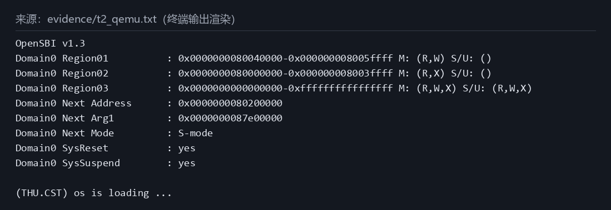
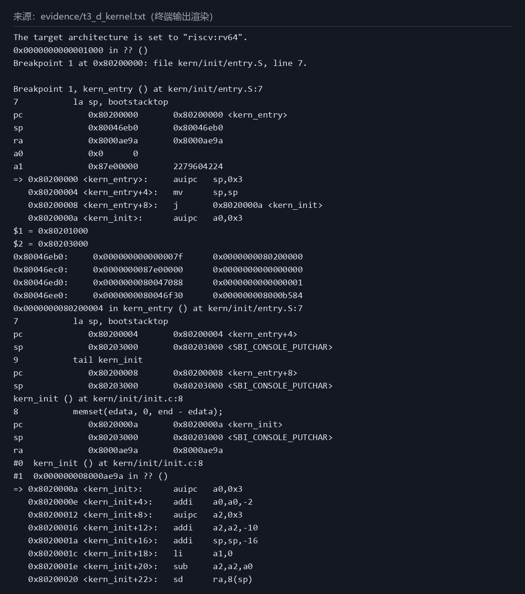
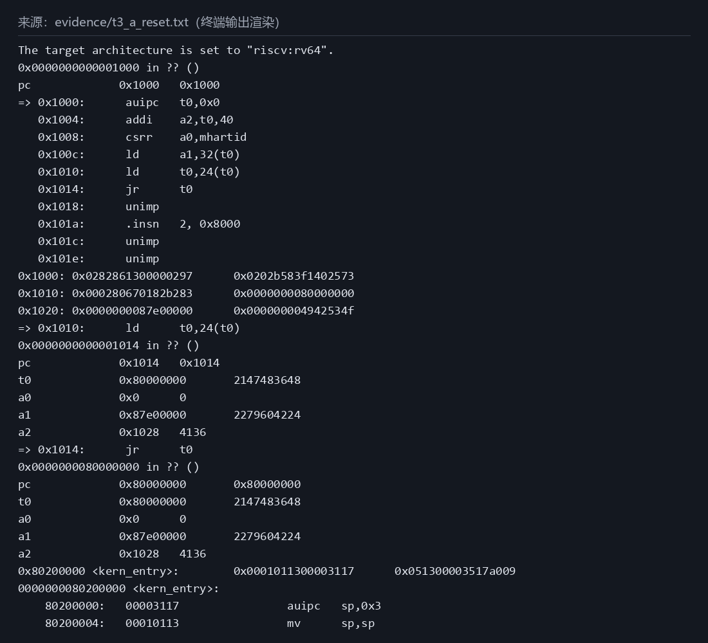
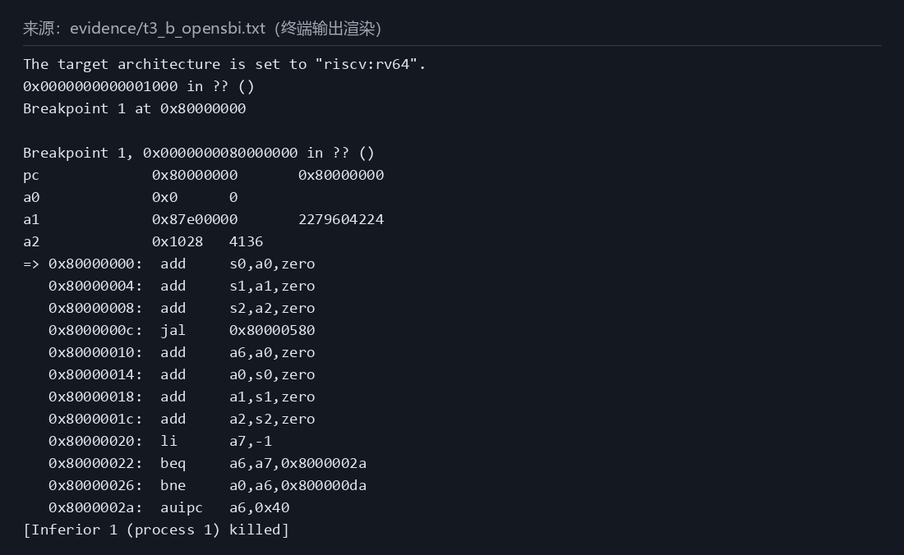
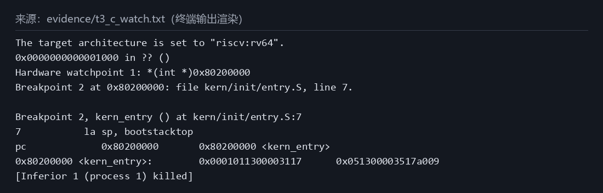
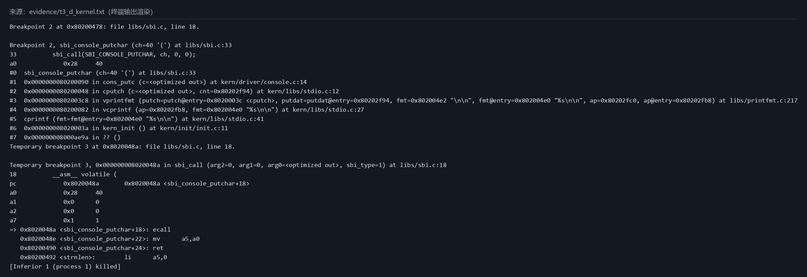

# 操作系统实验报告

## 实验基本信息

| 项目 | 内容 |
|------|------|
| **实验名称** | Lab 1：RISC-V 最小内核启动与 GDB 调试 |
| **小组成员** | 2412172-许城玮；单人小组 |
| **完成日期** | 2026-10-07（北京时间） |

### 小组分工

| 成员 | 负责的练习/模块 |
|------|----------------|
| 2412172-许城玮 | 全部练习、环境适配、构建验证、GDB 调试及实验报告 |

实验报告由该成员统一负责；AI 的任务分工见实验环境及协作过程。

---

## 一、实验目的

1. 理解 QEMU virt 上 RISC-V 从复位入口、OpenSBI 到内核入口的启动路径，并用真实断点和寄存器观察验证。
2. 解释 `entry.S` 中建立内核栈、跳转 C 入口两条伪指令的操作和目的。
3. 理解内核链接布局及最小字符输出链，区分源码意图、工具链实际生成的指令和实际执行结果。

---

## 二、实验环境

| 成员 | AI 编程工具 | 底层模型 | 备注 |
|------|------------|---------|------|
| 2412172-许城玮 | Claude Code | Claude Opus 5.5 | Leader：读需求、拆任务、写 Spec、复核 |
| 2412172-许城玮 | Codex CLI | GPT-6.1-Sol，medium | 实现、测试、调试、报告撰写 |
| 2412172-许城玮 | pi | deepseek-flash | Review：审查报告与代码改动，见 [review_01.md](ai_logs/lab1/review_01.md) |

以上工具与模型信息按 Leader 的 [Task 04 规格](ai_logs/lab1/task_04.md)填写。

软件环境：WSL Ubuntu-24.04、riscv64-unknown-elf-gcc 13.2.0、QEMU 8.2.2、OpenSBI v1.3、gdb-multiarch 15.1；版本信息依据任务规格，OpenSBI v1.3 同时见实际启动输出。仓库分支为 `lab1`，代码位于 `code/`。`make debug` 使用 `-s -S`，通过 `localhost:1234` 连接 GDB，每个采集阶段重新启动 QEMU。

---

## 三、实验整体逻辑分析

### 2.1 本章节的逻辑主线

本章围绕“如何让 C 内核从加电复位现场开始执行并输出信息”展开。先将已有源码链接为入口在 `0x80200000` 的 ELF，再转换成 raw 镜像；QEMU 装入固件和内核镜像，CPU 从 MROM 的 `0x1000` 执行复位指令，转入 `0x80000000` 的 OpenSBI。OpenSBI 完成固件初始化后进入 `0x80200000` 的 `kern_entry`，汇编入口设置独立内核栈并跳到 `kern_init`，最终通过 SBI 字符输出服务打印加载文字。

本机观察到内核机器码在 CPU 执行内核之前已存在，故本环境不能把“OpenSBI 初始化”和“内核镜像的加载”混为同一动作。镜像预加载和下一阶段入口传递是 QEMU 的工作；固件接着转交控制权，见练习 2 的证据。

### 2.2 功能的逐步实现

1. 构建并核对链接布局，先确认镜像存在及 `kern_entry` 地址，否则后续断点无可靠对象。
2. 适配 Makefile 的 GDB 程序名；运行发现只有 OpenSBI 输出，进入 Bug 1 排查。
3. 把 `qemu`、`debug` 两处 loader 参数换成 `-kernel`，验证下一阶段地址、内核文字及入口断点。
4. 分阶段采集复位、固件入口、watchpoint 与内核入口数据，最后解释栈初始化和 SBI 输出链；不修改课程 C/汇编/头文件或链接脚本。

---

## 四、实验内容与实现

### 功能模块：构建、启动适配与字符输出

**负责人：** 2412172-许城玮

#### 模块功能描述

本实验无需补写 C 函数；实际改动仅为 Makefile 的三行环境适配。相关已有函数如下：

```c
int kern_init(void) __attribute__((noreturn));
int cprintf(const char *fmt, ...);
void cons_putc(int c);
void sbi_console_putchar(unsigned char ch);
uint64_t sbi_call(uint64_t sbi_type, uint64_t arg0, uint64_t arg1, uint64_t arg2);
```

`kern_entry` 是汇编入口，不是普通 C 函数。`kern_init` 调用 `memset(edata, 0, end-edata)` 后输出文字并永久循环。本次 `edata=end=0x80203008`，清零长度为 0，不能据此声称已经测试了非空 BSS 的清零过程。

链接脚本 `code/tools/kernel.ld` 指定 `ENTRY(kern_entry)`、`BASE_ADDRESS = 0x80200000`，在 `.data` 前执行 `ALIGN(0x1000)`。实际地址来自 [nm / objdump / readelf 证据](ai_logs/lab1/evidence/t1_symbols.txt)：

| 对象 | 起始地址 | 大小或说明 |
|------|----------|------------|
| `.text` / `kern_entry` | `0x80200000` | `.text` 大小 `0x4c0` |
| `.rodata` | `0x802004c0` | 大小 `0x270` |
| `.data` / `bootstack` | `0x80201000` | 大小 `0x2000` |
| `.sdata` / `bootstacktop` | `0x80203000` | `.sdata` 大小 `0x8` |
| `edata` / `end` | `0x80203008` | ELF 没有独立非空 `.bss` 段 |

ELF 的入口为 `0x80200000`，两个 LOAD 段分别从 `0x80200000`、`0x80201000` 开始；raw 镜像本身不保留 ELF 入口元数据，因此还需要启动参数正确传递下一阶段入口。

#### 最终提示词

执行规格保留在 [Task 01](ai_logs/lab1/task_01.md)、[Task 02](ai_logs/lab1/task_02.md)、[Task 03](ai_logs/lab1/task_03.md)、[Task 04](ai_logs/lab1/task_04.md)，均包含 PROMPT / RELY / GUARANTEE / SPECIFICATION。以下摘录实际规格的关键约束，完整提示词以链接文件为准：

```text
Task 01：只改 gdb: 目标里调用的程序名为 gdb-multiarch，其它行一律不动。
Task 02：把 -device loader,file=$(UCOREIMG),addr=0x80200000 替换为 -kernel $(UCOREIMG)（debug: 保留 -s -S）。
Task 03：每个阶段结束后 kill 并确保本任务启动的 QEMU 退出，下一阶段重新启动 make debug。
Task 04：只裁剪片段，不得改写或编造任何一行内容。
```

#### 实现迭代过程

启动适配经历两轮执行：第一轮构建成功但启动验证失败，第二轮修复入口传递后成功。第三个任务是数据采集，第四个任务是报告整理，不计作新的内核实现。

##### 第一次迭代

Task 01 将缺失的 `riscv64-unknown-elf-gdb` 替换为本机已有的 `gdb-multiarch`。`make clean && make` 成功，生成 `bin/kernel` 和 `bin/ucore.img`，但 5 秒和 10 秒的 QEMU 输出都没有内核文字。两次均以正常 timeout 退出；[原始输出](ai_logs/lab1/evidence/t1_qemu.txt)显示 `Domain0 Next Address : 0x0000000000000000`。

Bug 1 的 [Leader 分析及修复记录](ai_logs/lab1/bugs.md)指出：`-device loader` 把文件放到指定地址，却未通过 QEMU 的启动信息传递正确的下一阶段入口。地址布局正确并不等于 CPU 真正执行了内核。

##### 第二次迭代（如有）

Task 02 仅把 `qemu` 和 `debug` 两处 `-device loader,file=$(UCOREIMG),addr=0x80200000` 换为 `-kernel $(UCOREIMG)`，保留 `debug` 的 `-s -S`。据指导书及 Leader 记录，旧环境 QEMU 4.1.1 / OpenSBI v0.4 的固件采用固定内核跳转地址 `0x80200000`；本机 QEMU 8.2.2 / OpenSBI v1.3 使用 fw_dynamic，下一阶段地址由 QEMU 传给固件。对本次 raw 镜像，`-kernel` 将其放在固件之后按 2 MiB 对齐的位置，并传递 `0x80200000`。旧环境本次没有运行，以上旧版行为不是本次独立实测结论。

[修复输出](ai_logs/lab1/evidence/t2_qemu.txt)中下一阶段地址变为 `0x0000000080200000`，并出现 `(THU.CST) os is loading ...`；[GDB 验证](ai_logs/lab1/evidence/t2_gdb_check.txt)在入口命中。相对助教原版的 [diff](ai_logs/lab1/evidence/t2_makefile.diff)只包含 gdb 程序名及两处启动参数，共三行变化。

图 1 展示实际入口地址和内核输出。它是原始证据片段的终端风格渲染，不是桌面截图；以下五张图使用相同方式。



##### 第三次迭代（如有）

未进行第三轮源码或 Makefile 修改。Task 03 仅运行四个独立调试阶段；Task 04 仅生成报告、图片和渲染脚本。

### 练习：练习 1——理解 entry.S

**负责人：** 2412172-许城玮

`la sp, bootstacktop` 的操作是把内核栈顶地址放入 `sp`。实际机器指令是 `0x80200000: auipc sp,0x3` 与 `0x80200004: mv sp,sp`；后者是 `addi sp,sp,0` 的反汇编别名。第一条以当前 PC 为基准计算 `0x80200000 + 0x3000 = 0x80203000`，第二条偏移为 0，所以 `sp` 保持该值。并非所有 `la` 都展开成这一组合，这是本次布局和链接结果。

实际 `sp` 从 OpenSBI 留下的 `0x80046eb0` 变为 `0x80203000`；符号 `bootstack=0x80201000`、`bootstacktop=0x80203000`。`KSTACKPAGE=2`、页大小为 4096 字节，故 KSTACKSIZE 为 8192 字节，即 8 KB。栈向低地址增长，栈空间为 `[0x80201000, 0x80203000)`。这样 C 函数才能使用独立内核栈保存寄存器和局部数据，而不继续占用固件的栈。

`bootstacktop` 与 `.sdata` 的起点重合，所以 GDB 将 `sp=0x80203000` 显示成 `<SBI_CONSOLE_PUTCHAR>`。这只是同址符号选择；栈从该边界向低地址增长，不把边界处 `.sdata` 当作已用栈空间。

`tail kern_init` 把控制权转到 C 入口，本次汇编为 `0x80200008: j 0x8020000a <kern_init>`。该跳转不写返回地址寄存器；执行后 `pc=0x8020000a`，`ra` 仍是固件留下的 `0x8000ae9a`。源码将 `kern_init` 标为 `noreturn` 且最终无限循环，不需要回到汇编入口，因此使用 tail 而不是创建新的返回点。

图 5 给出 `la` 前后寄存器、栈顶符号及 tail 后进入 `kern_init` 的实际现场，来源为 [阶段 D](ai_logs/lab1/evidence/t3_d_kernel.txt)。



### 练习：练习 2——GDB 验证启动流程

**负责人：** 2412172-许城玮

本实验的“加电”是 QEMU 模拟机启动。连接暂停的 QEMU 后，初始 `pc=0x1000`；这里是 virt 机器的 MROM 复位入口。实际执行六条指令，随后到达 OpenSBI：

| 地址 | 指令 | 功能及单步结果 |
|------|------|----------------|
| `0x1000` | `auipc t0,0x0` | 建立复位向量基址，`t0=0x1000` |
| `0x1004` | `addi a2,t0,40` | `a2=0x1028`，指向 fw_dynamic_info |
| `0x1008` | `csrr a0,mhartid` | 读取 hart 编号，本次 `a0=0` |
| `0x100c` | `ld a1,32(t0)` | 从 `0x1020` 读出设备树地址，`a1=0x87e00000` |
| `0x1010` | `ld t0,24(t0)` | 从 `0x1018` 读出 OpenSBI 地址，`t0=0x80000000` |
| `0x1014` | `jr t0` | 跳到 `0x80000000`；`a0/a1/a2` 保持上述值 |

MROM 数据字实测为：`0x1018` 处 `0x0000000080000000`、`0x1020` 处 `0x0000000087e00000`、`0x1028` 处 `0x000000004942534f`。最后一个值是 fw_dynamic_info 的 `OSBI` 魔数。魔数命名依据 [Task 03 的 Leader 复核](ai_logs/lab1/task_03.md)，数值来自实际内存读取。不要把 `x/10i` 继续解码到 `0x1018` 后显示的 `unimp` 等数据误当作 CPU 实际执行的指令。

图 2 展示复位反汇编、MROM 数据及最后跳转；[完整阶段 A 输出](ai_logs/lab1/evidence/t3_a_reset.txt)还记录了每一步寄存器。



阶段 B 在 `0x80000000` 命中。入口的前三条指令依次把 `a0/a1/a2` 保存到 `s0/s1/s2`，接着在 `0x8000000c` 执行 `jal 0x80000580`；随后恢复参数并执行 hart 相关条件分支。这些是 [阶段 B](ai_logs/lab1/evidence/t3_b_opensbi.txt)中已观察到的指令；没有继续逐条跟踪所有固件初始化函数，不能把未观察的内部调用细节写成实测。



阶段 C 按指导书设置 `watch *(int *)0x80200000`，并设置 `b *0x80200000` 兜底。实际先停在 `Breakpoint 2, kern_entry`，没有触发 watchpoint；图 4 展示 [完整观察结果](ai_logs/lab1/evidence/t3_c_watch.txt)。



原因不能仅凭“未触发”推断，需要结合阶段 A：CPU 刚离开复位向量、尚未执行 OpenSBI 初始化时，`x/2gx 0x80200000` 已得到 `0x0001011300003117`，对应 little-endian 下的 `00003117`（auipc）和 `00010113`（mv），与 objdump 一致。这支持本环境中 QEMU 在 CPU 开始执行前预加载镜像的解释，也与 Task 02 的 `-kernel` 加载机制一致。指导书所述“SBI 加载内核”不能原样当作本机的观察结果。watchpoint 只观察安装后运行中的访问，无法重现已经完成的预加载过程。

综合 A/B/C/D，实际控制流为 `0x1000 → 0x80000000 → 0x80200000 → 0x8020000a`；最终 CPU 确实执行了内核第一条指令，而不只是内存里存在内核代码。

调试前在 `code/` 中运行 `make debug`；GDB 的公共前置命令如下：

```gdb
set pagination off
file bin/kernel
set arch riscv:rv64
target remote localhost:1234
```

各阶段分别重新启动 QEMU。以下是关键命令；完整实际脚本原文见 [t3_gdb_scripts.txt](ai_logs/lab1/evidence/t3_gdb_scripts.txt)，阶段 C 外层使用 `timeout 60`，阶段结束执行 `kill` 并清理本阶段进程。

```gdb
# A：复位、单步和预加载观察
 i r pc
 x/10i $pc
 x/6gx 0x1000
 si
 i r pc t0 a0 a1 a2
 # 重复 si 与寄存器查看，直到 pc=0x80000000
 x/2gx 0x80200000
# B：固件入口
 b *0x80000000
 c
 i r pc a0 a1 a2
 x/12i $pc
# C：加载观察
 watch *(int *)0x80200000
 b *0x80200000
 c
 i r pc
 x/2gx 0x80200000
# D：内核入口、栈和输出服务
 b *0x80200000
 c
 i r pc sp ra a0 a1
 x/4i $pc
 p/x &bootstack
 p/x &bootstacktop
 x/8gx $sp
 si
 i r pc sp
 si
 i r pc sp
 si
 i r pc sp ra
 bt
 x/8i $pc
 b sbi_console_putchar
 c
 i r a0
 bt
 tbreak *0x8020048a
 c
 i r pc a0 a1 a2 a7
 x/4i $pc
 kill
```

阶段 D 的调用栈结合源码得到输出链：`kern_init → cprintf → vcprintf → vprintfmt → cputch → cons_putc → sbi_console_putchar → sbi_call`。`sbi_call` 在本次优化构建中内联进字符输出函数，GDB 在 `ecall` 前能识别其源码位置；因此不是把每个名称都当成独立机器级栈帧。

各函数的作用是：`cprintf` 构造可变参数列表并交给 `vcprintf`；`vcprintf` 建立字符计数器并调用格式化引擎 `vprintfmt`；`vprintfmt` 根据格式串逐字符调用 `cputch`；`cputch` 调用 `cons_putc` 并增加计数；`cons_putc` 把字符转为 unsigned char 交给 `sbi_console_putchar`；后者调用 `sbi_call`，将服务号与参数放入寄存器后执行 `ecall`。这把字符串格式化与底层固件输出接口分开。

图 6 展示首字符输出的调用栈和 `ecall` 前现场：`pc=0x8020048a`、`a0=0x28`（字符 `'('`）、`a1=a2=0`、`a7=1`（SBI_CONSOLE_PUTCHAR）。这是内核调用固件的 SBI 服务，不是本实验实现了用户程序的系统调用。



### Challenge：本实验未指定额外 Challenge

**负责人：** 2412172-许城玮

本次任务规格只包含练习 1 和练习 2，没有指定需要完成的额外 Challenge；不填造挑战实现或结果。

---

## 五、测试与验证

验证对象是已有最小内核的构建、启动控制流及入口行为，不是完整操作系统功能。六张测试图片已在相应正文引用，均由原始证据原文截取渲染，顶部标明来源；可用 [render_images.py](ai_logs/lab1/render_images.py)重新生成。

| 检查项 | 实际结果 | 原始证据 |
|--------|----------|----------|
| `make clean && make` | 成功生成内核 ELF 和 raw 镜像 | [t1_build.txt](ai_logs/lab1/evidence/t1_build.txt) |
| 原始启动参数 | 只输出 OpenSBI，下一阶段地址为 0；启动验证失败 | [t1_qemu.txt](ai_logs/lab1/evidence/t1_qemu.txt) |
| 修复后 `timeout 10 make qemu` | 入口 `0x80200000`，输出加载文字；被 `timeout` 终止（QEMU 日志 `terminating on signal 15 ... (timeout)`），属预期结束方式 | [t2_qemu.txt](ai_logs/lab1/evidence/t2_qemu.txt)、[Task 02](ai_logs/lab1/task_02.md) |
| 入口断点确认 | 命中 `kern_entry`，`pc=0x80200000` | [t2_gdb_check.txt](ai_logs/lab1/evidence/t2_gdb_check.txt) |
| 复位与固件入口 | 六步离开 MROM，命中 `0x80000000` | [阶段 A](ai_logs/lab1/evidence/t3_a_reset.txt)、[阶段 B](ai_logs/lab1/evidence/t3_b_opensbi.txt) |
| 内核地址 watchpoint | watchpoint 未触发，入口断点先命中 | [阶段 C](ai_logs/lab1/evidence/t3_c_watch.txt) |
| 栈、tail 与首字符 ecall | `sp=0x80203000`，进入 `kern_init`，`a0=0x28`、`a7=1` | [阶段 D](ai_logs/lab1/evidence/t3_d_kernel.txt) |

本实验无 grade 脚本（压缩包缺 `tools/grade.sh`），以 `make qemu` 输出与 GDB 观察作为验证；本次只读检查也确认 `code/tools/grade.sh` 不存在。Makefile 虽有 grade 目标，不能据此声称执行了 `make grade` 或通过其测试。四个 GDB 阶段退出码均为 0，进程清理已在 Task 03 验证。

Git 边界：Task 01～03 时 `code/` 与 `report/` 尚未被跟踪，普通 `git diff` 不能证明这些目录内部未改。Task 01 保存了修改前副本的 no-index diff，Task 02 保存相对助教原版的 diff；Task 02、Task 03 的执行脚本用 sha256 清单校验了仓库原有文件未被改动（`PASS: all original repository files unchanged`），依据见 [Review 01](ai_logs/lab1/review_01.md) 问题 1 的依据第 2 点。代码与报告最终提交到仓库 `lab1` 分支。

---

## 六、实验总结与收获

### 对操作系统的理解

| 本实验重要知识点 | 对应 OS 原理及关系、差异 |
|------------------|------------------------|
| 复位与引导 | 硬件复位入口到固件，再到内核；本实验用 QEMU 模拟机观察，具体 MROM 地址与指令属于此平台，不能推广为所有 RISC-V 板卡的固定布局 |
| 链接、加载与执行 | 链接确定地址，加载把字节放入内存，入口传递决定控制流；Bug 1 说明“内存已有代码”不代表“CPU 已进入代码” |
| ABI、内核栈和寄存器 | C 代码依赖可用栈；`la` 设置独立栈，`tail` 不建立返回点；本实验没有进程切换，也没有每进程内核栈管理 |
| 特权级与 SBI | OpenSBI 输出显示下一阶段为 S-mode；内核通过 ecall 请求固件服务，与用户态程序向 OS 请求系统调用的接口层次不同 |
| 段布局和初始化 | `.text/.rodata/.data/.sdata` 各自承载代码和数据；本次没有独立非空 BSS，未覆盖实际非零长度清零 |
| 断点与观察点 | breakpoint 验证执行到达，watchpoint 观察运行中的数据变化；预加载发生在安装 watchpoint 之前，因此需要结合内存和机器码证据解释 |

OS 原理中重要、但本实验未对应实现的内容包括：进程与线程调度、上下文切换、用户态隔离与系统调用分发、页表与虚拟内存管理、同步互斥、文件系统以及完整中断/异常处理。本实验的启动输出不能作为这些功能已经实现的证明。

### AI 协作开发的经验

Leader 阅读需求后按 PROMPT / RELY / GUARANTEE / SPECIFICATION 拆出四个限定任务，Agent 按授权范围执行，Leader 再对原始证据复核：

- [Task 01](ai_logs/lab1/task_01.md)：Implementation/Test Agent 完成构建和符号检查，明确报告启动失败，没有把“编译通过”写成“全部通过”。Leader 从 `Next Address=0` 识别入口传递问题。
- [Task 02](ai_logs/lab1/task_02.md)：Debug Agent 按 Leader 的 Bug 1 方案修改两行，通过启动文字与 GDB 断点两类证据验证修复；保留原先失败记录。
- [Task 03](ai_logs/lab1/task_03.md)：Test Agent 分四次启动采集，记录 watchpoint 未触发等实际结果；Leader 逐文件复核寄存器、指令与魔数解释。
- [Task 04](ai_logs/lab1/task_04.md)：Report Agent 使用已有证据生成六张原文渲染图、按模板撰写本报告；本任务不修改代码、证据或既有规格文件。
- [Task 05](ai_logs/lab1/task_05.md)：Review Agent（pi）逐项对照 evidence 审查报告，结论 NEEDS_FIX，提出 2 项表述问题（无记录的哈希核对说法、借用 Task 01 的退出码），未发现数据错误；见 [review_01.md](ai_logs/lab1/review_01.md)。
- [Task 06](ai_logs/lab1/task_06.md)：Report Agent 按 Review 修订上述表述。

本次协作的具体经验是：把可修改范围、失败退出条件和证据格式写进任务，可以防止调试时扩大改动；用实际寄存器和断点结果检查推断，可以发现环境差异；失败输出与成功输出都应保留，且不能把指导书提示、Leader 分析或尚未完成的 Review 当作实测结论。
