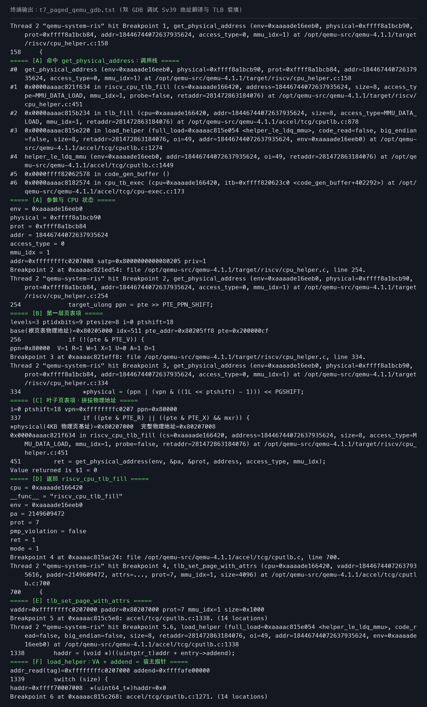
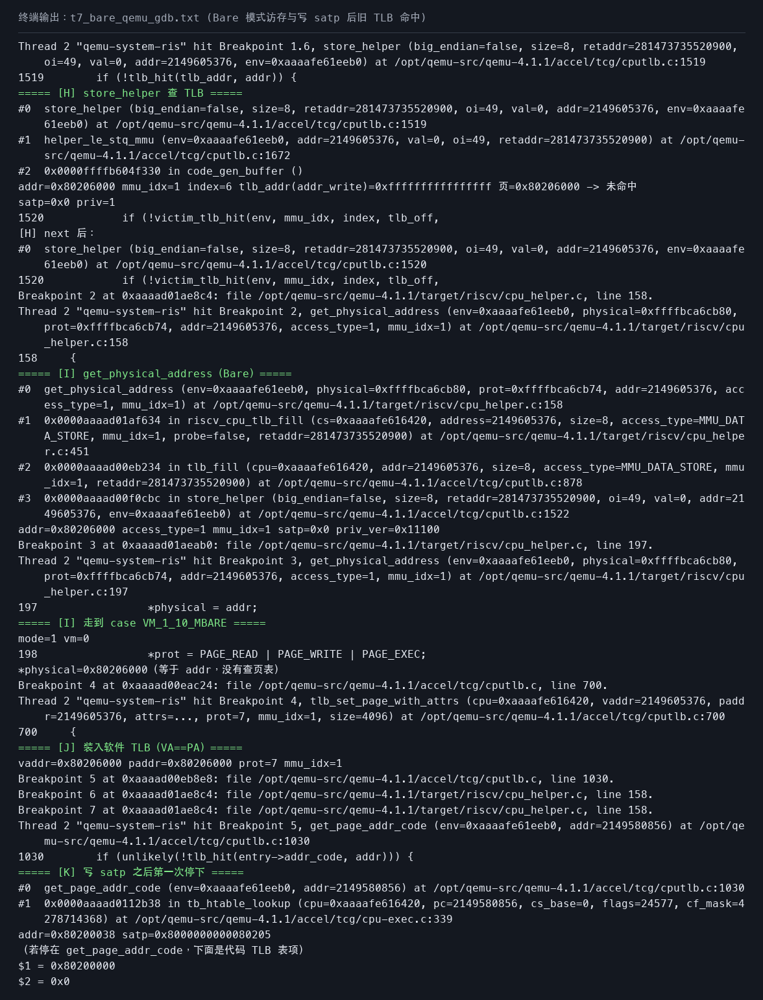
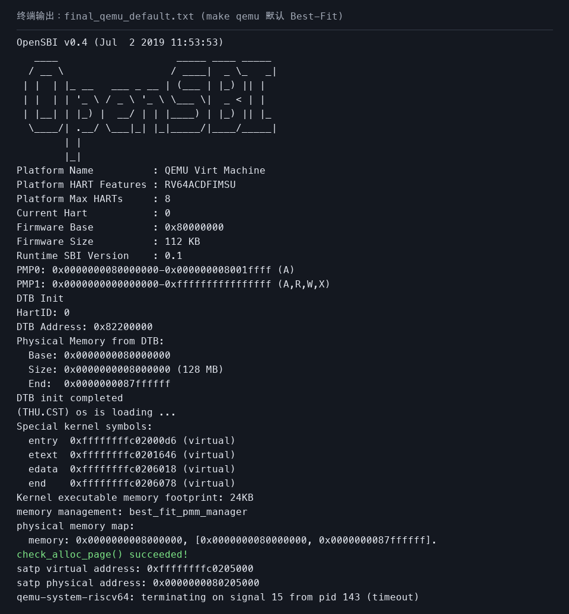
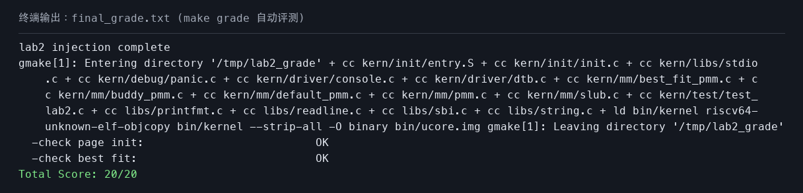
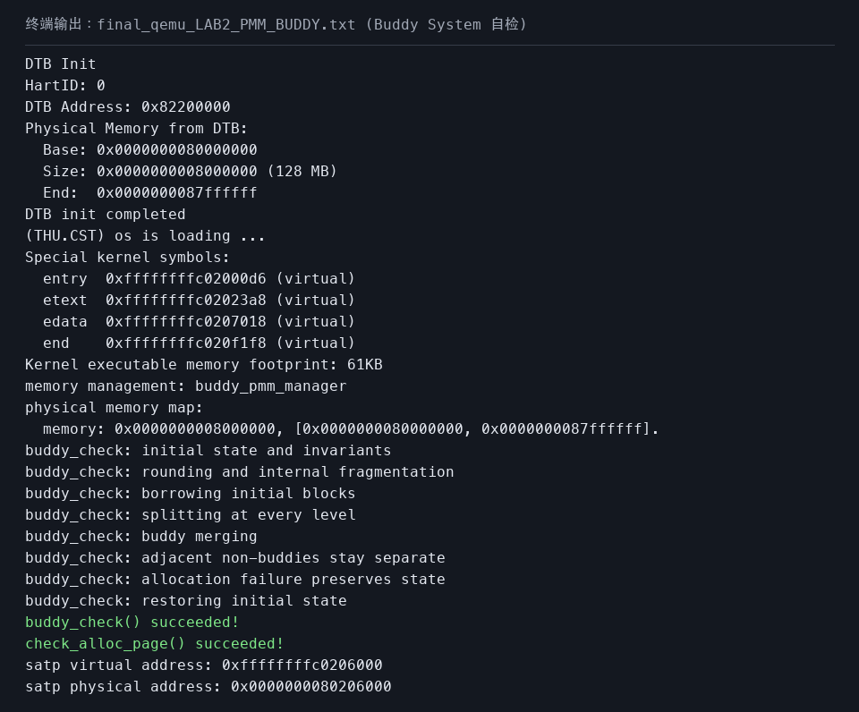
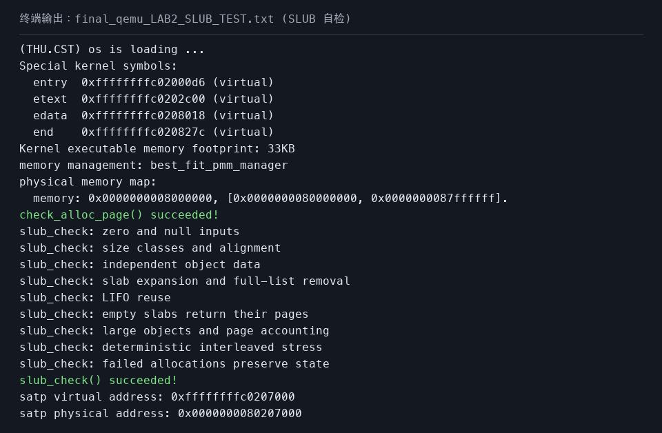

# 操作系统实验报告

## 实验基本信息

| 项目 | 内容 |
|------|------|
| **实验名称** | Lab 2：物理内存和页表 |
| **小组成员** | 2412172-许城玮（单人小组） |
| **完成日期** | 2026-10-24 |

### 小组分工

| 成员 | 负责的练习/模块 |
|------|----------------|
| 2412172-许城玮 | 单人独立完成全部编程练习、扩展任务（Buddy / SLUB / Challenge）、QEMU 双 GDB 调试及实验报告撰写 |

---

## 一、实验目的

1. 理解 RISC-V Sv39 页表的建立与地址转换流程，掌握物理地址、内核虚拟地址与物理页描述符之间的映射关系。
2. 理解操作系统物理内存探测、保留区隔离与连续物理页管理机制（`struct pmm_manager` 接口与 `struct Page` 描述符）。
3. 掌握并对比 First-Fit、Best-Fit、Buddy System（伙伴系统）页分配算法，以及在页分配器之上构建 SLUB 任意大小内存对象分配器的两层设计。
4. 通过双 GDB 调试正在运行 ucore 的 QEMU 模拟器源码，直观观察软件模拟 MMU 查软件 TLB、遍历页表与转换宿主内存地址的完整过程。
5. 掌握基于 `PROMPT / RELY / GUARANTEE / SPECIFICATION` 四段式规格的 AI 协同开发与迭代验证方法。

---

## 二、实验环境

### 使用的 AI 工具

| 成员 | AI 编程工具 | 底层模型 | 备注 |
|------|------------|---------|------|
| 2412172-许城玮 | Claude Code | Claude Opus 4.5 | 需求梳理、四段式 Spec 编写、Docker 构建验证与 GDB 调试 |
| 2412172-许城玮 | Codex CLI | GPT-5.4 | 模块代码生成、单元测试编写与交叉代码审查 |

### 软硬件与容器环境

- **宿主机与容器**：macOS（Apple Silicon）+ OrbStack Docker，使用专门构建的调试镜像 `os2026-dbg`。
- **工具链与模拟器版本**：`riscv64-unknown-elf-gcc 13.2.0`、`QEMU 4.1.1`（以 `--enable-debug` 编译，源码位于容器内 `/opt/qemu-src/qemu-4.1.1`）、`gdb-multiarch`、引导固件 `OpenSBI v0.4`（Runtime SBI Version `0.1`）。
- **为什么固定使用 QEMU 4.1.1**：`kern/init/entry.S` 中的启动页表 `boot_page_table_sv39` 前 511 项全为 0，仅第 511 项映射了 `0xFFFFFFFFC0000000` 起的 1GB 高地址空间，未建立 `0x80200000` 低地址的恒等映射。在 QEMU 8.2.2 上执行 `csrw satp, t0` 开启分页后的下一条低地址指令（`0x80200038`）会立即触发取指缺页异常（`exec_page_fault`）；而在课程配套的 QEMU 4.1.1 中，由于软件 TLB 仍保留分页前建立的低地址代码表项（详见第四节分支任务第 5 问实测分析），能够顺利过渡并跳转到高地址内核入口。

---

## 三、实验整体逻辑分析

### 3.1 本章节的逻辑主线

在计算机刚上电的瞬间，内存中尚无页表数据，CPU 无法直接依赖 MMU 完成虚实地址转换（否则会陷入“查页表需要先翻译页表地址”的死锁）。因此处理器必须先在直接输出物理地址的模式（如 x86 的实模式、RISC-V 的 `satp.MODE=Bare` 模式）下运行，由引导程序和内核入口 `entry.S` 先在物理内存中构造好启动页表 `boot_page_table_sv39`，再将页表根物理页号写入 `satp` 寄存器切换到 Sv39 虚拟内存模式，最后跳转到 `0xFFFFFFFFC0200000` 起的高虚拟地址空间执行 C 语言内核代码。

进入 C 语言环境后，本章实验围绕**“如何发现、登记并高效分配物理内存”**展开，核心主线分为三步：

1. **物理内存探测与保留区隔离**：内核必须先知道硬件提供了多少物理内存（通过 OpenSBI 传递的设备树 DTB 解析），同时必须保证内存分配器不会把 OpenSBI 固件、内核自身的代码与数据段、以及管理内存所用的 `struct Page` 描述符数组当成空闲内存分配出去。为此，链接脚本 `tools/kernel.ld` 在链接的最后阶段定义了符号 `end` 标记内核镜像的结束虚拟地址；`page_init()` 将 `Page` 描述符数组紧挨着放在 `end` 向上页对齐的位置，并将数组末尾之后的完整物理页作为真正可分配的空闲内存起点。
2. **物理内存管理器的机制与策略分离**：内核在 `pmm.h` 中定义了函数指针结构体 `struct pmm_manager`，提供统一的初始化、分配、释放与自检入口（机制），而将具体的选块与合并逻辑交由不同的实现结构体绑定（策略）。这种设计在 C 语言中起到了面向对象语言（C++/Java）**纯虚函数与多态接口**的作用，使上层调用 `alloc_pages()` / `free_pages()` 时无需关心底层究竟是 First-Fit、Best-Fit 还是 Buddy System。
3. **从连续页级分配到任意字节对象分配**：页级分配器（First-Fit / Best-Fit / Buddy）以 4KB 物理页为最小粒度；为了支撑内核中频繁的小结构体动态申请，进一步在页分配器之上构建简化的 SLUB 两层分配器，实现按字节粒度的 `kmalloc()` / `kfree()`。

### 3.2 功能的逐步实现

整个物理内存管理子系统按 `kern_init() -> dtb_init() -> pmm_init()` 的调用链依次推进，各阶段存在严格的先后依赖关系：

1. **解析硬件设备树（`dtb_init()`）**：在进入 `pmm_init()` 之前，先从设备树二进制块（DTB）中提取物理内存起始地址（`0x80000000`）与总大小（默认 128MB），为后续建立页描述符提供硬件边界。
2. **绑定并初始化物理内存管理器（`init_pmm_manager()`）**：将全局指针 `pmm_manager` 指向目标分配器实例（默认切换为 `&best_fit_pmm_manager`，编译指定 `-DLAB2_PMM_BUDDY` 时指向 `&buddy_pmm_manager`），并调用其 `init()` 初始化内部空闲链表与计数器。必须先初始化管理器，后续 `page_init()` 才能向其注册空闲内存块。
3. **建立页描述符并移交可用空闲页（`page_init()` -> `init_memmap()`）**：设置虚实地址偏移 `va_pa_offset`，计算可管理物理页号上界 `npage`，在 `end` 之后规划 `pages` 描述符数组，将全部物理页先标记为保留（`PG_reserved`），最后计算排除 OpenSBI、内核镜像和 `pages` 数组后的空闲物理区间 `[freemem, mem_end)`，调用 `init_memmap()` 一次性移交给当前管理器。
4. **实现并验证连续页分配策略（First-Fit -> Best-Fit -> Buddy System）**：先阅读理解框架默认的 First-Fit 实现，再实现 Best-Fit 并通过 `check_alloc_page()` 中的 `basic_check()` 与 `best_fit_check()` 断言自检；在此基础上扩展实现按 $2^k$ 页拆分合并的 Buddy System 及其 8 组测试。
5. **构建第二层字节级分配器（SLUB）**：以第一层 `alloc_pages()` / `free_pages()` 为底座，实现 9 级 size class 的 slab 对象缓存与大对象直通分配，并通过 9 组分配回收测试。
6. **双 GDB 观测 QEMU 地址翻译（分支任务）**：在内核能够正常启动并访问 `pages` 数组后，使用宿主 GDB 附加 QEMU 进程、客户机 GDB 连接内核，跟踪一次真实的 `pages[0].flags` 访存指令如何经过软件 TLB 查询、Sv39 页表遍历最终定位到宿主机内存。

---

## 四、实验内容与实现

### 功能模块一：物理内存初始化

#### 任务一：实现 `page_init()`（`kern/mm/pmm.c`）

**负责人：** 2412172-许城玮

##### 模块功能描述

**需要实现的函数：**

```c
// kern/mm/pmm.c
static void page_init(void);
```

**功能说明：**

`page_init()` 负责根据 `dtb_init()` 解析出的物理内存范围初始化全系统的物理页描述符数组 `pages`，并将扣除保留区后的完整空闲物理页注册到当前 `pmm_manager`。其核心处理逻辑如下：

1. **地址空间与页号映射**：本实验中 `DRAM_BASE` 为 `0x80000000`，对应的起始物理页号为 `nbase = DRAM_BASE / PGSIZE = 0x80000`。内核虚拟地址与物理地址之间存在固定线性偏移 `va_pa_offset = PHYSICAL_MEMORY_OFFSET = 0xFFFFFFFF40000000`。可管理物理内存上界 `mem_end` 取设备树内存末端与 `PHYSICAL_MEMORY_END`（`0x88000000`）的较小值并向下按页对齐；`npage = PPN(mem_end)` 表示可管理物理页号的上界，因此 `pages` 描述符数组的总元素个数为 `npage - nbase`（默认 128MB 下为 `0x8000 = 32768` 项），`pages[0]` 对应物理地址 `0x80000000`。
2. **利用链接符号 `end` 隔离内核与描述符数组**：C 代码中声明的 `extern char end[];` 在编译阶段并无具体初值，而是在编译链接的最后一步由 `tools/kernel.ld` 赋值为内核 `.text`、`.rodata`、`.data`、`.bss` 全部摆放完毕后的末尾**虚拟地址**。`page_init()` 将 `pages` 数组放置在 `ROUNDUP((uintptr_t)end, PGSIZE)` 处，先通过 `PADDR(&pages[npage - nbase])` 算出描述符数组末尾的**物理地址** `descriptors_end`，校验其未超出 `mem_end` 后，将全部 `npage - nbase` 个描述符置上 `PG_reserved` 标志。
3. **注册初始空闲区**：将 `descriptors_end` 向上按页对齐得到 `freemem`。若 `freemem < mem_end`，调用 `init_memmap(pa2page(freemem), (mem_end - freemem) / PGSIZE)` 将这段连续空闲物理页交给分配器管理；这样 `[0x80000000, 0x80200000)` 的 OpenSBI、`[0x80200000, end)` 的内核镜像以及 `[pages, descriptors_end)` 的页描述符数组全部保持 `PG_reserved` 状态，绝不会被分配器误分出去。

##### 最终提示词

完整的初版提示词与越界修复提示词原文分别收录于 [prompt.md：一、page_init 初版](prompt.md#task01) 和 [prompt.md：二、page_init 越界检查修复](prompt.md#task04)。核心四段式规格摘要如下：

````markdown
## PROMPT
在 `code/kern/mm/pmm.c` 的 `//lab2 function1 2412172` 处实现 `static void page_init(void)`：根据设备树提供的物理内存信息建立 `Page` 描述符数组，把排除 OpenSBI、内核镜像和描述符数组本身之后剩余的完整空闲页面通过 `init_memmap()` 交给当前 `pmm_manager`。

## RELY
- 全局变量：`pages`（虚拟地址）、`npage`（物理页号上界）、`va_pa_offset`、`nbase = 0x80000`。
- 接口：`get_memory_base()`、`get_memory_size()`、`PADDR(kva)`、`pa2page(pa)`、`ROUNDUP`/`ROUNDDOWN`、`SetPageReserved`、链接符号 `extern char end[]`（虚拟地址）。

## GUARANTEE
- 正确设置 `va_pa_offset`、`npage`、`pages`，按指导书格式打印 `physical memory map:`。
- OpenSBI、内核镜像及描述符数组所在页保持 `PG_reserved`，仅将完整可用页交给 `init_memmap()`。

## SPECIFICATION
- Case 1：设备树 `base == 0`、`size == 0` 或 `base + size` 溢出 -> `panic`。
- Case 2：`base + size > PHYSICAL_MEMORY_END` -> 截断至 `PHYSICAL_MEMORY_END` 并向下按页对齐。
- Case 3：数组放得下但 `ROUNDUP(descriptors_end, PGSIZE) >= mem_end` -> 保留全部描述符，打印无空闲页原因，不调用 `init_memmap()`。
- Case 4：`base != DRAM_BASE` -> `panic`。
- Case 5（第二轮迭代新增）：`descriptors_end > mem_end`（物理内存连描述符数组本身都放不下） -> 在写入任何 `pages[i]` 之前直接 `panic`。
````

##### 实现迭代过程

本模块的实现经历了 **2 次迭代**：

---

###### 第一次迭代

- **实现情况**：按照初版四段式提示词生成 `page_init()`，完成了设备树参数校验、`va_pa_offset` 与 `npage` 计算、`pages` 数组保留标记及 `init_memmap()` 空闲区注册。在默认 128MB 配置下编译通过，`make grade` 的 Test 1（`page_init`）全部 8 项断言均通过。
- **遇到的问题**：在对 `page_init()` 进行边界代码审查（见 [t3_review_page_init.md](ai_logs/lab2/evidence/t3_review_page_init.md)）时发现一处潜在越界漏洞：初版代码先执行 `for (i = 0; i < npage - nbase; i++) SetPageReserved(&pages[i]);`，之后才比较 `freemem < mem_end`。如果设备树报告的物理内存较小（例如 `base = 0x80000000, size = 0x208000`，此时 `end = 0xffffffffc0206078` 虽在内存内，但 520 个 `Page` 描述符末尾 `0x8020c140` 已超出内存上界 `0x80208000`），循环会在容量检查前向超出物理内存范围的地址写入数据。
- **问题解决策略**：修订 `SPECIFICATION`，区分“描述符数组本身越界（Case 5）”与“描述符数组放得下但剩余空间不足一整页（Case 3）”，要求在进入 `SetPageReserved` 循环前先校验 `descriptors_end <= mem_end`。

---

###### 第二次迭代

- **改进与验证**：在 `SetPageReserved` 循环前加入 `if (descriptors_end > mem_end) panic(...)` 检查。重新编译后，在默认 128MB 与 `-m 64M`（64MB 物理内存）下均运行通过，`make grade` 保持满分。
- **最终结果**：
  - ✅ 编译无警告通过（`-Werror`）
  - ✅ `make grade` Test 1 满分通过，64MB 设备树动态大小验证通过
  - ✅ 保留区与容量边界检查完整

---

#### 扩展任务 Challenge：硬件可用物理内存范围的获取方法

**负责人：** 2412172-许城玮

如果操作系统无法提前通过硬编码常量知道当前硬件的可用物理内存范围，常见的获取途径可分为**“固件/引导协议传递”**与**“操作系统主动内存探测”**两类：

1. **通过固件或引导程序接口获取（主流工业级方案）**：
   - **x86 架构（BIOS `int 15h` / UEFI）**：在 x86 实模式下，BIOS 提供了 `int 15h` 中断服务（最典型的是 `EAX=0xE820`，早期还有 `0xE801`、`0x88`），向操作系统返回一张内存布局表（Address Range Descriptor Structure），逐段说明物理地址区间的起止范围与类型（可用 RAM、BIOS 保留区、ACPI 数据区等）；在现代 UEFI 固件下，则通过 `GetMemoryMap()` 服务获取完整内存映射。
   - **RISC-V / ARM 架构（设备树 DTB / ACPI）**：嵌入式与 RISC-V 开发板没有传统 BIOS，通常使用开放标准的**设备树（Device Tree）**描述板载硬件资源，经设备树编译器（DTC）编译为二进制 DTB。上电后，底层固件 OpenSBI 将 DTB 的物理地址放在 `a1` 寄存器中传递给内核（本实验 `entry.S` 将 `a1` 保存到 `boot_dtb`，再由 `dtb_init()` 解析 `/memory` 节点的 `reg` 属性得到起始地址 `0x80000000` 和长度 `0x80000000`）。服务器级平台也可结合 ACPI 表（如 SRAT/SLIT 及固件内存映射）获取内存拓扑。
   - **OS 侧的后处理**：无论使用哪种固件接口，固件给出的只是硬件 RAM 区间，OS 自身仍需结合链接脚本符号（如本实验的 `end`）扣除固件驻留区、内核代码数据段和页管理元数据后，才能得到真正可分配的物理页范围。

2. **操作系统主动读写探测（Memory Probing）**：
   - **基本原理**：如课上所讲的早期探测思路，OS 在候选物理地址区间内按页步进，先保存目标地址原有的数值，随后依次向该地址写入特定的交替位模式（如 `0x55` 与 `0xAA`，即二进制 `01010101` 与 `10101010`，或 `0x55555555` / `0xAAAAAAAA`）并立即读回比对；若两次读回的值均与写入值严格一致，最后恢复原值，则判定该页为可正常读写的物理 RAM。
   - **局限性与工程风险**：主动写探测在现代系统中通常只作为底层固件自检手段，OS 内核直接对未知物理地址做写探测存在诸多风险：
     1. **误触 MMIO 设备寄存器**：许多外设寄存器被映射到物理地址空间（MMIO），向其写入 `0x55`/`0xAA` 可能直接触发设备复位、DMA 传输或中断等不可逆副作用，即便随后写回原值也无法撤销硬件动作。
     2. **CPU 缓存（Cache）假象**：若未禁用数据缓存或未执行缓存刷回/失效指令，写入的测试字节可能仅停留在 Cache 行中，读回比对成功但底层物理地址实际上根本没有挂载 DRAM。
     3. **地址回绕与别名（Aliasing）**：部分硬件在地址线未完全解码时会出现地址回绕，导致向高地址写入实际上覆盖了低地址的同一块物理内存，需配合跨地址交叉校验才能排除。
     4. **触发访问异常或破坏已有数据**：访问未映射的物理空洞可能直接触发 Bus Error / Access Fault，因此探测时必须先挂载异常捕获处理程序，且必须严格避开内核代码段、栈和固件驻留区。

---

### 功能模块二：物理内存分配

#### 任务一：理解 First-Fit 连续物理内存分配算法

**负责人：** 2412172-许城玮

##### First-Fit 核心函数与流程分析

`kern/mm/default_pmm.c` 基于双向循环链表 `free_area.free_list` 和空闲页计数器 `free_area.nr_free` 实现了 First-Fit（首次适应）连续物理内存分配器。其核心设计约定是：**只有每个连续空闲块的起始页（块头）才挂载到 `free_list` 链表上**，块头的 `page->property` 记录该连续空闲块的页数，并置位 `PG_property` 标志；块内其余页面不挂入链表，`property` 为 0。

1. **初始化分配器（`default_init`）**：
   调用 `list_init(&free_list)` 将空闲链表初始化为空循环链表，并将总空闲页数 `nr_free` 置为 0。
2. **初始化空闲物理页块（`default_init_memmap(base, n)`）**：
   接收 `page_init()` 传入的一段连续保留页 `[base, base + n)`。首先遍历每一页，断言其处于 `PageReserved` 状态，清空 `flags` 和 `property`（从而清除了 `PG_reserved`），并将引用计数 `ref` 置 0；随后将首页 `base->property` 设为 `n` 并调用 `SetPageProperty(base)` 标记为空闲块头；最后遍历 `free_list` 找到首个地址大于 `base` 的节点，将 `base` 插入其前面，维持链表**按物理页地址严格升序**排列，并令 `nr_free += n`。
3. **分配连续物理页（`default_alloc_pages(n)`）**：
   断言 `n > 0`；若 `n > nr_free` 则直接返回 `NULL`。否则从 `free_list` 表头开始顺序扫描，**遇到第一个满足 `p->property >= n` 的空闲块即停止搜索**。将该块头 `page` 从链表摘下：若 `page->property > n`，说明块有富余，将剩余部分的起始页 ` page + n` 设置为新块头（`property = page->property - n` 并置位 `PG_property`），插回原链表位置 `prev` 之后；最后将分配出去的 `page` 清除 `PG_property`、`nr_free -= n` 并返回 `page`。若遍历完整个链表都没有找到长度 $\ge n$ 的连续块，则返回 `NULL`。
4. **释放页面并合并相邻空闲块（`default_free_pages(base, n)`）**：
   断言释放范围内的每一页既不是保留页（`!PageReserved`）也不是已在链表中的空闲块头（`!PageProperty`），清空每页标志与引用计数后，将 `base` 设为长度 `n` 的空闲块头，按地址升序插入 `free_list` 并令 `nr_free += n`。随后利用链表的地址有序性只检查前后直接邻居：
   - **向前合并**：若前驱节点 `prev` 满足 `prev + prev->property == base`（前块末尾紧挨当前块起点），则令 `prev->property += base->property`，清除 `base` 的 `PG_property` 并将其从链表删除，同时令 `base = prev`；
   - **向后合并**：若后继节点 `next` 满足 `base + base->property == next`（当前块末尾紧挨后块起点），则令 `base->property += next->property`，清除 `next` 的 `PG_property` 并将其从链表删除。通过这两步即可在 $O(1)$ 的邻居检查内完成左合并、右合并或左右同时合并。

##### 原有 First-Fit 算法的改进空间

1. **低地址碎片聚集问题**：每次分配都从链表头（最低物理地址）开始扫描，导致低地址区域的大块被频繁切分，容易在链表前端堆积大量难以被后续请求利用的小空闲块（外部碎片），同时迫使后续搜索每次都要先跨过这些小碎片。可改用 **Next-Fit（循环首次适应）** 记录上次分配结束的游标位置，使碎片分布更均匀。
2. **线性扫描的时间开销 $O(k)$**：当空闲块数量 $k$ 较多时，`alloc_pages`（扫描查找）和 `free_pages`（按地址顺序查找插入点）都需要 $O(k)$ 时间。可通过以下数据结构优化：
   - **分级空闲链表（Segregated Free Lists）**：按块大小区间（如 $1, 2, [3,4], [5,8], \dots$）维护多条空闲链表，分配时直接定位到对应大小等级的链表查找；
   - **平衡二叉搜索树（如红黑树 / AVL 树）或伙伴系统（Buddy System）**：按地址或大小建立平衡树索引可将查找与插入复杂度降至 $O(\log k)$；若业务允许按 $2^k$ 页向上取整，则可采用 Buddy System 利用位异或直接定位伙伴块，实现快速的各级拆分与合并。

---

#### 任务二：实现 Best-Fit 连续物理内存分配算法（`kern/mm/best_fit_pmm.c`）

**负责人：** 2412172-许城玮

##### 模块功能描述

**需要实现的函数与结构体：**

```c
// kern/mm/best_fit_pmm.c
static void best_fit_init(void);
static void best_fit_init_memmap(struct Page *base, size_t n);
static struct Page *best_fit_alloc_pages(size_t n);
static void best_fit_free_pages(struct Page *base, size_t n);
static size_t best_fit_nr_free_pages(void);
const struct pmm_manager best_fit_pmm_manager;
```

**功能说明：**

Best-Fit（最佳适应）分配器与 First-Fit 共用相同的空闲块链表结构（按地址升序排列的 `free_list`、块头记录 `property` 与 `PG_property`、释放时与前后紧邻空闲块合并），核心区别在于 `best_fit_alloc_pages(n)` 的选块策略：不再遇到第一个够用的块就停下，而是**完整遍历整个 `free_list`，在所有满足 `p->property >= n` 的空闲块中选出 `p->property` 最小的一块**（若存在多个相同最小长度的块，保留最先遇到的低地址块），以尽可能减少单次大块切分时的剩余损失。模块实现完成后，在 `kern/mm/pmm.c` 的 `init_pmm_manager()` 中将 `pmm_manager` 绑定为 `&best_fit_pmm_manager`。

##### 最终提示词

完整四段式提示词收录于 [prompt.md：三、Best-Fit 连续物理内存分配器](prompt.md#task02)，核心内容如下：

````markdown
## PROMPT
在 `code/kern/mm/best_fit_pmm.c` 第 6 行注释 `//lab2 function2-2 2412172` 的位置，实现完整的 Best-Fit 连续物理内存分配模块，并定义 `const struct pmm_manager best_fit_pmm_manager` 完成注册。分配 n 页时，在所有长度 >= n 的空闲连续块中选择长度最小的那一块（同长度选地址最低块）；不得修改文件中已有的 `basic_check()` 和 `best_fit_check()`。

## RELY
- `struct pmm_manager` 接口定义（`pmm.h`）、`struct Page` 与 `free_area_t`（`memlayout.h`）、双向链表接口（`list.h`）。
- 测试函数直接访问文件级符号 `free_list` 和 `nr_free`，且要求链表按地址升序排列、仅块头置位 `PG_property` 并记录连续页数 `property`。

## GUARANTEE
- 实现 `best_fit_init`、`best_fit_init_memmap`、`best_fit_alloc_pages`、`best_fit_free_pages`、`best_fit_nr_free_pages` 及内部插入辅助函数 `best_fit_insert`，导出 `best_fit_pmm_manager`。
- 切换管理器后通过 `basic_check()`、`best_fit_check()` 及 `make grade` Test 2。

## SPECIFICATION
- `best_fit_alloc_pages(n)`：前置条件 `n > 0`；若 `n > nr_free` 返回 `NULL`；否则完整遍历 `free_list`，仅当 `p->property >= n && (page == NULL || p->property < page->property)` 时更新候选 `page`。若找到候选块，摘链并在 `page->property > n` 时将剩余 `page + n`（长度 `page->property - n`）放回原位置，清除返回块头的 `PG_property` 并将 `property` 置 0，`nr_free -= n`。
- `best_fit_free_pages(base, n)`：重置 `[base, base + n)` 状态，按地址升序插入 `free_list`，依次检查前驱 `prev + prev->property == base` 与后继 `base + base->property == next` 完成相邻合并，被吸收块头的 `property` 置 0 并清除 `PG_property`。
````

##### 实现迭代过程

- **第一次迭代**：根据上述四段式提示词在 `best_fit_pmm.c` 中实现了完整的管理函数与 `best_fit_pmm_manager` 结构体，并在 `pmm.c` 的 `init_pmm_manager()` 中将管理器切换为 `&best_fit_pmm_manager`。编译一次通过，`check_alloc_page()` 中的 `basic_check()` 和 `best_fit_check()`（特别是空闲块长度为 2 的 `p0+1` 与长度为 1 的 `p0+4` 并存时，`alloc_pages(1)` 准确命中 `p0+4` 的断言）以及 `make grade` 均一次通过，交叉代码审查（[t3_review_best_fit.md](ai_logs/lab2/evidence/t3_review_best_fit.md)）结论为 `PASS`。
- **最终结果**：
  - ✅ 编译无警告通过
  - ✅ `best_fit_check()` 与 `make grade`（20/20）全部通过

##### Best-Fit 算法的改进空间

1. **每次分配仍需全表扫描 $O(k)$**：由于链表按物理地址排序而非按块大小排序，为了找到全局最小的满足块，即使第一个块已经大于 $n$（除非恰好等于 $n$ 可以提前终止），也必须遍历完整个链表。首先可以在 `p->property == n` 时立即 `break` 提前结束循环；更进一步，可以使用两棵平衡二叉搜索树（一棵以 `(size, addr)` 为键用于 $O(\log k)$ 查找最佳匹配块，另一棵以 `addr` 为键用于释放时 $O(\log k)$ 查找前后相邻块合并）。
2. **极小剩余碎片问题**：Best-Fit 总是挑选最接近请求大小 $n$ 的空闲块，一旦块大小略大于 $n$（例如请求 4 页而选中 5 页块），切分后留下的 1 页余块往往非常细碎，长期运行后容易产生大量难以再利用的极小外部碎片。在工程中可以结合设置“最小切分阈值”（若余块小于阈值则整块分配不切分）或配合二级小对象分配器（如 SLUB）共同缓解。

---

#### 任务三：Buddy System（伙伴系统）分配算法（`kern/mm/buddy_pmm.[ch]`）

**负责人：** 2412172-许城玮

##### 模块功能描述

**需要实现的函数与结构体：**

```c
// kern/mm/buddy_pmm.h & kern/mm/buddy_pmm.c
#define MAX_ORDER 15
extern const struct pmm_manager buddy_pmm_manager;
void buddy_check(void);
```

**功能说明：**

1. **数据结构与阶（Order）设计**：设置 `MAX_ORDER = 15`（最大单块为 $2^{15} = 32768$ 页 = 128MB），维护 `free_areas[0 .. MAX_ORDER]` 数组，每个阶 `k` 包含一条按地址升序排列的双向链表 `free_list` 和块计数 `nr_blocks`。同时记录管理区起点 `region_base`、总页数 `region_pages` 和当前空闲页数 `nr_free`。空闲块头置位 `PG_property`，并在 `page->property` 中保存该块的阶 `k`；已分配块头清除 `PG_property`，但保留 `page->property = k` 供释放时校验阶数。
2. **非 $2^k$ 初始区域的贪心对齐切分（`buddy_init_memmap`）**：`page_init()` 移交的可用空闲页数（默认 128MB 下约为 `0x7df9 = 32249` 页）并非 2 的整数次幂。本实现以相对下标 `idx = page - region_base` 为对齐基准，从 `idx = 0` 开始循环：在当前位置选择同时满足 `idx % (1 << k) == 0` 且 `idx + (1 << k) <= n` 的最大阶 `k`，切出一块挂入 `free_areas[k]`，然后令 `idx += (1 << k)` 继续，从而在不丢页、不越界的前提下将任意长度的连续区域精确分解为若干对齐的 $2^k$ 块。
3. **分配拆分（`buddy_alloc_pages`）与异或合并（`buddy_free_pages`）**：
   - 分配 `n` 页时，先向上取整到最小的 $2^k \ge n$；从 `j = k` 向上查找最小的非空阶链表，取出首块（最低地址）。若 `j > k`，循环令 `j--`，每次将高地址半块 `block + (1 << j)` 作为 `order j` 空闲块挂回链表，保留低地址半块继续向下拆分，最终扣除 `nr_free -= (1 << k)`（多出的 $2^k - n$ 页为内部碎片，随整块一起管理）。
   - 释放时，校验传入的 `n` 向上取整后的阶与块头记录的 `k` 一致，计算伙伴块的相对下标 `buddy_idx = idx ^ (1 << k)`。仅当伙伴块在管理区域内、`PageProperty(buddy)` 为真且 `buddy->property == k` 时，才将伙伴从链表摘下，以 `min(idx, buddy_idx)` 为新块头升级为 `k + 1` 阶并继续向上尝试合并，直至伙伴不空闲或达到 `MAX_ORDER`。
4. **内核接入方式**：在 `kern/mm/pmm.c` 的 `init_pmm_manager()` 中通过条件编译宏 `LAB2_PMM_BUDDY` 接入：执行 `make DEFS=-DLAB2_PMM_BUDDY` 时切换为 `&buddy_pmm_manager` 并运行 `buddy_check()`；默认 `make` 仍使用 `best_fit_pmm_manager`，不影响 `make grade` 评分。

##### 两份提示词设计

- **第一份提示词（生成 Buddy 分配模块并接入内核）**：见 [prompt.md：五、Buddy System 实现提示词](prompt.md#task09)。通过 `SPECIFICATION` 明确规定了 `MAX_ORDER`、相对下标对齐基准 `idx = page - region_base`、非 2 的幂初始区域的贪心切分规则、拆分时“返回低地址半块、挂回高地址半块”的确定性约定，以及 `idx ^ (1 << k)` 伙伴合并条件。
- **第二份提示词（生成 Buddy 测试函数）**：见 [prompt.md：六、Buddy System 测试提示词](prompt.md#task10)。要求在不修改分配器实现的前提下，围绕不变量、取整、借块隔离、逐级拆分、伙伴合并、相邻非伙伴不合并、失败路径和初态恢复编写 8 组白盒+黑盒测试。

##### 测试覆盖与有效性分析（含变异测试验证）

`buddy_check()`（`kern/mm/buddy_pmm.c:176-395`）共包含 8 组测试，并在每个关键阶段调用 `buddy_assert_invariants()` 对全表结构做白盒不变量检查：

| 测试组 | 覆盖的核心行为与边界情况 | 为什么能有效检验实现 |
|---|---|---|
| **1. 初态与全局不变量** | 校验 `nr_free == region_pages`；遍历所有阶链表校验 `PageProperty`、`property == order`、相对下标 $2^k$ 对齐、地址严格升序、`Σ(nr_blocks * 2^k) == nr_free`，并用位图排除同阶/跨阶块重叠 | 验证非 2 的幂初始区域切分后无丢页、无越界、无重叠，且后续每组操作后均调用该函数防止结构静默损坏 |
| **2. 向上取整与内部碎片** | 依次申请 3、1、5、8 页，`nr_free` 必须分别减少 4、1、8、8 页（共 21 页）；将整块 $2^k$ 页的 `ref` 置 1 后释放 | 检验非 $2^k$ 请求向上取整扣账是否准确，以及释放时是否完整清理并归还含内部碎片在内的整块 $2^k$ 页 |
| **3. 借块构造隔离区** | 记录初始各阶块数快照，将所有初始块借出直至 `nr_free == 0`，仅归还最大阶块作为单块隔离区 | 消除初始零散小块的干扰，迫使后续分配必须从唯一的大块逐级向下拆分 |
| **4. 每一级逐级拆分** | 在单个大块隔离区上申请 1 页（order 0），验证返回最低地址，且从 `0` 到 `top_order - 1` 每一阶恰好各多出 1 个空闲伙伴块，下标严格等于 `first_idx ^ (1 << k)` | 精确检验拆分方向（保留低地址、挂回高地址）、拆分阶数以及拆出伙伴块的标志与位置 |
| **5. 互为伙伴逐级合并** | 分配两个互为伙伴的 1 页块 `first` 和 `second`；先释放 `first` 验证其停留在 order 0 不合并，再释放 `second` 验证其一路级联合并回原来的最大阶块 | 验证“单方空闲不合并、双方空闲级联合并”以及合并过程中旧块头 `PG_property` 的清理 |
| **6. 相邻非伙伴不合并** | 分配 4 个连续 1 页块（相对偏移 0、1、2、3），释放中间两块（偏移 1 和 2，物理相邻但 `1 ^ 1 = 0 != 2`） | 检验分配器是否严格按异或伙伴关系合并，防止把 First-Fit 的“只要地址相邻就合并”错误照搬到 Buddy 中 |
| **7. 失败路径状态保持** | 测试 `alloc(nr_free + 1)`、`alloc((1 << MAX_ORDER) + 1)` 以及耗尽全部内存后的 `alloc(1)` | 确认超界与内存耗尽时均返回 `NULL`，且不会污染现有空闲链表或修改 `nr_free` |
| **8. 完整恢复初态** | 归还全部借出的块，对比各阶 `nr_blocks`、块头地址与测试前快照完全一致 | 证明经过多轮拆分与合并后，分配器能无泄漏、无结构退化地完全还原初始状态 |

为了进一步检验这 8 组测试本身是否能抓出实现缺陷，我们在临时副本中对 `buddy_pmm.c` 做了 3 项**变异测试（Mutation Testing）**（原始日志见 [t10_mutation.txt](ai_logs/lab2/evidence/t10_mutation.txt)）：
- **变异 M1（禁用合并循环 `while (0 && ...)`）**：在第 3 组 `borrowing initial blocks` 的 `buddy_pmm.c:304` 触发 `assert(free_areas[k].nr_blocks == initial_counts[k])` 失败——第 2 组释放后虽然总页数恢复，但因未合并导致各阶块数无法恢复初态，被测试当场捕获。
- **变异 M2（反转拆分方向：挂回低地址、返回高地址）**：在第 4 组 `splitting at every level` 触发 `assert(first == isolated)` 失败，准确检出拆分方向与规格不符。
- **变异 M3（扣减空闲页数时写成 `nr_free -= n` 而非 `nr_free -= (1 << order)`）**：在第 2 组 `rounding and internal fragmentation` 的 `buddy_pmm.c:229` 触发 `assert(before >= size && nr_free == before - size)` 失败，当场抓出 `alloc(3)` 漏扣内部碎片页的错误。

---

#### 任务四：任意大小的内存单元 SLUB 分配算法（`kern/mm/slub.[ch]`）

**负责人：** 2412172-许城玮

##### 模块功能描述

**需要实现的函数：**

```c
// kern/mm/slub.h & kern/mm/slub.c
void slub_init(void);
void *kmalloc(size_t size);
void kfree(void *ptr);
void slub_check(void);
```

**功能说明：**

本模块参考 Linux SLUB 核心思想，实现了简化的两层内核内存分配器：

1. **两层架构职责划分**：
   - **第一层（页级分配）**：直接调用内核 `pmm_manager` 提供的 `alloc_pages(n)` 和 `free_pages(base, n)` 获取或归还连续物理页。
   - **第二层（字节级对象分配）**：对外提供 `kmalloc(size)` 与 `kfree(ptr)`。共设置 9 个固定大小等级（size classes）：`8, 16, 32, 64, 128, 256, 512, 1024, 2048` 字节，每个等级对应一个 `struct slub_cache`，维护 `partial` 链表（挂载仍有空闲对象的 slab 页）。当请求 `0 < size <= 2048` 时，向上匹配最小的 size class 从对应 cache 分配；当 `size > 2048` 时走大对象路径，直接向第一层申请连续物理页。
2. **Slab 页内布局与内嵌 Freelist**：
   - **为什么不在 `struct Page` 中存放 SLUB 元数据**：`struct Page` 的 `property` 和 `flags` 字段归第一层物理内存管理器所有（例如 Buddy 分配器会在已分配块头的 `property` 中保存块的阶 `order`）。若 SLUB 借用 `Page` 字段存放自身指针，释放整页回第一层时就会破坏第一层的不变量。因此，本实现将 slab 元数据保存在分配出的物理页起始处，实现两层完全解耦。
   - **小对象页内布局**：每个 slab 占 1 个物理页（4096B），页首放置 48 字节的 `struct slab_header`（含校验魔数 `SLAB_MAGIC = 0x534c55424d414749ULL`、所属 `cache` 指针、空闲对象计数 `nr_free`、空闲单链表头 `freelist`、双向链表节点 `link`）。对象区起点为 `object_offset = ROUNDUP(sizeof(slab_header), object_size)`，每页可容纳 `(PGSIZE - object_offset) / object_size` 个对象。对象处于空闲态时，直接利用对象自身的前 8 个字节存放下一个空闲对象的指针（内嵌 freelist，零额外指针开销）；对象分配与释放采用头插法（LIFO 复用），当一个 slab 的对象全部用尽时从 `partial` 链表摘除，当一个 slab 的对象全部释放变为空页时立即调用 `free_pages()` 归还给第一层。
   - **大对象页内布局**：页首放置 16 字节的 `struct large_header`（含魔数 `LARGE_MAGIC` 与所占页数 `npages`），向第一层申请 `ROUNDUP(size + sizeof(large_header), PGSIZE) / PGSIZE` 页，返回页头之后的地址。`kfree(ptr)` 时只需通过 `ROUNDDOWN((uintptr_t)ptr, PGSIZE)` 找到所在页起始处的页头，根据魔数即可区分是小对象 slab 还是大对象页，并校验地址对齐与边界。
3. **内核接入方式**：在 `kern/mm/pmm.c` 的 `pmm_init()` 中通过宏 `LAB2_SLUB_TEST` 接入：执行 `make DEFS=-DLAB2_SLUB_TEST` 时，在物理页自检完成后依次调用 `slub_init()` 与 `slub_check()`。

##### 两份提示词设计

- **第一份提示词（生成 SLUB 两层分配模块）**：见 [prompt.md：七、SLUB 分配器实现提示词](prompt.md#task11)。明确了第一层与第二层的接口边界、页内 `slab_header` / `large_header` 布局、不可占用 `struct Page` 字段的约束，以及虚拟地址与 `struct Page *` 之间通过 `page2pa(page) + va_pa_offset` 和 `pa2page(PADDR(kva))` 转换（因为 `pmm.h` 中 `KADDR` 宏被注释）。
- **第二份提示词（生成 SLUB 测试函数）**：见 [prompt.md：八、SLUB 分配器测试提示词](prompt.md#task12)。设计了覆盖零值/空指针、19 种大小选级与对齐、数据独立性、跨页扩展、LIFO 复用、空 slab 退页、大对象分配、伪随机交错压力测试及失败路径的 9 组测试。

##### 测试覆盖与有效性分析（含变异测试验证）

`slub_check()`（`kern/mm/slub.c:219-460`）包含以下 9 组测试：

| 测试组 | 覆盖的核心行为与边界情况 | 为什么能有效检验实现 |
|---|---|---|
| **1. 边界输入（Zero & NULL）** | 验证 `kmalloc(0) == NULL`、`kfree(NULL)` 安全返回，前后各 cache 统计与 `nr_free_pages()` 不变 | 防止零长度请求误耗物理页或空指针释放触发非法访存 |
| **2. 选级与对齐（Size Classes）** | 针对 `1, 8, 9, 16, 17, 31, 32, 33, ..., 2048` 共 19 个跨边界大小逐一分配，白盒检查所属 `cache->object_size`、8 字节对齐、页头魔数与页内步长偏移 | 精确验证“向上取最小可用 class”的选级边界与页内对象步长布局 |
| **3. 对象数据独立性** | 保持上组 19 个对象同时存活，按各对象真实请求长度写入互异特征字节并逐一读回校验，释放过程中持续复核未释放对象数据 | 能直接检出对象区间重叠、越界覆盖或内嵌 freelist 指针破坏在用对象数据 |
| **4. Slab 跨页扩展与满页摘链** | 对 64B cache 连续分配 `objects_per_slab + 1`（64 个）对象，验证 `nr_slabs == 2`、首尾对象位于不同物理页，且首个用满的 slab 已不在 `partial` 链表中 | 检验单页容量上限计算、向第一层动态申请新页以及满 slab 从 `partial` 摘链的逻辑 |
| **5. LIFO 空闲对象复用** | 在已满的第 1 个 slab 中释放 1 个对象（验证该 slab 重新挂回 `partial`），紧接着再申请 1 个 64B 对象，断言返回地址与刚释放的地址完全相同 | 证明对象级缓存与内嵌 freelist LIFO 复用生效，而非每次都重新向第一层申请新页 |
| **6. 空 Slab 物理页归还** | 将第 4 组分配的 64 个对象全部释放，断言 `nr_slabs == 0`、`nr_inuse == 0`，且第一层 `nr_free_pages()` 完全恢复到分配前数值 | 确认空 slab 被及时归还给底层页分配器，无物理页泄漏 |
| **7. 大对象分配与跨页核算** | 分别申请 `2049`、`4080`（`PGSIZE - 16`，含 16B 页头恰好 1 页）、`4096`（含页头占 2 页）、`12289`（占 4 页），核对 `nr_free_pages()` 扣减量并全量读写校验 | 覆盖大小等级上限边界、恰好单页边界与多页大对象分配及归还 |
| **8. 确定性交错压力测试** | 使用固定种子的线性同余伪随机序列，在 32 个槽位上执行 512 次 `1 ~ 3000B` 的随机分配、数据校验与释放，结束后全部回收 | 检验小对象与大对象混合生命周期、频繁扩缩容下的链表与计数器一致性 |
| **9. 失败路径状态保持** | 请求 `(size_t)-1`（触发大小加法溢出防护）和 `(nr_free_pages() + 1) * PGSIZE`（超出总物理内存） | 验证异常大请求安全返回 `NULL`，且不改变已有对象或泄漏页面 |

同样，我们在临时副本中对 `slub.c` 做了 3 项**变异测试**（原始日志见 [t12_mutation.txt](ai_logs/lab2/evidence/t12_mutation.txt)）：
- **变异 S1（注释掉空 slab 释放时的 `free_pages`）**：在第 3 组末尾 `slub.c:223` 触发 `assert(nr_free_pages() == expected_pages)` 失败，直接抓出底层物理页泄漏。
- **变异 S2（将选级条件 `size_classes[i] >= size` 改为 `>`）**：在第 2 组 `slub.c:265` 触发 `assert(slab->cache == cache && cache->object_size == size_classes[class_idx])` 失败，抓出恰好等于等级边界（如 8B 落入 16B）的选级偏移错误。
- **变异 S3（将对象步长错写为 `object_size / 2`）**：在第 2 组 `slub.c:255` 触发 `assert(ptr != NULL && ((uintptr_t)ptr & 7) == 0)` 失败（8B 等级第 2 个对象偏移变为 4B 破坏了 8 字节对齐），立即阻断了后续重叠写入。

---

### 分支任务：gdb 调试页表查询过程

**负责人：** 2412172-许城玮

#### 调试环境与双 GDB 协作方式

在镜像 `os2026-dbg` 中，QEMU 4.1.1 已带 `--enable-debug` 选项编译，源码位于容器内 `/opt/qemu-src/qemu-4.1.1`，容器同时具备 `SYS_PTRACE` 权限。因此无需执行指导书中“重新编译 QEMU、修改 Makefile 路径、`sudo gdb`”三步，直接使用课程目录下的 `os2026.sh` 开启三个终端即可完成双重调试（完整交互演示手册见 [分支任务演示步骤.md](ai_logs/lab2/分支任务演示步骤.md)）：

1. **终端 1（启动被调 QEMU 模拟器）**：执行 `./os2026.sh debug`，在容器内以 `-s -S` 启动调试版 QEMU 4.1.1，模拟器暂停在初始状态并开放 `1234` 远程调试端口。
2. **终端 2（宿主 GDB 调试 QEMU 源码）**：执行 `./os2026.sh gdb-qemu`，自动查找到容器内 `qemu-system-riscv64` 进程 PID 并 `attach`，设置 `handle SIGPIPE nostop noprint`，在 QEMU 的 C 源码（如 `riscv_cpu_tlb_fill`、`get_physical_address`）打上关于目标虚拟地址的条件断点后输入 `continue`。
3. **终端 3（客户机 GDB 调试 ucore 内核）**：执行 `./os2026.sh gdb`，使用 `gdb-multiarch` 加载 `bin/kernel` 符号表并连接 `localhost:1234`（已配置 `set remotetimeout unlimited` 防止当 QEMU 在终端 2 被断点挂起时终端 3 报 `Ignoring packet error`），输入 `continue` 让 ucore 向前运行。

**需要注意的调试细节**：当在终端 3 使用客户机 GDB 打印内核虚拟地址内容（如 `x/gx`）时，GDB stub 会通过 `cpu_memory_rw_debug -> riscv_cpu_get_phys_page_debug` 调用 `get_physical_address`。为了避免把 GDB 自身的调试读内存误当成 CPU 正常指令访存，我们在终端 2 先将条件断点设在只由 CPU 真实访存慢路径进入的 `riscv_cpu_tlb_fill`（`target/riscv/cpu_helper.c:451`，条件为 `address == $va && access_type == 0`），命中后再 `step` 进入 `get_physical_address` 单步跟踪。

---

#### 问题 1：理解调试涉及的 QEMU 源码，给出关键调用路径与分支语句，并演示一次访存虚拟地址如何翻译为物理地址

##### 1. 完整调用路径

当 ucore 在 S 态执行一条 8 字节数据加载指令（如 `ld`）且未命中 TCG 生成代码的快速内联 TLB 时，QEMU 4.1.1 的完整调用链如下：

```text
code_gen_buffer (TCG 翻译生成的宿主机器码)
  -> helper_le_ldq_mmu()             [accel/tcg/cputlb.c:1446-1450]
    -> load_helper()                 [accel/tcg/cputlb.c:1247-1365]
      -> tlb_hit()                   [include/exec/cpu-all.h:359-361]  (主软件 TLB 未命中)
      -> victim_tlb_hit()            [accel/tcg/cputlb.c:977-1010]     (Victim TLB 未命中)
      -> tlb_fill()                  [accel/tcg/cputlb.c:868-879]
        -> riscv_cpu_tlb_fill()      [target/riscv/cpu_helper.c:438-484]
          -> get_physical_address()  [target/riscv/cpu_helper.c:158-360] (执行 Sv39 页表遍历，算出客户机物理页基址)
          -> tlb_set_page_with_attrs() [accel/tcg/cputlb.c:700-831]      (将 VA->宿主 RAM addend 填入软件 TLB)
    <- 返回 load_helper()
    -> haddr = addr + entry->addend  [accel/tcg/cputlb.c:1338]
    -> ldq_le_p(haddr)               [accel/tcg/cputlb.c:1361]         (从宿主机内存读出 8 字节数据返回)
```

##### 2. 路径上的关键分支语句

1. **软件 TLB 与 Victim TLB 分支（`accel/tcg/cputlb.c:1271-1278`）**：
   ```c
   if (!tlb_hit(tlb_addr, addr)) {
       if (!victim_tlb_hit(env, mmu_idx, index, tlb_off, addr & TARGET_PAGE_MASK)) {
           tlb_fill(env_cpu(env), addr, size, access_type, mmu_idx, retaddr);
           ...
       }
   }
   ```
   先查当前特权级 `mmu_idx` 对应的软件主 TLB 表项；若未命中，再查容量为 8 项的 `victim_tlb`（命中则与主表交换表项，不触发页表遍历）；只有两者均未命中时才调用 `tlb_fill` 进入硬件架构相关的页表遍历。
2. **特权级与 Bare 模式直通分支（`target/riscv/cpu_helper.c:171-199`）**：
   - 若当前有效特权级为 M 态（`mode == PRV_M` 且非取指或未开启 `MPRV`），或 CPU 不支持 MMU，直接令 `*physical = addr` 返回 `TRANSLATE_SUCCESS`（`:171-174`）。
   - 读取 `satp` 寄存器的 `MODE` 字段：若为 `VM_1_10_MBARE`（即 `satp.MODE == 0`，未开启分页），同样直接令 `*physical = addr`、`*prot = PAGE_READ | PAGE_WRITE | PAGE_EXEC` 并返回成功（`:196-199`），不执行后续页表循环。
3. **Sv39 虚拟地址合法性（符号扩展）分支（`cpu_helper.c:223-229`）**：
   Sv39 有效虚拟地址宽度为 39 位（bit 0..38），硬件规范要求高 25 位（bit 39..63）必须与第 38 位（符号位）完全相同，否则直接返回 `TRANSLATE_FAIL`。
4. **页表项（PTE）有效性、非叶节点下探与权限检查分支（`cpu_helper.c:256-288`）**：
   - `!(pte & PTE_V)`：有效位 `V == 0`，页表项无效，返回 `TRANSLATE_FAIL`（`:256`）。
   - `!(pte & (PTE_R | PTE_W | PTE_X))`：`V == 1` 且 `R/W/X` 全为 0，表示该项是指向下一级页表的**目录项（非叶子节点）**，将 `base = ppn << PGSHIFT` 更新为下一级页表物理基址，进入下一轮循环（`:258-261`）。
   - `(pte & (PTE_R | PTE_W | PTE_X)) == PTE_W`：只有写权限没有读权限属于 RISC-V 保留非法组合，返回失败（`:262-267`）。
   - **叶子节点特权级与访问类型检查（`:268-288`）**：
     - 若 `pte & PTE_U`（用户页）：S 态下除非 `mstatus.SUM == 1` 且为数据读写（非取指），否则禁止访问；
     - 若 `!(pte & PTE_U)`（内核页）：仅允许 S 态访问，U 态禁止访问；
     - 大页对齐检查：`ppn & ((1UL << ptshift) - 1)` 必须为 0（如 1GB 大页要求 `ptshift = 18`，即 `ppn` 低 18 位全为 0），否则为非对齐大页（misaligned superpage），返回失败；
     - 读写执行权限匹配：读访问要求 `PTE_R`（或开启 `mstatus.MXR` 时有 `PTE_X`），写访问要求 `PTE_W`，取指要求 `PTE_X`。
5. **A/D 位原子更新与页基址拼接分支（`cpu_helper.c:291-334`）**：
   检查并原子置位访问位 `PTE_A`（写操作还需置位脏位 `PTE_D`），随后通过 `*physical = (ppn | (vpn & ((1L << ptshift) - 1))) << PGSHIFT` 拼接出 4KB 物理页基址。
6. **翻译结果处理分支（`cpu_helper.c:471-479`）**：
   `riscv_cpu_tlb_fill` 根据 `get_physical_address` 的返回值分支：若为 `TRANSLATE_SUCCESS`，调用 `tlb_set_page_with_attrs()` 将该 4KB 页映射装入软件 TLB；若失败，则调用 `raise_mmu_exception()` 设置 `scause` / `stval` 并通过 `cpu_loop_exit_restore()` 触发客户机缺页异常。

##### 3. 实测演示：一次虚拟地址访存的完整翻译过程

我们选取 `page_init()` 中第一次调用 `SetPageReserved(&pages[0])` 时读取 `pages[0].flags` 的访存指令进行实测跟踪（对应虚拟地址 `0xffffffffc0207008`，因为 `pages` 数组起始于 `ROUNDUP(end, PGSIZE) = 0xffffffffc0207000`，而 `flags` 字段在 `struct Page` 内偏移为 8 字节）。完整 GDB 实测输出见图 5 及 [t7_paged_qemu_gdb.txt](ai_logs/lab2/evidence/t7_paged_qemu_gdb.txt)：

- **停点 [A]（进入 `get_physical_address`）**：
  调用栈为 `cpu_tb_exec -> code_gen_buffer -> helper_le_ldq_mmu -> load_helper -> tlb_fill -> riscv_cpu_tlb_fill -> get_physical_address`。此时传入参数 `addr = 0xffffffffc0207008`、`access_type = 0`（`MMU_DATA_LOAD`）、`mmu_idx = 1`（S 态）、`env->satp = 0x8000000000080205`、`env->priv = 1`。
- **停点 [B]（查询根页表项）**：
  在 `cpu_helper.c:254` 测得：`levels = 3, ptidxbits = 9, ptesize = 8, i = 0, ptshift = 18`，根页表物理基址 `base = 0x80205000`，索引 `idx = 511`，页表项物理地址 `pte_addr = 0x80205ff8`，读出 `pte = 0x200000cf`（`ppn = 0x80000`，标志位 `V=1, R=1, W=1, X=1, U=0, A=1, D=1`）。
- **停点 [C]（大页叶子拼接物理地址）**：
  由于 `R/W/X` 非零，第 0 层即为 1GB 大页叶子节点。在 `cpu_helper.c:334` 测得 `vpn = 0xffffffffc0207`，拼接得到 4KB 物理页基址 `*physical = 0x80207000`，加上页内偏移 `0x8` 得到目标数据的完整客户机物理地址 `0x80207008`。
- **停点 [D] & [E]（返回并装填软件 TLB）**：
  `get_physical_address` 返回 `0`（`TRANSLATE_SUCCESS`），随后调用 `tlb_set_page_with_attrs`，实测参数为 `vaddr = 0xffffffffc0207000, paddr = 0x80207000, prot = 7, mmu_idx = 1, size = 0x1000`。
- **停点 [F]（通过 `addend` 计算宿主内存指针并完成读取）**：
  回到 `load_helper`（`cputlb.c:1338`），此时软件 TLB 表项 `entry->addr_read = 0xffffffffc0207000`，`entry->addend = 0xffffafe00000`，通过 64 位无符号加法 `haddr = (void *)((uintptr_t)addr + entry->addend)` 算出宿主机进程内的虚拟地址 `haddr = 0xffff70007008`，并从该地址读出 8 字节初值 `0x0`。



---

#### 问题 2：单步调试页表翻译部分，解释关键操作流程

在 `target/riscv/cpu_helper.c:184-345` 中，QEMU 用一个三层 `for` 循环模拟硬件 MMU 的多级页表遍历。结合上述实测数值，单步流程如下：

1. **解析 `satp` 寄存器确定页表规格（`:184-213`）**：
   实测 `env->satp = 0x8000000000080205`。最高 4 位 `MODE = 8` 表示启用 **Sv39** 三级页表模式，因此代码设置 `levels = 3`（共 3 级页表）、`ptidxbits = 9`（每级页表索引占 9 位，含 $2^9 = 512$ 项）、`ptesize = 8`（每项 8 字节）；低 44 位为根页表物理页号 `PPN = 0x80205`，左移 `PGSHIFT`（12 位）得到根页表物理基址 `base = 0x80205000`（恰好对应 `entry.S` 中的 `boot_page_table_sv39`）。
2. **三层循环的步进控制（`:231-242`）**：
   循环初始令 `ptshift = (levels - 1) * ptidxbits = 18`，每下一层令 `ptshift -= 9`（即 `i = 0, 1, 2` 分别对应 `ptshift = 18, 9, 0`，依次提取虚拟地址的 `VPN[2]`、`VPN[1]`、`VPN[0]`）：
   ```c
   for (i = 0; i < levels; i++, ptshift -= ptidxbits) {
       target_ulong idx = (addr >> (PGSHIFT + ptshift)) & ((1 << ptidxbits) - 1);
       target_ulong pte_addr = base + idx * ptesize;
       ...
   ```
   在 `i = 0`（根页表 L2）时，对 `addr = 0xffffffffc0207008` 右移 `12 + 18 = 30` 位再取低 9 位，算出 `idx = 511`；从而算出该页表项在物理内存中的地址为 `pte_addr = 0x80205000 + 511 * 8 = 0x80205ff8`。
3. **从客户机物理内存读取 PTE（`:252`）**：
   64 位模式下调用 `target_ulong pte = ldq_phys(cs->as, pte_addr);`。注意这里调用的是物理内存读取接口 `ldq_phys`——因为页表基址和 `pte_addr` 本身就是物理地址，硬件 MMU 直接通过物理总线读取页表项，绝不会对 `pte_addr` 再递归做一次虚拟地址翻译。实测读出 `pte = 0x200000cf`，右移 `PTE_PPN_SHIFT`（10 位）得到 `ppn = 0x80000`，低 8 位标志为 `0xcf`（`V|R|W|X|A|D` 全为 1，`U = 0`）。
4. **为什么本次实测只走了一层循环，以及 4KB 页表的三层流程对比**：
   - 在本实验中，`entry.S` 将第 511 号根页表项直接配置成了 `R=1, W=1, X=1` 的叶子项（`0x200000cf`）。根据 RISC-V Sv39 规范，当 `i = 0`（`ptshift = 18`）的页表项直接置位 `R` 或 `X` 时，它就是一个 **1GB 大页（Gigapage）叶子节点**，因此在第 0 层就直接进入 `else` 分支合成物理地址并返回，无需再查后两级页表。
   - 如果是标准的 **4KB 细粒度页映射**，那么 `i = 0`（L2）和 `i = 1`（L1）读出的 PTE 其 `V = 1` 且 `R = W = X = 0`，会命中 `cpu_helper.c:258` 的非叶子分支 `base = ppn << PGSHIFT`，将 `base` 更新为下一级页表的物理基址并继续循环；直到 `i = 2`（`ptshift = 0`，L0 页表）才读到 `R/W/X` 非零的 4KB 叶子 PTE。
5. **大页与普通页统一的物理地址合成公式（`:333-334`）**：
   ```c
   target_ulong vpn = addr >> PGSHIFT;
   *physical = (ppn | (vpn & ((1L << ptshift) - 1))) << PGSHIFT;
   ```
   这一行精妙地同时处理了 1GB 大页（`ptshift = 18`）、2MB 大页（`ptshift = 9`）和 4KB 普通页（`ptshift = 0`）：对于本次 1GB 大页，`ppn = 0x80000` 的低 18 位为 0，位或操作把虚拟页号 `vpn = 0xffffffffc0207` 的低 18 位（`0x207`）填进 `ppn` 的低 18 位得到物理页号 `0x80207`，左移 12 位得到该 4KB 页的物理基址 `*physical = 0x80207000`。

---

#### 问题 3：在 QEMU 4.1.1 源码中找到模拟 CPU 查找 TLB 的 C 代码，并结合调试说明细节

##### 1. 模拟查找 TLB 的 C 源码位置

在 QEMU 4.1.1 中，软件 TLB 查找的 C 语言入口位于 `accel/tcg/cputlb.c`：
- **数据读（Load）路径**：`load_helper()`（`accel/tcg/cputlb.c:1271-1278`）：
  ```c
  uintptr_t mmu_idx = get_mmuidx(oi);
  uintptr_t index = tlb_index(env, mmu_idx, addr);
  CPUTLBEntry *entry = tlb_entry(env, mmu_idx, addr);
  target_ulong tlb_addr = code_read ? entry->addr_code : entry->addr_read;
  ...
  if (!tlb_hit(tlb_addr, addr)) {
      if (!victim_tlb_hit(env, mmu_idx, index, tlb_off, addr & TARGET_PAGE_MASK)) {
          tlb_fill(env_cpu(env), addr, size, access_type, mmu_idx, retaddr);
          index = tlb_index(env, mmu_idx, addr);
          entry = tlb_entry(env, mmu_idx, addr);
      }
      ...
  }
  ```
- **数据写（Store）路径**：`store_helper()`（`accel/tcg/cputlb.c:1519-1526`），使用 `entry->addr_write` 调用 `tlb_hit(tlb_addr, addr)` 与 `victim_tlb_hit(...)`。
- **取指（Instruction Fetch）路径**：`get_page_addr_code_hostp()`（`accel/tcg/cputlb.c:1030`），使用 `entry->addr_code` 调用 `tlb_hit(entry->addr_code, addr)`。
- **核心比对函数 `tlb_hit`**：定义在 `include/exec/cpu-all.h:348-361`，将访问地址 `addr` 清掉页内低 12 位偏移后（保留 `TLB_INVALID_MASK` 等低位状态标志位），与 `tlb_addr` 比较是否相等：
  ```c
  static inline bool tlb_hit_page(target_ulong tlb_addr, target_ulong addr) {
      return tlb_addr == (addr & (TARGET_PAGE_MASK | TLB_INVALID_MASK));
  }
  ```

##### 2. QEMU 软件 TLB 的数据结构与索引细节

- **`CPUTLBEntry` 结构（`include/exec/cpu-defs.h:110-129`）**：每个表项包含 4 个 64 位字段：`addr_read`（读权限虚拟页 tag）、`addr_write`（写权限虚拟页 tag）、`addr_code`（可执行虚拟页 tag）以及 `addend`（**宿主机 RAM 虚拟地址与客户机虚拟地址之间的差值偏移**，使得命中后只需一次加法 `addr + entry->addend` 就能直接得到宿主机内存指针 `haddr`）。若某一页没有某项权限（或表项为空），对应的 `addr_*` 会被设为 `-1`（`0xffffffffffffffff`）或带上 `TLB_INVALID_MASK`，从而使 `tlb_hit` 自然返回 `false`。
- **特权级分组 `mmu_idx`**：在 RISC-V 目标代码中（`target/riscv/cpu_helper.c:27-33`），`cpu_mmu_index()` 直接返回当前特权级 `env->priv`（`0`=U 态，`1`=S 态，`3`=M 态）。每个特权级拥有各自独立的软件 TLB 表 `env->iotlb[mmu_idx]` 与 `env->tlb_table[mmu_idx]`，避免不同特权级的权限混淆。
- **哈希索引与 Victim TLB**：`tlb_index()`（`include/exec/cpu_ldst.h:163-180`）通过 `(addr >> TARGET_PAGE_BITS) & (env->tlb_mask[mmu_idx] >> CPU_TLB_ENTRY_BITS)` 计算主表下标（直接映射缓存）。当发生哈希冲突被替换时，旧表项会被移入 8 项全相联的 `v_table[mmu_idx]`（Victim TLB，`cputlb.c:977-1010`）；若 `victim_tlb_hit` 命中，则直接将 Victim 项与主表项交换（`SWAP_TLB_ENTRY`），省去重新遍历页表的开销。
- **调试实测印证**：
  - 在图 6 的停点 **[H]**（`cputlb.c:1519`）中，测得访问地址 `addr = 0x80206000`、`mmu_idx = 1`、主表索引 `index = 6`，此时空表项的 `tlb_addr (addr_write) = 0xffffffffffffffff`，与 `0x80206000` 不相等，`tlb_hit` 返回 `false`；单步 `next` 到 `1520` 行继续检查 `victim_tlb_hit` 亦未命中，从而进入 `tlb_fill`。
  - 在停点 **[F]** 装填完 `0xffffffffc0207000` 页的软件 TLB 后，后续内核继续循环初始化 `pages[1]`、`pages[2]`（同在 `0xffffffffc0207000` 页内）时，由于 TCG 生成的宿主机机器码内联了软件 TLB 快速查表逻辑且直接命中，不再调用慢路径 C 函数 `load_helper` 或 `get_physical_address`，因此设在 C helper 上的断点不再触发（停点 **[G]** 验证）。

---

#### 问题 4：QEMU 模拟的 TLB 与真实 CPU 中的硬件 TLB 在逻辑上有什么区别？

结合未开启虚拟地址空间（Bare 模式，`satp = 0`）的访存调试（图 6 停点 **[H]~[J]**，原始日志见 [t7_bare_qemu_gdb.txt](ai_logs/lab2/evidence/t7_bare_qemu_gdb.txt)）与开启 Sv39 后的对比，二者的核心逻辑区别如下：

1. **缓存的目标完全不同（`VPN -> PPN` vs `Guest VA -> Host VA addend`）**：
   - **真实 CPU 硬件 TLB**：缓存的是**客户机虚拟页号（VPN）到客户机物理页帧号（PPN）**的映射及权限位，转换结果直接送到物理内存总线访问 DRAM 芯片。
   - **QEMU 软件 TLB**：QEMU 本身是运行在宿主机 Linux 容器里的一个用户态进程，客户机的“物理内存”实际上是 QEMU 进程通过 `mmap` 分配的一块宿主机虚拟内存。因此 QEMU 软件 TLB 缓存的 `addend` 是**客户机虚拟地址到宿主机进程虚拟地址（`haddr`）的直接偏移量**，它把“客户机 VA -> 客户机 PA -> QEMU MemoryRegion -> 宿主机 RAM 指针 `haddr`”两层转换压缩成了一次加法 `haddr = addr + addend`，并兼顾了 RAM 与 MMIO 设备分发。
2. **未开启分页（Bare 模式）时是否使用 TLB 不同**：
   - **真实 CPU 硬件 TLB**：当 `satp.MODE = Bare`（或 M 态直通）时，CPU 处于物理地址直通模式，硬件不需要做虚实页表转换，访存地址直接发往物理总线。
   - **QEMU 软件 TLB**：即便客户机处于未开启分页的 Bare 模式（`satp = 0`），QEMU 依然无法直接拿客户机物理地址 `0x80206000` 去解引用宿主机内存，仍必须将其转换为宿主机指针 `haddr`。我们在 `entry.S` 开启分页前的一条写指令 `sd a0, 0(t0)`（向物理地址 `0x80206000` 写入 `boot_hartid`，此时 `satp = 0x0, priv = 1`）处下断点实测（见图 6 停点 **[H][I][J]**）：
     - **[H]**：`store_helper` 依然先查软件 TLB（`index = 6, addr_write = 0xffffffffffffffff` 未命中），未命中后同样调用 `tlb_fill -> riscv_cpu_tlb_fill -> get_physical_address`；
     - **[I]**：在 `get_physical_address` 中命中 `case VM_1_10_MBARE:`（`cpu_helper.c:197`），不查页表，直接赋 `*physical = addr = 0x80206000`、`*prot = 7`；
     - **[J]**：返回后依然调用 `tlb_set_page_with_attrs(vaddr=0x80206000, paddr=0x80206000, prot=7, mmu_idx=1, size=4096)` 将这条恒等映射对应的宿主机 `addend` 装入软件 TLB！
3. **特权级隔离与刷新时机等软件实现特征**：
   真实硬件 TLB 通常使用单一阵列配合标签中的权限位（如 `U` 位、`ASID`）在硬件门电路中并行比对；而 QEMU 按 `mmu_idx`（特权级）拆分成多个独立的软件数组，并设计了软件专属的动态扩缩容主表 + 8 项 Victim TLB 结构。



---

#### 问题 5：记录调试过程中有趣的细节，以及观察模拟器通过软件模拟硬件时的收获

在调试过程中，我们发现了 4 个非常有意思的底层细节：

1. **揭秘“为什么 `entry.S` 没有建低地址恒等映射，在写完 `satp` 后却没有在低地址取指缺页崩溃？”**：
   - 在 `kern/init/entry.S:29-42` 中，CPU 先在低物理地址 `0x80200034` 执行 `csrw satp, t0` 开启 Sv39 分页，紧接着在 `0x80200038` 执行 `sfence.vma` 和加载高地址 `kern_init` 跳转。然而 `boot_page_table_sv39` 根本没有映射 `0x80200000` 这段低地址！
   - 为什么 QEMU 4.1.1 没有在 `0x80200038` 触发取指缺页？我们结合 `-d in_asm,exec,nochain` 日志（[t7_inasm_kern_entry.txt](ai_logs/lab2/evidence/t7_inasm_kern_entry.txt)）和 GDB 断点 **[K]**（图 6 下半部分）揭开了真相：
     1. `csrw satp, t0` 位于前一个翻译块（TB）的末尾，写完 `satp` 后 QEMU 回到主循环准备为下一条指令 `pc = 0x80200038` 查找或翻译新 TB；
     2. 翻阅 QEMU 4.1.1 的 `write_satp()` 源码（`target/riscv/csr.c:739-749`）发现：在 `PRIV_VERSION_1_10_0` 分支下，QEMU **只在前后两次 `satp` 的 `ASID` 字段发生变化时才调用 `tlb_flush()`**！而 `entry.S` 把 `satp` 从 `0` 改为 `0x8000000000080205` 时，虽然 `MODE` 和 `PPN` 变了，但 `ASID` 都是 `0`，因此 `write_satp` **没有刷新软件 TLB**！
     3. 在停点 **[K]**（`get_page_addr_code`，`cputlb.c:1030`）实测看到：此时虽然 `env->satp = 0x8000000000080205` 已开启 Sv39，但软件代码 TLB 中 `index = 0` 的 `entry->addr_code` 依然保留着分页前 Bare 模式下装入的 `0x80200000`！`tlb_hit` 直接命中旧表项，根本没有调用 `get_physical_address` 去查新页表，从而顺利把从 `0x80200038` 到跳转 `kern_init` 的整个新 TB 翻译出来并一气呵成执行完毕（其中 `sfence.vma` 刷新 TLB 时后续跳转指令已在同一个 TB 内翻译好，无需再次按低地址取指）。这也完美解释了为什么高版本 QEMU（在 `satp.MODE/PPN` 变化时刷新 TLB）会在这里报 `0x80200038` 取指缺页。
2. **页表映射的是 1GB 大页，但 QEMU 软件 TLB 每次只按 4KB 粒度装填**：
   在停点 **[B]** 中，根页表项映射的是 1GB 大页；但在停点 **[E]** 调用 `tlb_set_page_with_attrs` 时，传入的 `size` 却是固定的 `TARGET_PAGE_SIZE = 0x1000`（4096 字节，`cpu_helper.c:472-473`）。这是因为 QEMU 软件 TLB 的哈希索引是固定按 4KB 页号（`addr >> 12`）计算的，无法在一个直接映射表槽位里跨越多个 4KB 页索引，因此大页在软件 TLB 中被拆解成按需填入的 4KB 表项。
3. **`get_physical_address()` 返回的 `*physical` 只是 4KB 物理页基址，不含页内偏移**：
   在停点 **[C]** 中，访问地址为 `0xffffffffc0207008`，而函数写回的 `*physical` 是 `0x80207000`。因为在 Sv39 分支下，该函数计算的是当前 4KB 虚拟页对应的物理页起点（供后续 `tlb_set_page` 建立页级映射），真正的字节级访问地址是在 `load_helper` 中通过完整虚拟地址 `addr`（含低 12 位偏移 `0x8`）加上页级 `addend` 得到的。
4. **`-d in_asm` 反汇编日志的特殊现象**：
   在 `t7_inasm_kern_entry.txt` 中，`0x80200038` 处的 TB 在实际执行时正确完成了 `sfence.vma` 和高地址跳转，但日志打印反汇编文本时却显示为重复的 `sw a2, 96(s0)`。这是因为 TCG 代码生成与日志反汇编读取客户机内存走的是不同路径：反汇编器调用的调试读接口按新 `satp` 查页表读取低地址失败，从而解码了异常字节，而 TCG 取指走的是命中旧软件 TLB 的 `get_page_addr_code` 路径。

---

#### 问题 6：记录实验过程中通过大模型解决的问题、情景、思路与交互过程

在完成分支任务的过程中，我主要借助大模型（Claude Code 与 Codex）解决了以下两个核心问题（完整分析提示词见 [prompt.md：九、分支任务源码分析与调试方案](prompt.md#task05)）：

1. **情景一：在庞大的 QEMU 4.1.1 源码树中快速定位 RISC-V 地址翻译与软件 TLB 调用链，并解决 GDB 调试读内存干扰断点的问题**
   - **当时面临的问题**：QEMU 源码体量很大，如果直接在 `get_physical_address` 上无条件打断点，系统启动过程中成千上万次取指和访存都会触发断点；而且当客户机 GDB 查看内存时也会触发该函数，难以区分哪一次才是我们想观察的目标 C 语句访存。
   - **解决思路与交互过程**：我将容器内 `/opt/qemu-src/qemu-4.1.1` 的源码目录与 `code/` 下的内核代码一并提供给 AI，要求其梳理从 TCG 生成代码 `helper_le_ldq_mmu` 到 `get_physical_address` 的完整函数行号，并设计能排除 `cpu_memory_rw_debug` 调试访问的条件断点方案。AI 分析源码后指出：`load_helper` 和 `store_helper` 被标记为 `inline`，若按源码行下断点会展开为十几个位置；最稳妥的办法是先在 `riscv_cpu_tlb_fill`（`target/riscv/cpu_helper.c:451`）设置条件断点 `address == 0xffffffffc0207008 && access_type == 0`（因为 GDB 调试读内存走的是 `riscv_cpu_get_phys_page_debug:382`，不会经过 `riscv_cpu_tlb_fill:451`），命中后再 `step` 进入 `get_physical_address`。实测该方案一次即精准捕获到了 `SetPageReserved(&pages[0])` 的首次读取。
2. **情景二：探究 `csrw satp` 后低地址取指为何在 QEMU 4.1.1 下不缺页**
   - **当时面临的问题**：在分析 `entry.S` 时发现启动页表没有映射 `0x80200000` 低地址，最初猜测是因为 `csrw satp` 和后面的 `jr t0` 被编译进了同一个 TB，所以没重新取指。
   - **解决思路与交互过程**：为了验证这一猜想，我结合 AI 的建议开启 QEMU 的 `-d in_asm,exec,nochain` 参数导出 TB 切分日志，结果发现 `csrw satp` 处在一个 TB 的最后一条指令，下一条 `0x80200038` 明明开启了新 TB！猜想被推翻后，我们进一步检索 QEMU 中处理 `satp` 写入的 `write_satp`（`target/riscv/csr.c:739-749`），发现它只在 `ASID` 变化时才刷新 TLB；随后在 `get_page_addr_code`（`accel/tcg/cputlb.c:1030`）打条件断点 `addr == 0x80200038`，实测打印出 `entry->addr_code = 0x80200000`，用确凿的调试证据证实了“命中分页前残留的旧软件 TLB 代码项”这一根因。

---

## 五、测试与验证

本实验所有构建配置、自动化评分与 GDB 调试均在 `os2026-dbg` 容器中实际运行验证，终端截图由真实输出日志通过 [render_images.py](ai_logs/lab2/render_images.py) 原样渲染生成。

### 5.1 三种构建配置与运行验证汇总

| 构建配置与命令（容器内 `/code`） | 当前物理页管理器 | 执行的自检项 | 运行结果 | 原始日志与截图 |
|---|---|---|---|---|
| **默认配置**：`make`、`make qemu`、`make grade` | `best_fit_pmm_manager` | `basic_check()`、`best_fit_check()`、`make grade` Test 1 & Test 2 | 启动正常，自检通过，**Total Score: 20/20** | [final_qemu_default.txt](ai_logs/lab2/evidence/final_qemu_default.txt)、[final_grade.txt](ai_logs/lab2/evidence/final_grade.txt)（图 1、图 2） |
| **64MB DTB 补测**：`qemu-system-riscv64 ... -m 64M` | `best_fit_pmm_manager` | 动态设备树 64MB 探测与 Best-Fit 自检 | 准确识别 `[0x80000000, 0x83ffffff]`（64MB），`check_alloc_page() succeeded!` | [t4_qemu_m64M.txt](ai_logs/lab2/evidence/t4_qemu_m64M.txt) |
| **Buddy 扩展配置**：`make clean && make DEFS=-DLAB2_PMM_BUDDY`、`make qemu` | `buddy_pmm_manager` | `buddy_check()` 全部 8 组测试 + M1~M3 变异测试 | 8 组测试全部通过，打印 `buddy_check() succeeded!`，M1~M3 均被断言检出 | [final_qemu_LAB2_PMM_BUDDY.txt](ai_logs/lab2/evidence/final_qemu_LAB2_PMM_BUDDY.txt)、[t10_mutation.txt](ai_logs/lab2/evidence/t10_mutation.txt)（图 3） |
| **SLUB 扩展配置**：`make clean && make DEFS=-DLAB2_SLUB_TEST`、`make qemu` | 第一层 `best_fit_pmm_manager` + 第二层 SLUB | 先通过物理页自检，再运行 `slub_check()` 全部 9 组测试 + S1~S3 变异测试 | 9 组测试全部通过，打印 `slub_check() succeeded!`，S1~S3 均被断言检出 | [final_qemu_LAB2_SLUB_TEST.txt](ai_logs/lab2/evidence/final_qemu_LAB2_SLUB_TEST.txt)、[t12_mutation.txt](ai_logs/lab2/evidence/t12_mutation.txt)（图 4） |

### 5.2 测试运行截图

#### 1. 默认配置 `make qemu`（`page_init` 与 Best-Fit 自检通过）



#### 2. 自动评测 `make grade`（满分 20/20）



#### 3. Buddy System 扩展配置 `make qemu`（8 组自检全部通过）



#### 4. SLUB 扩展配置 `make qemu`（9 组自检全部通过）



*(注：分支任务双 GDB 调试的完整运行截图已在第四节分支任务正文中展示，见图 5 与图 6。)*

---

## 六、实验总结与收获

### 6.1 使用提示词让 AI 生成代码过程中出现的 Bug 及解决

1. **Bug 1：`page_init()` 初版提示词遗漏了“物理内存连 `Page` 描述符数组本身都放不下”的前置容量检查**
   - **发现过程**：初版 `page_init()` 在 128MB 默认配置下顺利通过了 `make grade`（20/20），但在交叉代码审查（对照 `SPECIFICATION` 检查所有指针写入前置条件）时发现，代码先用 `for` 循环向 `pages[0 .. npage - nbase)` 写入 `PG_reserved` 标志，之后才检查 `freemem < mem_end`。当设备树报告的可用内存极小（恰好放得下内核镜像 `end`，但不足以容纳紧随其后的 `pages` 数组）时，循环会越过物理内存上界 `mem_end` 发生越界写。
   - **解决策略**：在第二轮提示词的 `SPECIFICATION` 中显式拆分为两个分支——先计算 `descriptors_end = PADDR(&pages[npage - nbase])`，若 `descriptors_end > mem_end`（Case 5），在写入任何描述符之前立即 `panic`；仅当数组本身放得下但对齐后无剩余完整页面（`freemem >= mem_end`，Case 3）时，才先将描述符置为保留并打印提示。这说明即使 `make grade` 满分，也需要通过严格的边界审查补齐规格漏洞。
2. **Bug 2：验证生成测试的有效性（防止“弱断言假阳性”）**
   - **发现过程**：在让 AI 生成 Buddy 和 SLUB 的测试函数 `buddy_check()` / `slub_check()` 时，如果只看最终打印 `succeeded!`，很难确认测试断言是否真的锁死了核心不变量（例如是否漏检了内部碎片扣账或空 slab 退页）。
   - **解决策略**：将“分配器实现”和“测试生成”拆成两份独立提示词，要求测试必须做白盒结构不变量检查与前后页数对账；并在实现完成后通过注入 6 处人工变异（M1~M3、S1~S3）反向检验测试集。其中在 SLUB 变异 S3（将对象步长减半）中，我们观察到测试在第 2 组的 8 字节对齐断言处就提前拦截了错误，从而验证了测试防线的严密性。

### 6.2 对操作系统的理解

#### 1. 本实验中重要的知识点与对应的 OS 原理知识点

| 实验中的实现与现象 | 对应的 OS 原理知识点 | 二者的含义、关系与差异 |
|---|---|---|
| **从 `satp=0`（Bare）构造 `boot_page_table_sv39` 再切换 Sv39 并跳高地址** | **处理器模式切换与地址空间引导** | 原理上 MMU 查表依赖内存中的页表，上电之初必须先由物理地址直通模式建立初始页表（类似 x86 实模式切保护模式）。本实验采用 1GB 大页完成启动期高地址映射，尚未为不同段设置细粒度只读/不可执行保护 |
| **DTB 解析、`end` 链接符号与 `struct Page` 数组（`page_init`）** | **物理内存探测与页帧数据库（Page Frame Database）** | OS 原理用页帧表追踪每个物理页帧的分配状态与引用计数。实验中通过链接脚本末尾符号 `end` 向上页对齐安放 `pages` 数组，将 OpenSBI、内核和 `pages` 数组自身标为 `PG_reserved`，体现了“管理数据结构自身也占用物理内存且需自我保护”的工程细节 |
| **`va_pa_offset` 与 `PADDR` / `page2pa` / `pa2page`** | **虚拟地址、物理地址与线性直接映射** | 原理上页表可建立任意非线性映射；本实验内核空间采用固定偏移（`0xFFFFFFFF40000000`）的线性映射，使得内核可通过简单加减法在内核虚拟地址与物理地址间转换，但这种固定偏移关系不适用于未来的用户态进程地址空间 |
| **`struct pmm_manager` 函数指针表与 First-Fit / Best-Fit** | **连续内存分配策略与“机制/策略分离”原则** | 原理中将“资源分配框架（机制）”与“如何挑选空闲块（策略）”解耦。实验在 C 语言中用包含函数指针的结构体模拟面向对象的纯虚函数接口，只需修改 `pmm_manager` 指针即可无缝切换 First-Fit、Best-Fit 与 Buddy |
| **Buddy System 相对下标 $2^k$ 对齐与 `idx ^ (1 << k)` 伙伴合并** | **伙伴系统与内部/外部碎片权衡** | 原理中 Buddy 通过限制块大小为 $2^k$ 页将查找与合并复杂度降至对数级，代价是向上取整带来内部碎片（如申请 3 页占 4 页）。实验中还必须处理真实物理内存扣除内核后长度非 $2^k$ 的边界切分问题 |
| **SLUB 两层架构（`alloc_pages` + 页内 `slab_header`/内嵌 freelist）** | **内核对象缓存（Slab / SLUB 分配器）** | 原理中通过页级分配器与对象级分配器分层，解决小对象频繁申请释放的内部碎片与初始化开销。本实验实现了简化的 9 级 size class 与对象内嵌空闲指针，省去了生产级 Linux SLUB 中的 Per-CPU 缓存与多核并发锁 |
| **QEMU `get_physical_address`、`tlb_hit`、`addend` 与 `sfence.vma`** | **MMU 多级页表硬件遍历與 TLB 快表一致性** | 原理中硬件先查 TLB、未命中再由硬件状态机逐级查物理页表并填入 TLB，修改页表后需用 `sfence.vma` 刷新。实验通过调试 QEMU 源码看到软件模拟器如何用 C 函数模拟硬件 MMU，并发现软件 TLB 额外将客户机地址直接映射到宿主机进程指针 `haddr` |

#### 2. OS 原理中很重要、但在本实验中没有对应上的知识点

1. **按需分页（Demand Paging）与页面置换算法（Page Replacement）**：本实验仅管理常驻物理内存的分配与回收，内存不足时直接返回 `NULL`，尚未实现缺页异常处理、Swap 外存换入换出以及 LRU / Clock 等页面置换算法。
2. **多进程独立虚拟地址空间、ASID 与上下文切换**：本实验只使用了单一的内核启动页表 `boot_page_table_sv39`（`ASID = 0`），尚未为不同用户进程建立各自的页表，也未涉及进程切换时切换 `satp` 与利用 `ASID` 避免全局 TLB 刷新的机制。
3. **写时复制（Copy-on-Write, COW）与共享内存**：虽然 `struct Page` 中定义了引用计数 `ref`，但本实验分配与释放时 `ref` 均维持为 0，尚未结合只读页表项与缺页异常实现父子进程共享物理页的写时复制。
4. **内核按需加载与高密度虚拟化内存优化**：如实验课上所讲，当前 ucore 将全部内核代码与数据常驻物理内存且不参与换页，虽然规避了内核缺页风险，但在高密度部署大量轻量虚拟机/沙箱时会造成显著的内存浪费；现代系统正探索内核模块按需加载与跨虚拟机内存去重（KSM）。
5. **多核并发内存分配（Per-CPU Cache / NUMA / TLB Shootdown）**：本实验运行在单核顺序环境下，Buddy 与 SLUB 均未加自旋锁，也未实现 Linux SLUB 最核心的每 CPU 无锁缓存（`kmem_cache_cpu`）、非一致性内存访问（NUMA）节点亲和性分配以及跨核页表修改时的远程 IPI TLB 失效（TLB Shootdown）。

### 6.3 AI 协作开发的经验

1. **从“写代码填空”到“写规格设计”的思维转变**：通过遵循 `PROMPT / RELY / GUARANTEE / SPECIFICATION` 四段式结构，我们在让 AI 动手写代码前，必须先自己把数据结构不变量（如 `npage` 是页号上界而非数组长度、`end` 是虚拟地址而非物理地址、链表按地址升序且仅块头置位 `PG_property`）和异常边界梳理清楚。规格定义得越精确、越可验证，AI 一次生成正确代码的成功率就越高。
2. **绝不盲信“测试绿灯”，坚持交叉审查与变异测试**：AI 生成的代码很可能只满足常规路径而漏掉极端边界（如 `page_init` 初版漏掉描述符数组越界检查），AI 生成的测试也可能因为断言过弱而放过错误。将实现、代码审查与测试生成解耦，并用故意注入错误的变异测试反向验证测试集，能够建立起可靠的质量闭环。
3. **借力 AI 深入阅读大型系统源码，但以真实调试数据为准**：在 QEMU 双 GDB 调试任务中，利用 AI 快速梳理 `accel/tcg/cputlb.c` 与 `target/riscv/cpu_helper.c` 的调用链大幅降低了阅读大型开源项目的门槛；但当遇到“写 `satp` 后低地址取指为何不缺页”这类反直觉现象时，必须依靠真实的 `-d in_asm` 日志和 GDB 断点数据去推翻错误假设、印证源码细节，才能真正把操作系统的底层机制学透。
